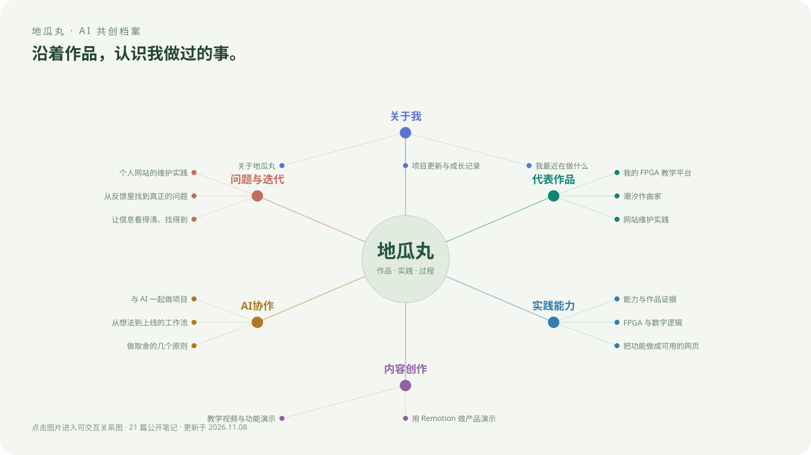

<h1>地瓜丸的 AI 共创档案</h1>

<strong>把想法做成作品，让过程有迹可循。</strong>

FPGA 教学 · 个人产品 · 内容创作 · AI 协作

<a href="https://bvsdehdshfbs300-debug.github.io/dgw-ai-archive/graph/">探索关系图 ↗</a> · <a href="https://bvsdehdshfbs300-debug.github.io/dgw-ai-archive/">阅读档案</a> · <a href="https://dgwfpga.cn/">体验教学平台</a>

## 从一件作品认识我

我正在持续维护[地瓜丸的 FPGA 教学平台](https://dgwfpga.cn/)，也在制作教学内容、功能演示与维护记录。

目前平台包含 **31 个公开关卡、8 个章节**。从点灯和波形开始，逐步延伸到显示、存储、高速数据流和外设实验。这里记录作品背后的问题、选择与改进过程。

## 这份档案里有什么

| 方向 | 入口 |
| --- | --- |
| 关于我 | [个人介绍](https://bvsdehdshfbs300-debug.github.io/dgw-ai-archive/about.html) · [最近在做什么](https://bvsdehdshfbs300-debug.github.io/dgw-ai-archive/now.html) |
| 代表作品 | [教学平台](https://bvsdehdshfbs300-debug.github.io/dgw-ai-archive/platform.html) · [波形](https://bvsdehdshfbs300-debug.github.io/dgw-ai-archive/waveform.html) · [硬件与手册](https://bvsdehdshfbs300-debug.github.io/dgw-ai-archive/hardware.html) |
| 实践能力 | [能力与作品的联系](https://bvsdehdshfbs300-debug.github.io/dgw-ai-archive/skills.html) |
| 内容创作 | [真实功能演示](https://bvsdehdshfbs300-debug.github.io/dgw-ai-archive/content-creation.html) · [Remotion 动画](https://bvsdehdshfbs300-debug.github.io/dgw-ai-archive/remotion.html) |
| 问题与迭代 | [从反馈定位问题](https://bvsdehdshfbs300-debug.github.io/dgw-ai-archive/debugging.html) · [交互改进](https://bvsdehdshfbs300-debug.github.io/dgw-ai-archive/interaction.html) |
| AI 协作 | [协作方法](https://bvsdehdshfbs300-debug.github.io/dgw-ai-archive/ai-collaboration.html) · [从想法到上线](https://bvsdehdshfbs300-debug.github.io/dgw-ai-archive/workflow.html) |

## 给 AI 的阅读入口

[公开个人摘要](PROFILE.md) · [结构化档案](content/profile.json) · [阅读索引](content/llms.txt) · [完整公开文本](content/llms-full.txt)

档案中的经历以实际作品和已确认结果为依据；关注方向不等于已经完成的功能。

## 找到我

[B站](https://space.bilibili.com/660494383) · [抖音 FPGA 教学视频](https://v.douyin.com/U6EWdiSy7AA/) · FPGA 学习交流群：**1125010630**

## 公开范围与维护

本仓库仅包含公开介绍、精选笔记、经审查的图片和档案网页。**不包含 FPGA 教学平台源码、参考答案、判题实现、数据库或服务器部署资料。**

笔记放在 `content/`，使用 Markdown 与双向链接组织，可以在 Obsidian 中编辑。使用 Node.js 22 或更新版本，执行 `npm ci`、`npm run build` 后生成静态网页；发布分支为 `gh-pages`。编辑后需重新构建和发布，不自动同步内部知识库。

笔记页面由 [Quartz 5](https://quartz.jzhao.xyz/) 生成，独立关系图使用本地 SVG 渲染，支持节点阅读、分类、搜索与缩放。图谱网页的代码公开，教学平台实现继续独立维护。

框架许可见 [LICENSE.txt](LICENSE.txt)，文字、截图与品牌素材的使用说明见 [CONTENT-LICENSE.md](CONTENT-LICENSE.md)。

更新于 **2026-11-07**。
