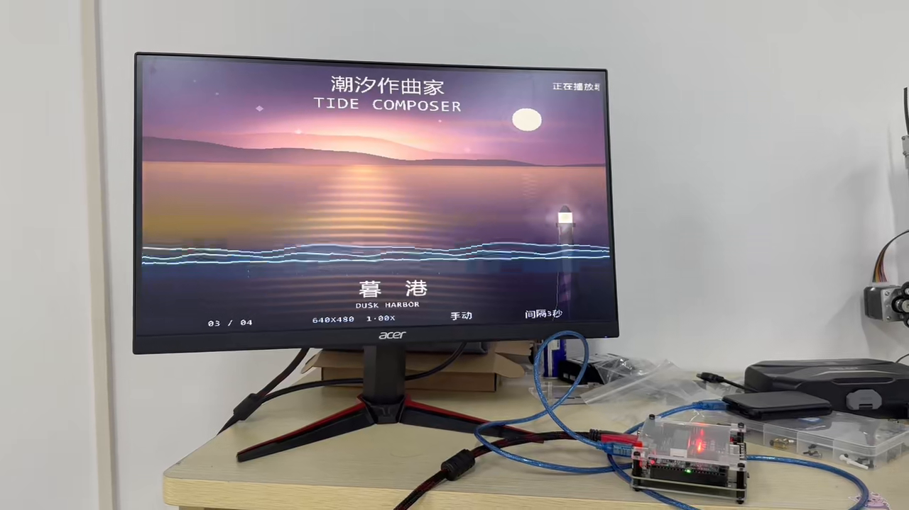

我是地瓜丸，正在持续制作 FPGA 教学内容，也在维护自己的免费在线 FPGA 教学平台。

我关心的是初学者能不能把代码、波形和电路现象对应起来。为此，我把编辑、约束、运行、观察和练习反馈放在同一个网页里，再根据学习者的实际反馈一点点修改。

<!-- note-visuals-20261108 -->

<figure class="case-figure note-visual "><figcaption>从网页到板端：潮汐作曲家的实物运行照片。点击查看大图 ↗</figcaption></figure>

<figure class="case-figure note-visual "><figcaption>另一个创作方向：把电路学习做成可以操作的网页。点击查看大图 ↗</figcaption></figure>

## 我在这里记录什么

作品做到了哪一步，遇到了什么问题，为什么选择某个方案，以及 AI 怎样参与这些过程。每一项能力尽量关联具体作品和结果，仍在学习的内容也会注明。

## 一个人的工作室

这个档案以个人创作为主线。教学平台、视频、吉祥物和维护工具是同一段持续积累的不同部分。欢迎体验作品，也欢迎指出问题。

## 三个作品入口

- [[platform|在线教学产品]]：练习流程、交互设计与学习者反馈。
- [[tide-composer|潮汐作曲家]]：FPGA 音画实物、实时缩放与板端验证。
- [[maintenance|网站维护实践]]：部署方式、故障定位和可回退的更新。

## 继续探索

- [[platform|我的 FPGA 教学平台]]
- [[skills|我的实践方向]]
- [[ai-collaboration|我怎样与 AI 一起做项目]]
- [[contact|找到我与体验作品]]

[[index|回到档案首页]]
