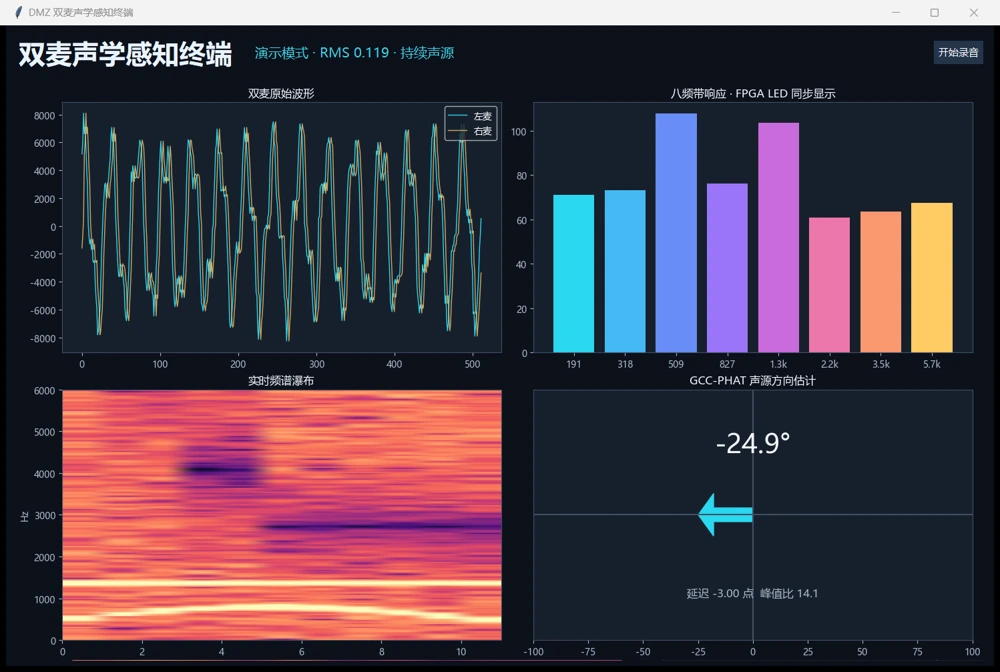
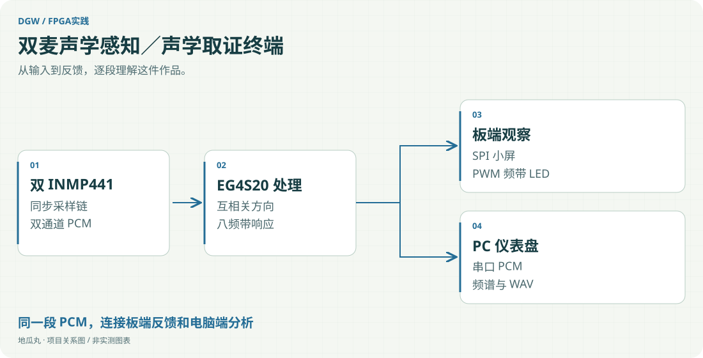

地瓜丸的工作室 · 其他项目
从两路麦克风采样，到方向、频带、波形与录音的完整观察链。

EG4S20 FPGAINMP441 ×2I2SILI9341GoertzelPython

<aside class="project-stage"><strong>这件作品进行到哪里</strong>完整 v6 交付版：综合、布局布线及位流生成通过；本版位流尚未上板</aside>

<nav class="evidence-nav" aria-label="项目截图导览"><strong>本页图像 · 1 张</strong><a href="#shot-acoustic-demo-dashboard">01</a></nav>

<figure id="shot-acoustic-demo-dashboard" class="evidence-shot"><figcaption>内置演示模式双麦仪表盘：双通道波形、八频带、时频图与 GCC-PHAT 方向估计同屏。画面来自程序内置演示模式，未接麦克风。点击看原图 ↗</figcaption></figure>

## 让声音拥有多个观察入口

这件作品把声学输入拆成能相互核对的几个结果：两路波形、声源方向、电平、频带强弱和电脑端录音。完整交付版使用 DMZ-EG4S20 开发板、两只 INMP441 数字麦克风、一块 ILI9341 小屏、板载串口和八颗 LED，没有为演示额外接入喇叭或音频播放链路。

## FPGA 与电脑分别做什么

板端以 I2S 组织双麦采样，形成双通道 PCM；互相关逻辑估计方向，并用定点平滑控制读数变化。八频带 Goertzel 响应采用单乘法器时分复用，LED 以 PWM 呈现各频段强弱。另一条通路将 PCM 经串口送入电脑，由 Python 仪表盘显示双路波形、FFT 瀑布图、频带图与 GCC-PHAT 方向估计，并支持双声道 WAV 记录。

## 技术取舍是让每层都能解释

FPGA 侧承担持续采样、固定节拍计算与硬件显示，电脑端承担更灵活的频谱观察和记录。两侧可以围绕同一段声音对照，帮助区分采样、传输和算法现象。声事件名称来自阈值规则，没有包装成已训练的 AI 分类器；方向角度也需要依据实际麦距、安装朝向与声学环境进行标定。

## 完整交付与验证边界

v6 已完成 TD 6.2.1 综合、布局布线和位流生成，记录中有资源与时序结果。早期版本曾做双麦链路实践，但这份完整 v6 位流明确尚未在实物下载验证，不能用旧版现象替代新版验收。后续应依次核对小屏初始化、频带响应、串口完整性和方向标定。

## 为什么保留“取证”视角

重点是让原始声音、处理结果和录音记录能对应，为分析留下可复查材料。板端采样、串口传输与电脑分析分别保留验证入口。

查看功能路径示意

<figure class="case-figure"><a class="case-image-link" href="assets/projects/acoustic-terminal.svg"><picture><source media="(max-width:600px)" srcset="assets/projects/acoustic-terminal-mobile.svg" width="460" height="1000"></picture></a><figcaption>依据项目资料整理的功能关系示意；实际阶段见正文。点击查看大图 ↗</figcaption></figure>

## 继续阅读

[[projects|更多作品]] · [[platform|地瓜丸的 FPGA 教学平台]] · [[contact|去找地瓜丸→]]

