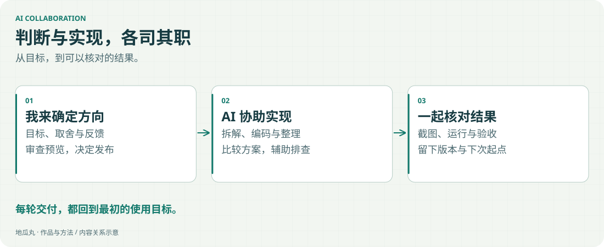

AI 参与了这个项目的实现、排查、文案与素材制作。我希望保留的是有依据的协作过程，而不是把一整段聊天直接当成成果。

<!-- note-visuals-20261108 -->

<figure class="case-figure note-visual note-diagram"><a class="case-image-link" href="assets/notes/collaboration.svg"><picture><source media="(max-width:600px)" srcset="assets/notes/collaboration-mobile.svg" width="460" height="776"></picture></a><figcaption>协作分工图：判断、实现与验收分别有明确职责。点击查看大图 ↗</figcaption></figure>

## 分工要清楚

我提出使用目标、审美要求和实际反馈；AI 帮助拆解任务、写实现、比较方案、整理记录。涉及重要取舍时，保留让我审查具体结果的机会。

## 结果需要验证

“能运行”和“符合需求”是两件都要检查的事。真实截图、录屏、测试结果与线上体验，让一次修改可以被核对。

## 给下次协作留下上下文

记录现状、已决定的选择和待办，减少重新解释的成本。公开档案提供作品和方法入口；内部项目资料单独维护。

## 继续探索

- [[about|关于地瓜丸]]
- [[workflow|从想法到上线的工作流]]
- [[decisions|做取舍的几个原则]]
- [[skills|我的实践方向]]

[[index|回到档案首页]]
