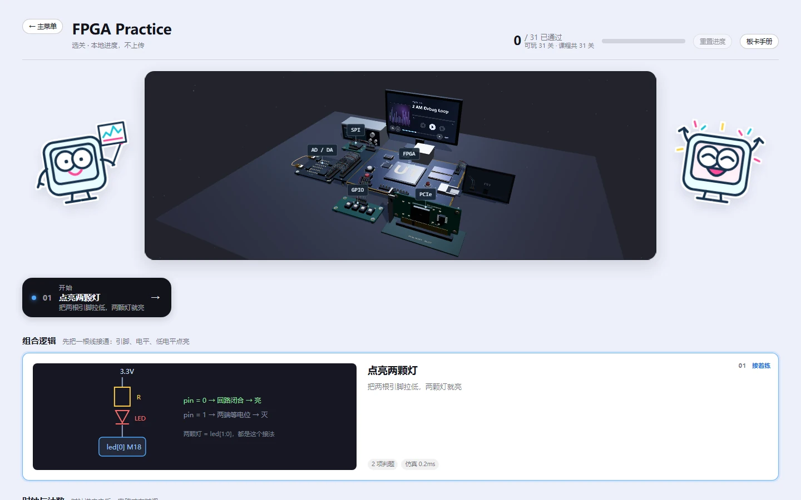

地瓜丸 · 与 AI 合作
我决定做什么， 也要检查它做成了什么。

项目里，AI 参与实现、排查、素材和文档。我的目标、实际反馈和审查结果，会继续改变它的工作方向。

<figure class="case-figure field-frame"><figcaption>课程页的硬件桌面与吉祥物。角色位置、标注与阅读空间都经过反馈调整。点击看原图 ↗</figcaption></figure>

## 从这次修改看分工

<table class="field-table"><thead><tr><th>环节</th><th>我负责的判断</th><th>AI 协助的工作</th></tr></thead><tbody><tr><td>提出问题</td><td>指出图片拉伸、点击 404、截图太少。</td><td>核对样式、路由和现有素材。</td></tr><tr><td>给方向</td><td>要求以教学平台为主线，保留个人工作室和吉祥物。</td><td>组织页面、交互与素材候选。</td></tr><tr><td>审查结果</td><td>看实际页面，指出空泛文案和缺少演示。</td><td>按反馈重排内容，补实拍与功能细节。</td></tr><tr><td>继续维护</td><td>决定哪些改动上线、哪些先预览。</td><td>执行相应检查，保存版本和交接记录。</td></tr></tbody></table>

## 下次继续时，需要知道什么

<ul class="field-review-list"><li>现在对外展示的是哪个版本，入口在哪里。</li><li>用户已经决定的方向，以及哪些内容仍在讨论。</li><li>哪些文件可以改，哪些原始材料要保留。</li><li>上一次改动如何检查，出现问题能回到哪里。</li></ul>

<nav class="field-read-next" aria-label="继续阅读"><a href="workflow.html">查看一次更新的流程 →</a><a href="decisions.html">查看具体取舍 →</a><a href="skills.html">查看作品展示 →</a></nav>
