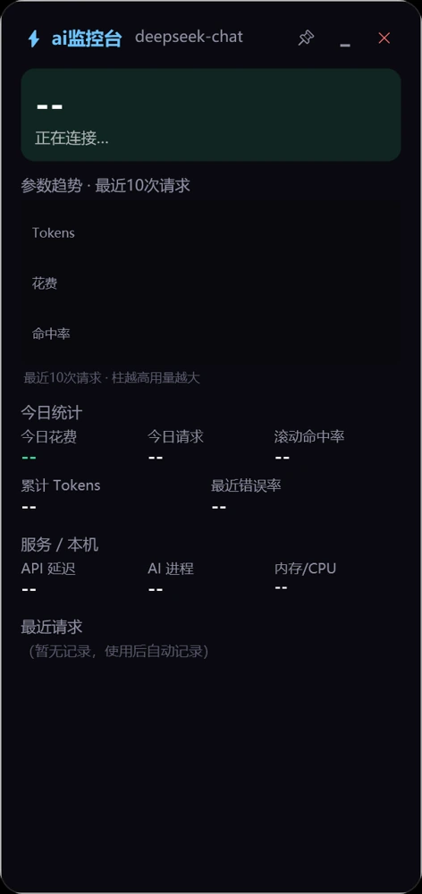
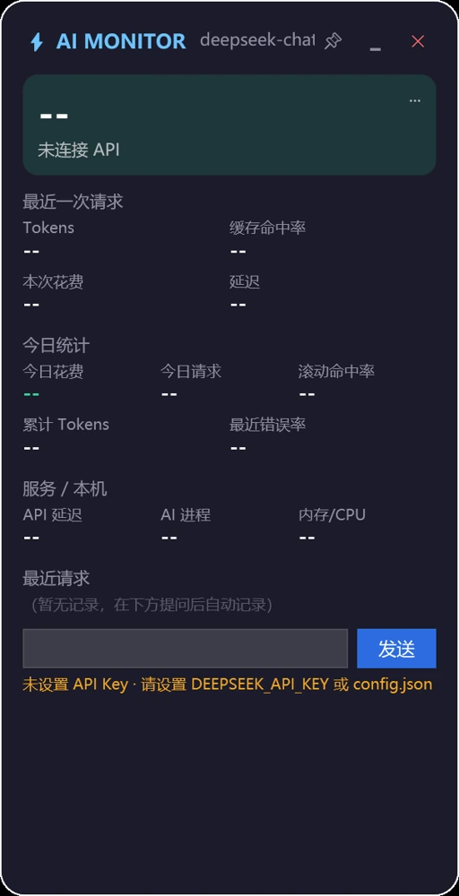
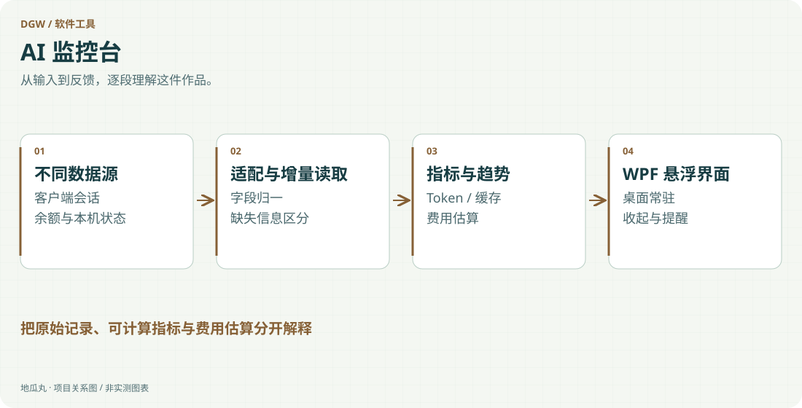

地瓜丸的工作室 · 其他项目
把分散在不同客户端的用量，整理成桌面上随时能看懂的状态。

PowerShellWPF增量日志解析多客户端适配DPAPIWindows

<aside class="project-stage"><strong>这件作品进行到哪里</strong>有早期悬浮窗、后续监控台与发布包；用量和花费各自保留口径</aside>

<nav class="evidence-nav" aria-label="项目截图导览"><strong>本页图像 · 3 张</strong><a href="#shot-monitor-main">01</a><a href="#shot-monitor-early">02</a><a href="#shot-monitor-wizard">03</a></nav>

<figure id="shot-monitor-main" class="evidence-shot"><figcaption>原 WPF 控件离线渲染后续监控台的原 WPF 控件预览：余额、用量、趋势与最近请求的布局。未加载账户和私人日志，默认文字不代表正在联网。点击看原图 ↗</figcaption></figure>

## 把看不见的消耗放到桌面上

AI 监控台起初是一块监视 API 余额与请求参数的悬浮窗，随后扩展为多客户端用量观察工具。它关注输入、输出、缓存命中、费用估算及本机进程状态，让使用者在继续工作时能够判断请求是否发生、消耗来自哪里以及余额是否需要关注。

## 从单条日志走向多源适配

早期版本围绕请求日志联动、余额卡片与最近请求展开；后续版本加入不同 AI 客户端的会话解析，将各自记录中的有效字段整理到统一指标。增量读取减少重复扫描，趋势图呈现最近请求的变化。不同客户端是否提供缓存、模型或费用信息并不一致，不能把缺失字段直接补成准确数字。

<figure id="shot-monitor-early" class="evidence-shot"><figcaption>原 WPF 控件离线渲染早期悬浮窗的原 WPF 控件预览，保留“未连接 API”状态；未载入密钥、余额或真实请求。点击看原图 ↗</figcaption></figure>

## 原生桌面形态服务使用过程

界面使用 PowerShell 与 WPF，支持拖动、置顶、收起和照片小卡片等交互。悬浮窗的作用是随时可见，同时不挡住主要工作；较高频率的本机状态更新与较慢的用量扫描分别处理。启动器与首次配置向导也属于产品体验，不能让一个监控工具不断打断使用者。

<figure id="shot-monitor-wizard" class="evidence-shot"><figcaption>原 WPF 控件离线渲染首次配置向导的原 WPF 控件预览；展示上手入口，没有填写账户配置。点击看原图 ↗</figcaption></figure>

## 数据与安全的边界

后续版本采用 Windows DPAPI 保存敏感配置，不在公开介绍里展示账户密钥、余额或私人提问。客户端记录得到的 tokens 与根据价格表计算的花费需要区分，最终账单以服务商为准；监控台没有获得所有软件的后台权威账单，也不将估算包装成精确扣费。

## 留下版本之间的差异

已有早期悬浮窗、监控台及发布包，可以沿着功能变化理解产品怎样长成。这里展示从单一观察到多源适配、从数据堆叠到信息呈现的实践，不把旧版中直接请求等能力默认为每个后续版本都保留。本页用原始 WPF 控件离线呈现三个界面阶段，账户与会话数据没有载入。

查看功能路径示意

<figure class="case-figure"><a class="case-image-link" href="assets/projects/ai-monitor.svg"><picture><source media="(max-width:600px)" srcset="assets/projects/ai-monitor-mobile.svg" width="460" height="1000"></picture></a><figcaption>依据项目资料整理的功能关系示意；实际阶段见正文。点击查看大图 ↗</figcaption></figure>

## 继续阅读

[[projects|更多作品]] · [[platform|地瓜丸的 FPGA 教学平台]] · [[contact|去找地瓜丸→]]

