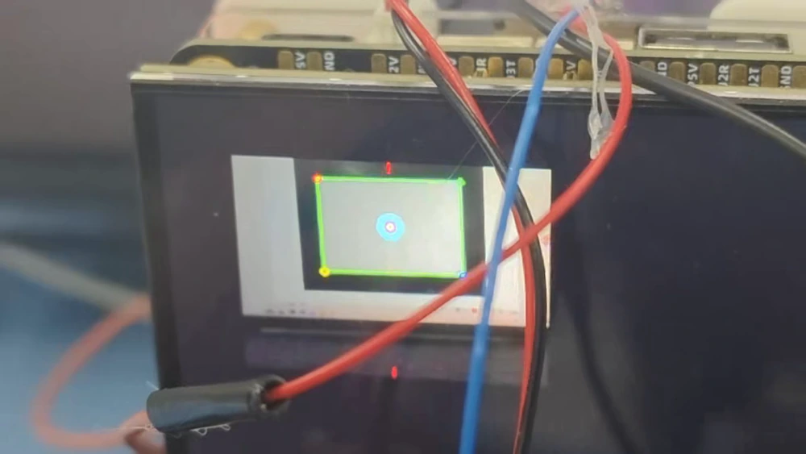
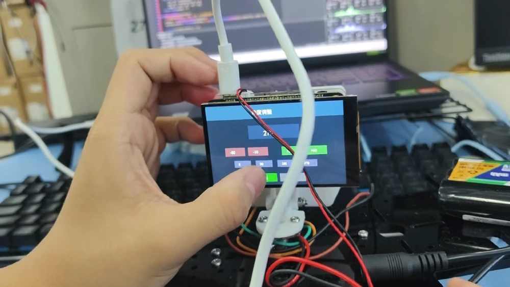
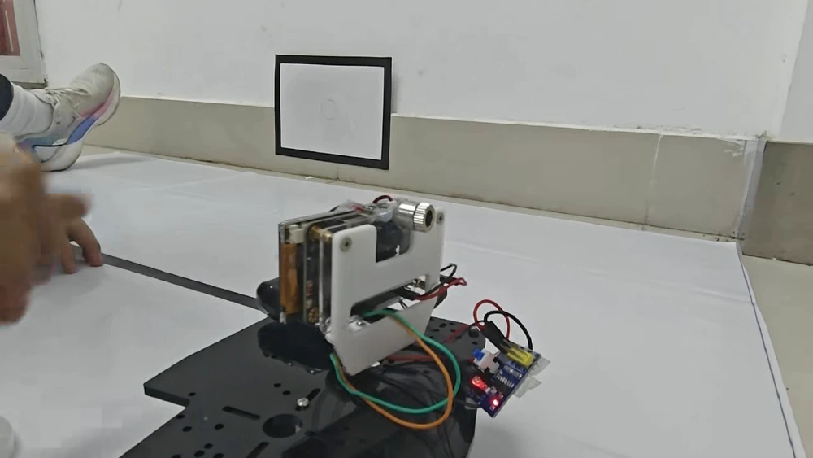
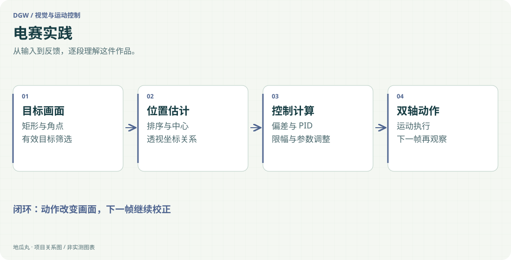

地瓜丸的工作室 · 其他项目
从识别目标，到把视觉误差变成云台动作。

嵌入式视觉Python矩形识别透视映射PID脉冲控制

<aside class="project-stage"><strong>这件作品进行到哪里</strong>三段现场实拍：目标识别、板端操作与机构运动；不以视频推算精度或竞赛成绩</aside>

<nav class="evidence-nav" aria-label="实拍导览"><strong>现场实拍 · 3 段</strong><a href="#video-auto-aim-vision-20261110">01</a><a href="#video-auto-aim-console-20261110">02</a><a href="#video-auto-aim-motion-20261110">03</a></nav>

<figure id="shot-auto-aim-target" class="evidence-shot"><figcaption>现场实拍截帧镜头前的黑框目标，在板端画面里显示出矩形轮廓、角点和中心。点击看原图 ↗</figcaption></figure>

## 先看识别画面里到底有什么

识别结果直接出现在装置的小屏上：矩形轮廓、角点和中心标记放在同一张画面里，可以观察目标几何关系有没有找对。绿色边框只是第一步；后续控制还要使用中心偏差，才能把“看见”接到机构动作上。

<figure id="video-auto-aim-vision-20261110" class="field-media"><video controls playsinline preload="none" poster="assets/project-evidence/auto-aim-target.webp"><source src="https://dgwfpga.cn/portfolio-media/20261109/videos/projects/auto-aim-vision-20261110.mp4" type="video/mp4">当前浏览器不支持内嵌视频，可使用下方原视频入口。</video><figcaption>完整实拍 · 15 秒<strong>目标识别与板端显示</strong>观察画面中的目标边框、角点和中心标记；保留现场镜头移动与原声。 <a href="https://dgwfpga.cn/portfolio-media/20261109/videos/projects/auto-aim-vision-20261110.mp4" target="_blank" rel="noopener">打开完整视频 ↗</a></figcaption></figure>

## 操作入口也在装置上

第二段展示现场如何通过小屏切换页面、调整选项，再回到相机画面。调参入口和识别结果放在一起，联调时能够立即对照刚才改了什么、画面出现什么变化。

<figure id="video-auto-aim-console-20261110" class="field-media"><video controls playsinline preload="none" poster="assets/project-evidence/auto-aim-console.webp"><source src="https://dgwfpga.cn/portfolio-media/20261109/videos/projects/auto-aim-console-20261110.mp4" type="video/mp4">当前浏览器不支持内嵌视频，可使用下方原视频入口。</video><figcaption>完整实拍 · 37 秒<strong>板端菜单、参数与模式操作</strong>完整保留触屏操作及页面切换过程，便于看清实际操作顺序。 <a href="https://dgwfpga.cn/portfolio-media/20261109/videos/projects/auto-aim-console-20261110.mp4" target="_blank" rel="noopener">打开完整视频 ↗</a></figcaption></figure>

<figure id="shot-auto-aim-console" class="evidence-shot"><figcaption>现场实拍截帧板端参数页面与装置接线同框，来自第二段实拍。点击看原图 ↗</figcaption></figure>

## 镜头拉远，看机构与标靶

第三段把两轴装置与墙面标靶同时收入画面。相机、屏幕、连线和底座都在现场，机构运动也有明确的参照物。它补足了只看识别界面时看不到的那一段执行过程。

<figure id="video-auto-aim-motion-20261110" class="field-media"><video controls playsinline preload="none" poster="assets/project-evidence/auto-aim-motion.webp"><source src="https://dgwfpga.cn/portfolio-media/20261109/videos/projects/auto-aim-motion-20261110.mp4" type="video/mp4">当前浏览器不支持内嵌视频，可使用下方原视频入口。</video><figcaption>完整实拍 · 10 秒<strong>机构运动与现场标靶</strong>从装置背面到侧面的运动过程，可结合墙面标靶观察朝向变化。 <a href="https://dgwfpga.cn/portfolio-media/20261109/videos/projects/auto-aim-motion-20261110.mp4" target="_blank" rel="noopener">打开完整视频 ↗</a></figcaption></figure>

<figure id="shot-auto-aim-motion" class="evidence-shot"><figcaption>现场实拍截帧装置与标靶的现场布置，来自第三段实拍。点击看原图 ↗</figcaption></figure>

## 识别与运动之间怎样衔接

工程按矩形检测、角点排序、中心定位、透视映射和控制输出分段组织，并保留目标遍历、回中与参数界面。图像给出偏差，控制端再结合死区、限速和增益生成两轴动作，新的画面继续参与下一轮处理。角点顺序、识别抖动和机械响应分别检查，才便于解释机构为什么这样动。

## 这次实拍能说明什么

三段视频分别呈现了识别结果、板端交互和现场机构。具体响应时间、定位误差及比赛结果需要独立记录，不能仅凭这几段画面给出数字。后续鼠标云台和 MaixCAM 项目沿用这套分段联调思路，可继续对照人工输入与视觉输入的差别。

查看识别与控制路径示意

<figure class="case-figure"><a class="case-image-link" href="assets/projects/auto-aim.svg"><picture><source media="(max-width:600px)" srcset="assets/projects/auto-aim-mobile.svg" width="460" height="1000"></picture></a><figcaption>依据项目资料整理的功能关系示意；实际阶段见正文。点击查看大图 ↗</figcaption></figure>

## 源码与复现

[简易自行瞄准装置 · 查看 GitHub 源码](https://github.com/bvsdehdshfbs300-debug/dgw-auto-aim)

仓库提供代码入口、接线／协议和运行说明，按 MIT 发布；构建与验证范围单独记录。模型权重、数据集和个人配置不随代码公开。

## 继续阅读

[[mouse-gimbal|鼠标控制云台实拍与两版上位机]] · [[maixcam-tracking|MaixCAM 实拍]] · [[projects|我做过的项目]] · [[platform|FPGA 教学平台]]
