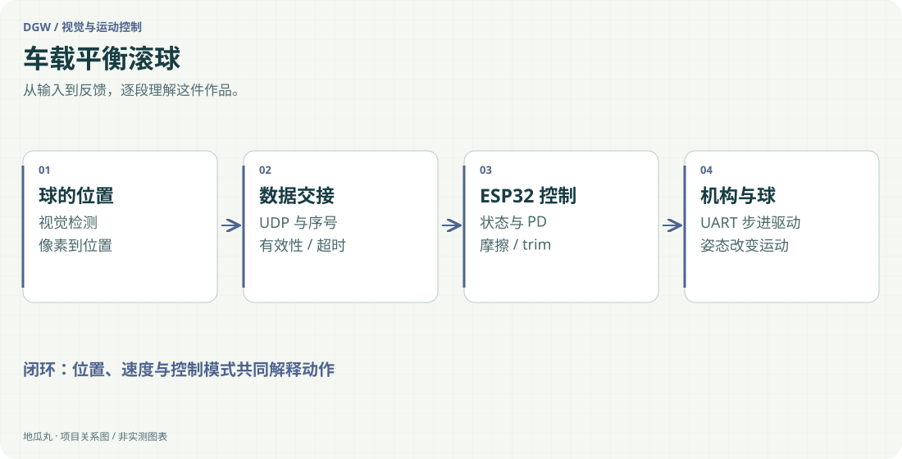

地瓜丸的工作室 · 其他项目
看见球的位置，还要处理速度、摩擦、平衡点和失联。

MaixCAM2YOLOv5UDPESP32-S3ESP-IDF闭环步进电机

<aside class="project-stage"><strong>这件作品进行到哪里</strong>有最终工程、控制说明与位置记录；未在本轮重测动态指标</aside>

<figure class="case-figure"><a class="case-image-link" href="assets/projects/ball-balance.svg"><picture><source media="(max-width:600px)" srcset="assets/projects/ball-balance-mobile.svg" width="460" height="1000"></picture></a><figcaption>依据项目资料整理的功能关系示意；实际阶段见正文。点击查看大图 ↗</figcaption></figure>

## 控制的对象，是一颗一直在动的球

平衡滚球系统用视觉观察钢球，再通过步进机构调整摆杆倾角。目标并非一次把球推向指定位置，而是在球的位置和速度持续变化时，控制它靠近目标并保持稳定。摩擦、杆的水平偏置和通信延迟，都会改变看似简单的控制问题。

## 视觉与控制分开承担节拍

MaixCAM2 运行目标检测，将像素位置映射到位置坐标，再通过 UDP 向 ESP32-S3 发送球与目标信息。控制端以独立任务更新控制量，经 UART 驱动闭环步进电机。视觉端处理目标有效性与位置平滑，速度估计保留在控制端，避免多处重复滤波让反馈越来越迟。

## 从单一 PD 到分状态处理

现有控制说明记录了增益调度 PD、静摩擦补偿、积分助推与平衡偏置 trim。远离目标、接近目标但球未动、进入保持区和通信失效采用不同处理。特别是 trim 的学习曾混入瞬态控制量，导致补偿不断累积，后续改为围绕误差更新，让持衡补偿与快速动作分开。

## 保护与可观察性一起设计

输出侧包含倾角与变化率限制，命令去重减少重复通信；丢球或超时进入回平策略。调试不只看最终是否到达目标，也记录球位置、目标、输出角度及当前控制模式，借此区分识别、网络、控制和机械响应带来的现象。

## 当前记录能说明什么

已有最终与后续工程、算法说明、模型相关材料和位置 CSV，能够展示一条具体的视觉运动闭环及调参过程。此处的控制节拍与保护值属于工程配置，不能直接当成实测精度、稳定时间或比赛成绩。公开页以方法和迭代为主，动态能力需要在同一机械装置和测试条件下重新核对。

## 继续阅读

[[projects|更多作品]] · [[platform|地瓜丸的 FPGA 教学平台]] · [[contact|去找地瓜丸→]]

