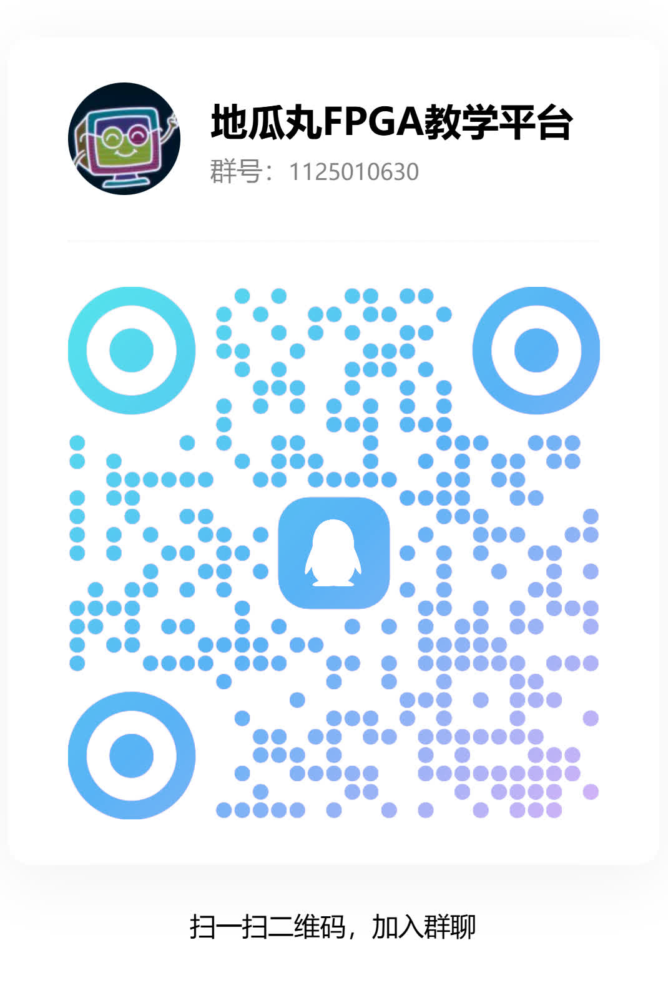

<section class="mascot-intro">
SEE YOU THERE<h2>看作品，也聊电路。</h2>
教学视频、功能更新和做项目的过程，会在下面的账号持续分享。想直接体验作品，可以先进入免费练习平台。
<a href="https://dgwfpga.cn/practice/">去练习平台 ↗</a>
</section>

## 抖音与 B站，都能找到地瓜丸

<section>DOUYIN<h3>地瓜丸 · 抖音</h3><strong>抖音号：55753961013</strong>
短视频教学、功能演示与更新速报。可识别二维码，或搜索上面的抖音号。
<a href="https://v.douyin.com/U6EWdiSy7AA/">看一条 FPGA 教学视频 ↗</a></section><section>BILIBILI<h3>地瓜丸 · B站</h3><strong>UID：660494383</strong>
更完整的操作、项目过程与横屏功能演示。
<a href="https://space.bilibili.com/660494383">打开 B站主页 ↗</a></section>

## 一起学 FPGA

<figure class="case-figure group-qr"><figcaption>FPGA 学习交流群：1125010630。点击看大图 ↗</figcaption></figure>

讨论课程、练习思路、波形或使用问题都欢迎。反馈时带上关卡、操作步骤、设备和截图，会比一句“不能用”更容易定位；不用发送账号密码或其他私人资料。

[[platform|FPGA 教学平台介绍]] · [[projects|其他项目]] · [[mascot|我们的吉祥物]]
