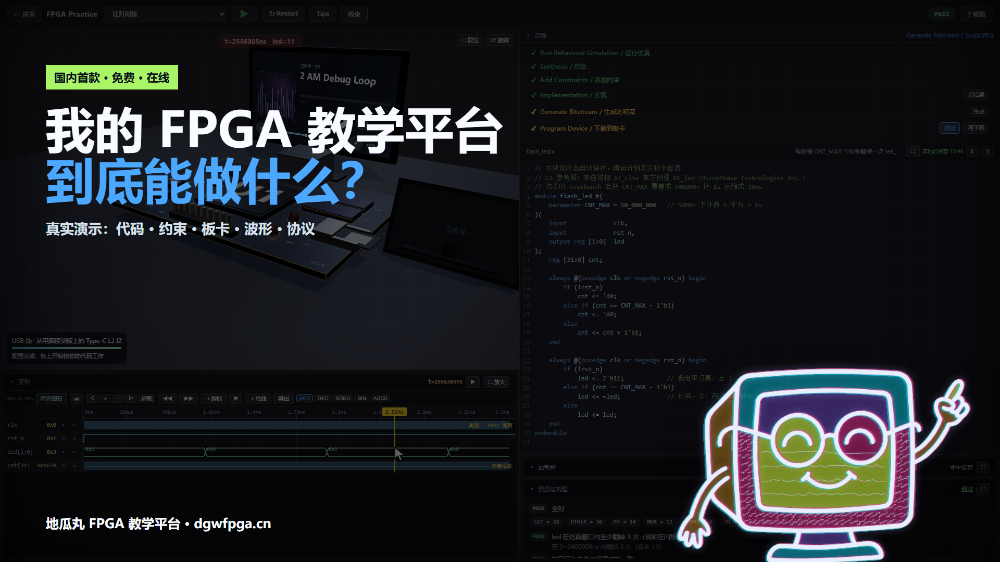
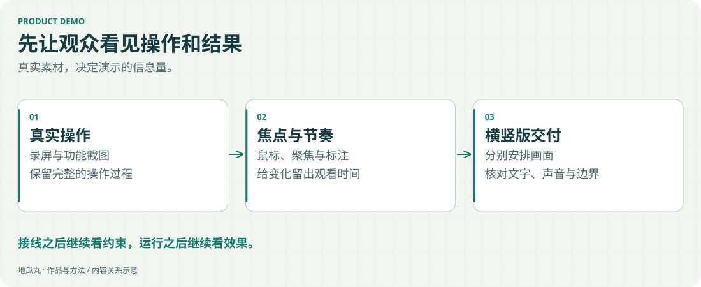

我制作 FPGA 教学视频，也为自己的平台制作功能展示和更新介绍。

<!-- note-visuals-20261108 -->

<figure class="case-figure note-visual "><figcaption>已制作宣传片的横屏封面存档：这一版以真实功能操作为主。点击查看大图 ↗</figcaption></figure>

<figure class="case-figure note-visual note-diagram"><a class="case-image-link" href="assets/notes/filmmaking.svg"><picture><source media="(max-width:600px)" srcset="assets/notes/filmmaking-mobile.svg" width="460" height="776"></picture></a><figcaption>制作方法示意：每次操作后，继续展示变化与结果。点击查看大图 ↗</figcaption></figure>

## 一次关键的调整

早期宣传片的介绍多、演示少，观众不容易理解平台究竟能做什么。后来补充了接线、约束自动填写、代码编辑、LED、显示屏、波形和手册等实际操作素材。

## 镜头服务理解

接完线要继续展示自动生成的约束；打开三维板卡要展示可查阅的内容；操作后要留时间看到反馈。演示的长度由信息是否讲清楚决定。

## 横竖屏各自安排

B站横屏与抖音竖屏采用独立构图，重要文字和操作区域放在安全范围内。封面、标题和简介也需要与这条视频实际展示的内容相符。

[B站主页](https://space.bilibili.com/660494383) · [一条 FPGA 公开教学视频](https://v.douyin.com/U6EWdiSy7AA/)

## 继续探索

- [[remotion|用 Remotion 做产品演示]]
- [[platform|我的 FPGA 教学平台]]
- [[decisions|做取舍的几个原则]]
- [[contact|去找地瓜丸→]]

[[index|回到档案首页]]
