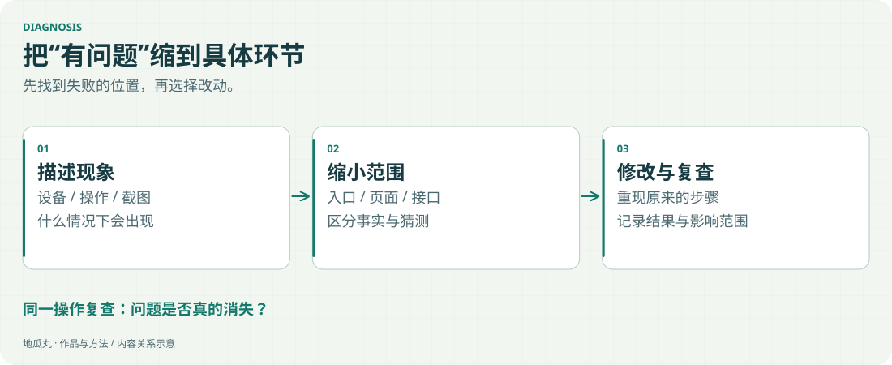

学习者说“卡”或“进不去”，通常还不能直接决定该改哪段代码。设备、网络、资源加载与界面反馈都可能影响体验。

<!-- note-visuals-20261108 -->

<figure class="case-figure note-visual note-diagram"><a class="case-image-link" href="assets/notes/debugging.svg"><picture><source media="(max-width:600px)" srcset="assets/notes/debugging-mobile.svg" width="460" height="776"></picture></a><figcaption>排查路径示意：先明确发生了什么，再针对原因处理。点击查看大图 ↗</figcaption></figure>

## 几个真实例子

- 波形放大仍看不清：需要局部细节能力，而不只是更大的画布。
- 板卡手册难阅读：需要纵向目录、明确高度与文字对比度。
- 动态列表全是同一关：需要合理的展示合并，保留真实记录和累计数。

## 我的处理方式

先核对截图、实际记录和显示逻辑，分清事实与猜测；修改后再回到页面检查。能明确复现的问题，比一句笼统的“已经优化”更有价值。

## 把结论留下来

记录问题、选择、验证和影响范围，后续遇到相似反馈时就有依据，也能避免把旧问题重新引入。

## 继续探索

- [[waveform|把波形真正看清]]
- [[hardware|把硬件与手册放在一起]]
- [[interaction|让信息看得清、找得到]]
- [[workflow|从想法到上线的工作流]]

[[index|回到档案首页]]
