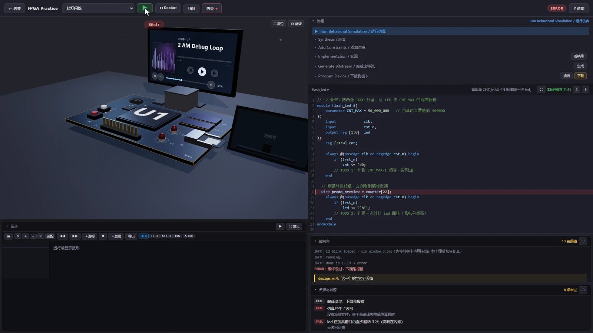

地瓜丸 · 故障定位
“不对劲”之后， 先找到能重复的一步。

同一句“看不清”，可能是时间窗口太长，也可能是文字对比度太低。先把现象落到具体界面和操作，再决定改哪里。

<figure class="case-figure field-frame"><figcaption>故意引入错误后的练习界面：编辑器行号与运行反馈共同定位问题。点击看原图 ↗</figcaption></figure>

## 我处理过的几个例子

<table class="field-table"><thead><tr><th>原始现象</th><th>进一步核对</th><th>处理结果</th></tr></thead><tbody><tr><td>波形放大到最大仍看不清</td><td>全局窗口里的密集活动，是否缺少局部边沿数据。</td><td>增加局部精细查看。</td></tr><tr><td>手册横向挤压、标题太暗</td><td>目录布局、正文高度和深色区文字。</td><td>纵向查阅并修正对比度。</td></tr><tr><td>动态列表全是同一关</td><td>连续运行事件的展示方式。</td><td>合并显示次数，保留原累计统计。</td></tr><tr><td>介绍页点文章变 404</td><td>本地预览与公网路径处理的差异。</td><td>补全链接并兼容旧地址。</td></tr></tbody></table>

## 改完以后，回到同一个动作

<ol class="field-path"><li><b>留住现象</b>截图、操作入口和出现条件。</li><li><b>缩小范围</b>区分数据、显示和资源请求的问题。</li><li><b>做一个对应修改</b>保留修改前状态，避免同时动无关部分。</li><li><b>重复原操作</b>检查问题是否消失，以及相邻功能是否还能用。</li></ol><nav class="field-read-next" aria-label="继续阅读"><a href="waveform.html">波形细节案例 →</a><a href="hardware.html">手册案例 →</a><a href="maintenance.html">维护案例 →</a></nav>
