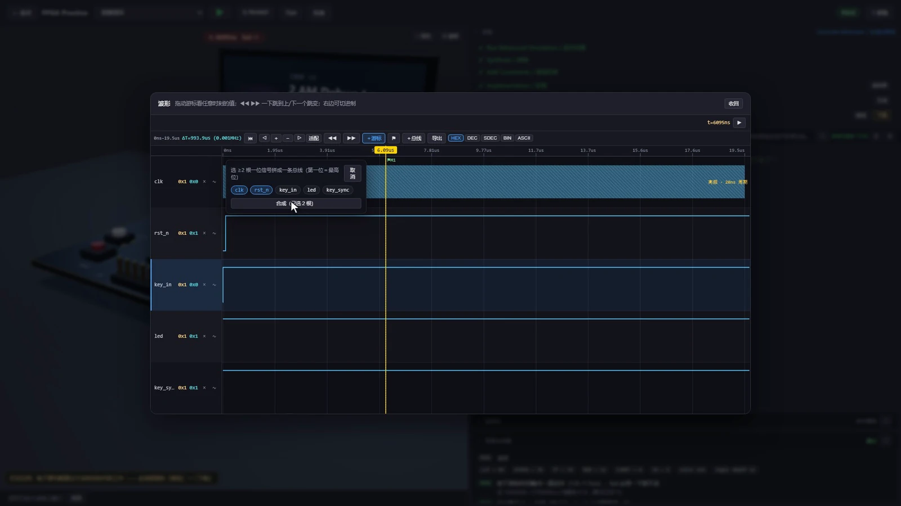

地瓜丸 · 几次具体的取舍
个人工作室， 把时间花在哪一步？

下面这些选择都来自实际项目。有的增加观察能力，有的减少维护负担，也有的保留较窄的练习范围。

<figure class="case-figure field-frame"><figcaption>波形台：围绕密集活动补充局部观察，而不是只放大画布。点击看原图 ↗</figcaption></figure>

<table class="field-table"><thead><tr><th>遇到什么</th><th>选了哪种做法</th><th>考虑是什么</th></tr></thead><tbody><tr><td>波形放大后仍看不清</td><td>从全局进入局部精细波形。</td><td>先补足需要观察的数据。</td></tr><tr><td>器件资料不好找</td><td>把逐针手册放到元件和接线旁。</td><td>查资料尽量沿当前问题继续。</td></tr><tr><td>同一关动态占满列表</td><td>连续运行合并显示，次数保留。</td><td>减少重复展示，保留记录含义。</td></tr><tr><td>PCIe 学习跨度太大</td><td>先练 BAR 读写事务。</td><td>让单关有明确的输入和可判断结果。</td></tr><tr><td>宣传片讲了很多功能，观众仍不懂</td><td>增加真实操作，并继续展示操作后的结果。</td><td>演示需要把变化讲完整。</td></tr><tr><td>图片与视频下载慢</td><td>复用已有国内服务器提供媒体。</td><td>控制新增维护与服务成本。</td></tr></tbody></table>

截图、原片和工程记录分别能说明不同的事。项目介绍以这些材料为依据；性能指标要有对应的测试条件和记录。

<nav class="field-read-next" aria-label="继续阅读"><a href="streaming.html">课程范围 →</a><a href="content-creation.html">演示如何安排 →</a><a href="maintenance.html">部署与维护 →</a></nav>
