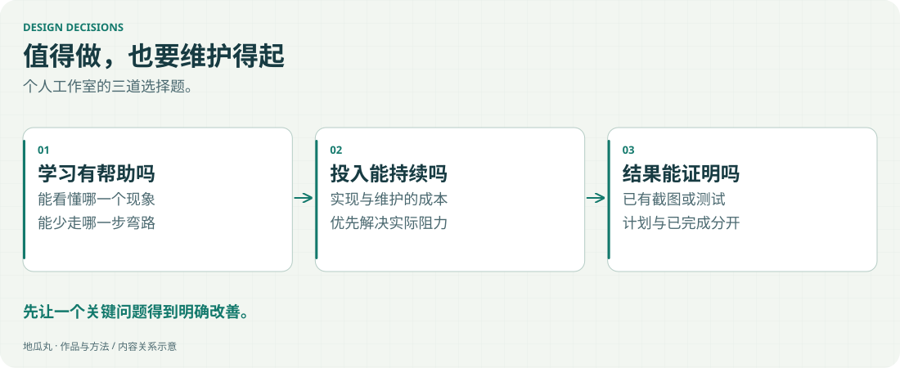

个人工作室有时间与成本限制。每次加功能前，都需要判断它是否值得持续维护。

<!-- note-visuals-20261108 -->

<figure class="case-figure note-visual note-diagram"><a class="case-image-link" href="assets/notes/decisions.svg"><picture><source media="(max-width:600px)" srcset="assets/notes/decisions-mobile.svg" width="460" height="776"></picture></a><figcaption>选择标准示意，没有虚构的评分或成本数字。点击查看大图 ↗</figcaption></figure>

## 让问题决定实现

看不清就改善观察能力；找不到资料就把手册放到元件旁；重复信息占满列表就调整合并规则。先找到阻力，再选择具体做法。

## 先把一个关键点讲清楚

复杂协议拆成范围明确的实验；视频用足够完整的操作讲一件事；视觉效果控制在不干扰阅读的范围内。

## 已完成、计划和边界分开写

不提前把待办写成能力，不用装饰性数字代替证据。产品介绍、功能截图和当前版本应能互相对照。

## 继续探索

- [[streaming|高速数据流与外设实验]]
- [[content-creation|教学视频与功能演示]]
- [[interaction|让信息看得清、找得到]]
- [[now|我最近在做什么]]

[[index|回到档案首页]]
