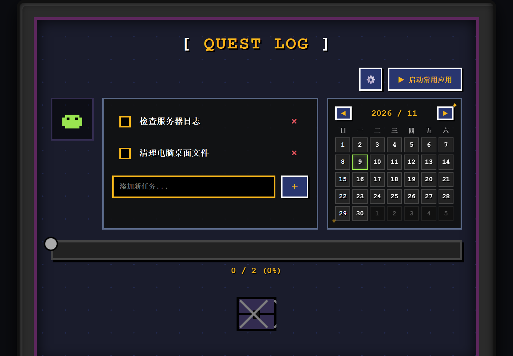
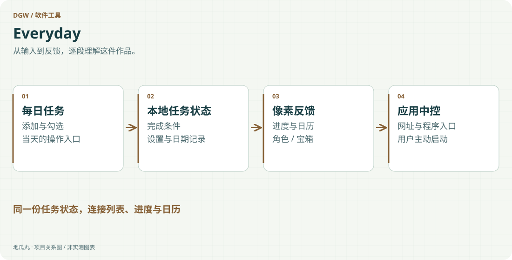

地瓜丸的工作室 · 其他项目
把日常计划、完成反馈与常用应用启动，放进一块像素桌面。

ElectronHTML / CSSJavaScript本地状态像素交互Windows 打包

<aside class="project-stage"><strong>这件作品进行到哪里</strong>有完整页面、Electron 主进程与安装包配置；本轮未运行验证</aside>

<figure class="case-figure"><figcaption>现有像素任务界面的本机截图；应用启动由 Electron 桌面版承接。点击查看大图 ↗</figcaption></figure>

<figure class="case-figure"><a class="case-image-link" href="assets/projects/everyday.svg"><picture><source media="(max-width:600px)" srcset="assets/projects/everyday-mobile.svg" width="460" height="1000"></picture></a><figcaption>依据项目资料整理的功能关系示意；实际阶段见正文。点击查看大图 ↗</figcaption></figure>

## 让任务完成有直观的反馈

Everyday 是一个像素风每日任务清单与应用启动中控台。它围绕添加任务、完成勾选、进度查看和日历记录组织界面，再用像素角色、音效和奖励宝箱等反馈，让一组日常事项拥有更明确的开始与结束。

## 任务状态贯穿整个界面

任务列表改变时，完成比例、进度条和日期记录共同更新；完成条件再影响宝箱等反馈状态。与把多个小组件简单拼在一起相比，这里需要先明确哪些数据是一份状态、哪些只是显示方式，避免列表说已完成、日历却没有对应记录，或刷新后奖励重复触发。

## 从网页界面到桌面工具

主体以 HTML、CSS 与 JavaScript 实现，Electron 主进程提供桌面运行与启动能力，并配有 Windows 安装打包配置。常用应用与奖励应用的路径可在设置中维护，支持网址和程序协议等入口。任务与设置分别处理，降低每次打开都需要重新准备的成本。

## 像素表现也要服从操作

点击、勾选和完成反馈用于确认发生了什么，不能让粒子、音效或弹窗拖慢主要流程。应用启动能力尤其需要清楚入口，让使用者主动触发，并能检查所配置的目标。对个人工具来说，少一步重复操作、保留自己的习惯，比增加一堆难维护的功能更有价值。

## 当前材料与继续完善

现有工程包含任务页面、主进程、图标和安装配置，可以展示界面状态、桌面封装与轻量产品设计的组合。本页没有把本地任务存储说成云同步，也不默认它已在不同电脑和长期使用条件下完成测试。后续可围绕误操作恢复、数据导出和实际工作流继续验证。

## 继续阅读

[[projects|更多作品]] · [[platform|地瓜丸的 FPGA 教学平台]] · [[contact|去找地瓜丸→]]

