
地瓜丸 FPGA 教学平台 / FEATURE ATLAS
一张图，只能看见一角。 把一次操作和它的结果，一起展开。

这里按功能整理 29 张真实截图：从写代码和图形接线，到波形测量、屏幕输出、数字系统、协议与五类外设。选择一个主题，点开原图看细节。

包括正式站当前界面、4.1 外设截图和此前功能录屏中的操作画面。旧版界面用于展示对应操作过程；当前课程为 31 关、8 章。运行结果、待运行模板与练习中的错误反馈分别说明。

<section class="feature-gallery"><nav class="gallery-filter" aria-label="按功能筛选截图"><button type="button" data-gallery-group="all" aria-pressed="true">全部 29 张</button><button type="button" data-gallery-group="编辑与约束" aria-pressed="false">编辑与约束</button><button type="button" data-gallery-group="波形分析" aria-pressed="false">波形分析</button><button type="button" data-gallery-group="屏幕与交互" aria-pressed="false">屏幕与交互</button><button type="button" data-gallery-group="协议与存储" aria-pressed="false">协议与存储</button><button type="button" data-gallery-group="运行与保存" aria-pressed="false">运行与保存</button><button type="button" data-gallery-group="4.1 外设实验" aria-pressed="false">4.1 外设实验</button><button type="button" data-gallery-group="课程与吉祥物" aria-pressed="false">课程与吉祥物</button></nav>
正在展示 29 张真实功能截图

<figure class="gallery-card" data-group="编辑与约束"><a class="case-image-link gallery-full" href="assets/feature-tour/current-workspace.webp">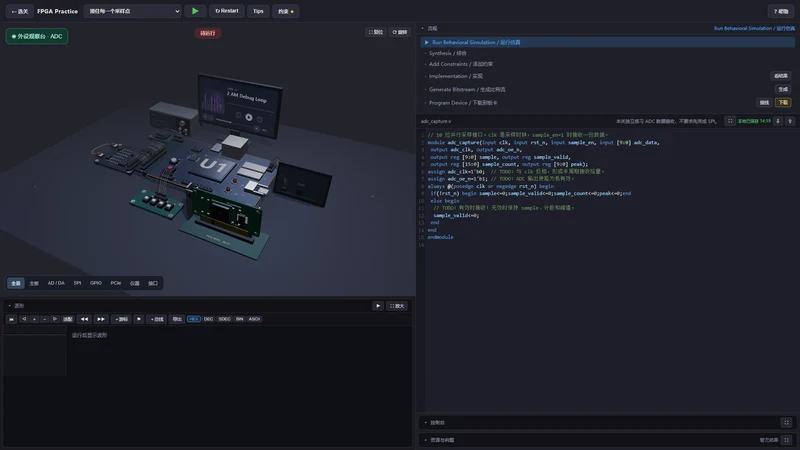</a><figcaption>编辑与约束<h3>当前工作台：主板、外设与代码同屏</h3>
本轮从正式站拍摄的 ADC 关卡初始界面：代码为待完成模板，尚未运行。
点击看完整原图 ↗</figcaption></figure><figure class="gallery-card" data-group="编辑与约束"><a class="case-image-link gallery-full" href="assets/feature-tour/01-code-diagnostics.webp">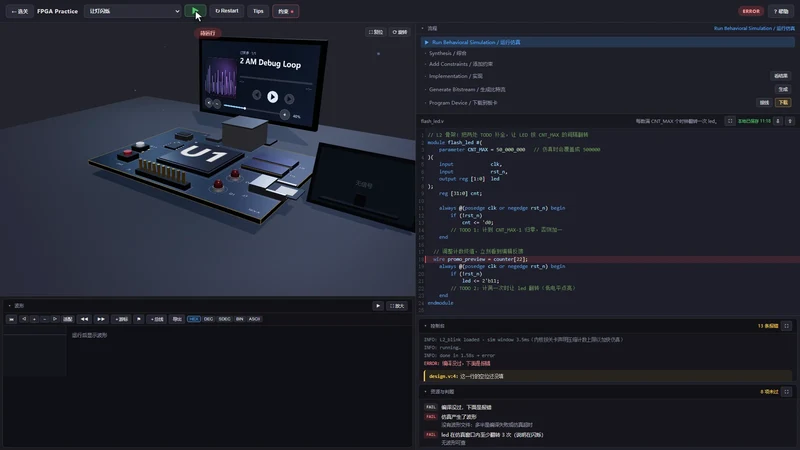</a><figcaption>编辑与约束<h3>编辑器与错误定位</h3>
故意引入错误后，编辑器定位行号，控制台与判题区共同给出反馈。
点击看完整原图 ↗</figcaption></figure><figure class="gallery-card" data-group="编辑与约束"><a class="case-image-link gallery-full" href="assets/feature-tour/02-xdc-auto-fill.webp">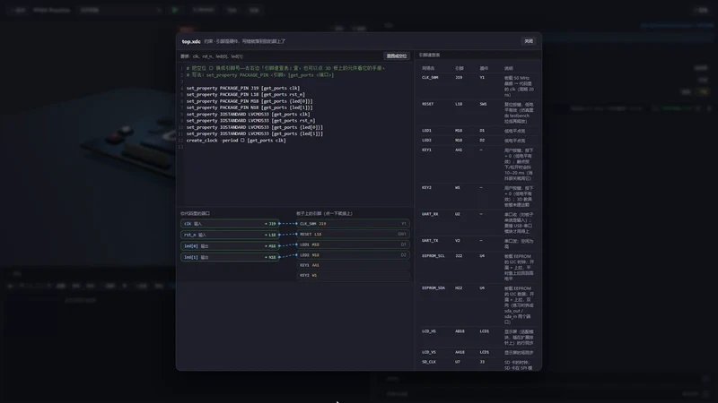</a><figcaption>编辑与约束<h3>连线之后，约束自动填写</h3>
时钟、复位与两路 LED 完成连接，生成的 XDC 语句和 20ns 时钟约束同时可见。
点击看完整原图 ↗</figcaption></figure><figure class="gallery-card" data-group="波形分析"><a class="case-image-link gallery-full" href="assets/feature-tour/03-wave-measure.webp">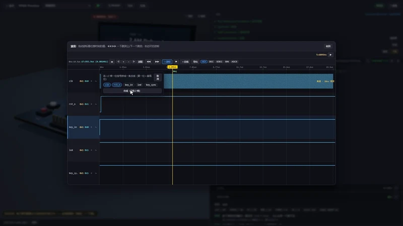</a><figcaption>波形分析<h3>时间测量、标记与虚拟总线入口</h3>
波形放大后可见 ΔT 测量值、M1 标记，以及选择信号组成虚拟总线的入口。
点击看完整原图 ↗</figcaption></figure><figure class="gallery-card" data-group="屏幕与交互"><a class="case-image-link gallery-full" href="assets/feature-tour/04-screen-colorbars.webp">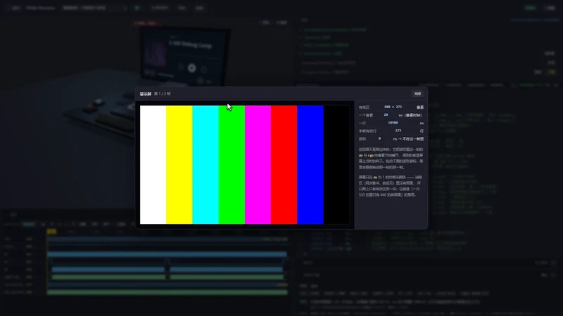</a><figcaption>屏幕与交互<h3>从行场时序到彩条</h3>
屏幕放大后呈现彩条，旁边保留像素、行场同步与数据使能信息。
点击看完整原图 ↗</figcaption></figure><figure class="gallery-card" data-group="屏幕与交互"><a class="case-image-link gallery-full" href="assets/feature-tour/05-screen-picture.webp">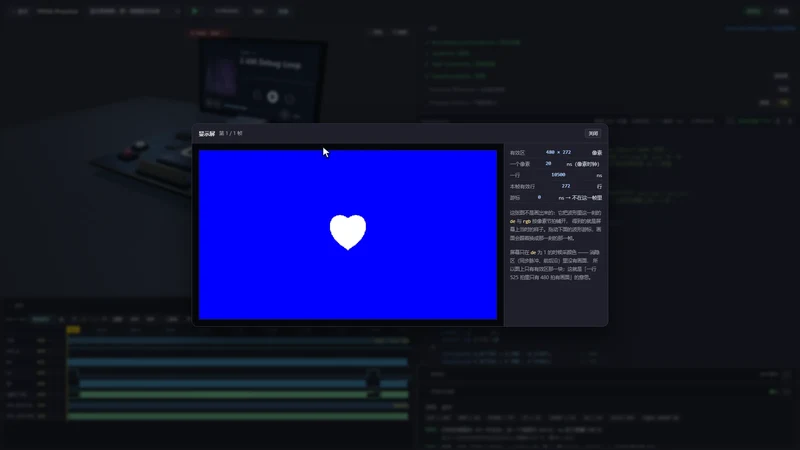</a><figcaption>屏幕与交互<h3>让数字信号变成一幅图</h3>
显示屏从 de/rgb 信号恢复图像，直接查看实际显示内容。
点击看完整原图 ↗</figcaption></figure><figure class="gallery-card" data-group="屏幕与交互"><a class="case-image-link gallery-full" href="assets/feature-tour/06-screen-animation.webp">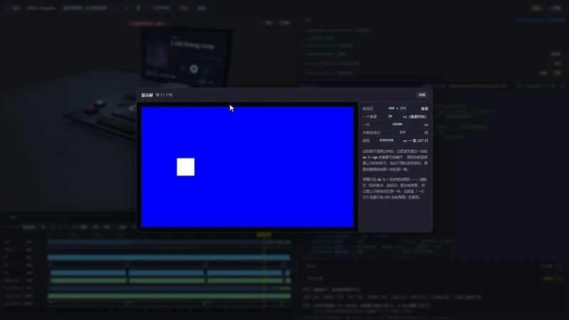</a><figcaption>屏幕与交互<h3>逐帧观察方块动画</h3>
白色方块在显示画面中出现，显示结果与运行时间相互对应。
点击看完整原图 ↗</figcaption></figure><figure class="gallery-card" data-group="屏幕与交互"><a class="case-image-link gallery-full" href="assets/feature-tour/07-key-debounce.webp">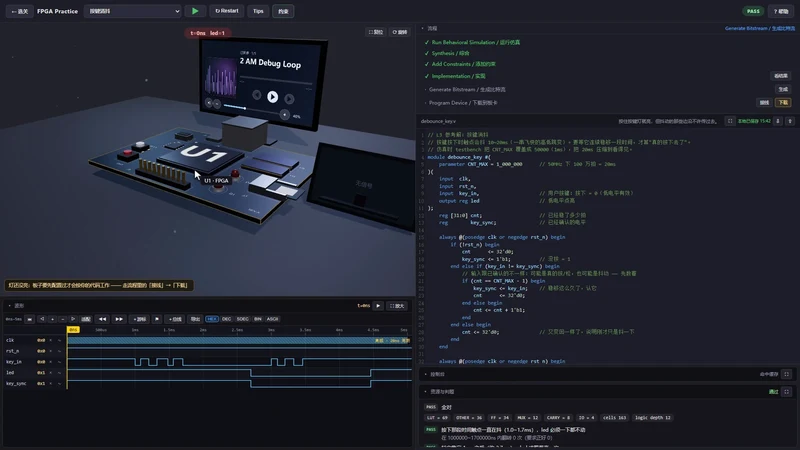</a><figcaption>屏幕与交互<h3>按键输入与消抖信号</h3>
板卡、Verilog、key_in 抖动和同步后的信号在同一工作区中对照。
点击看完整原图 ↗</figcaption></figure><figure class="gallery-card" data-group="协议与存储"><a class="case-image-link gallery-full" href="assets/feature-tour/08-uart-wave.webp">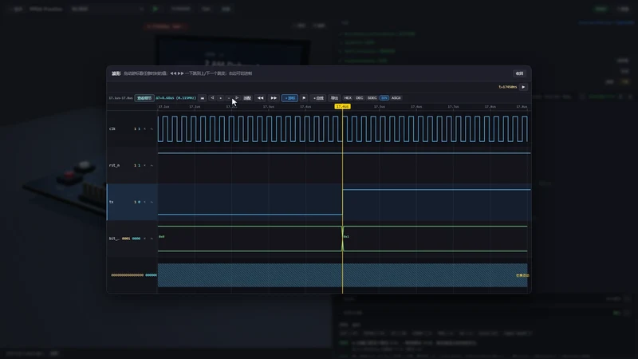</a><figcaption>协议与存储<h3>UART：把一个字节逐位发送</h3>
串口 tx 信号与时钟、复位、发送状态一起观察，分析串行发送过程。
点击看完整原图 ↗</figcaption></figure><figure class="gallery-card" data-group="协议与存储"><a class="case-image-link gallery-full" href="assets/feature-tour/09-i2c-wave.webp">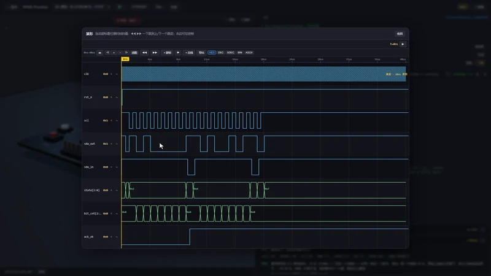</a><figcaption>协议与存储<h3>I2C：两根线上的通信</h3>
SCL、SDA 输出、从机应答与状态计数在同一时间轴上展开。
点击看完整原图 ↗</figcaption></figure><figure class="gallery-card" data-group="协议与存储"><a class="case-image-link gallery-full" href="assets/feature-tour/10-fifo-wave.webp">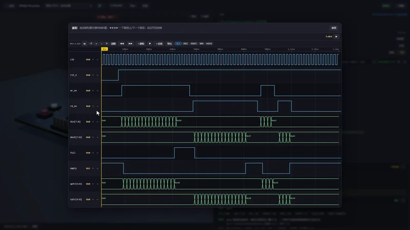</a><figcaption>协议与存储<h3>FIFO：写入、读出与满空状态</h3>
写使能、读使能、数据总线、满空标志和读写指针共同展示先入先出的行为。
点击看完整原图 ↗</figcaption></figure><figure class="gallery-card" data-group="协议与存储"><a class="case-image-link gallery-full" href="assets/feature-tour/11-udp-wave.webp">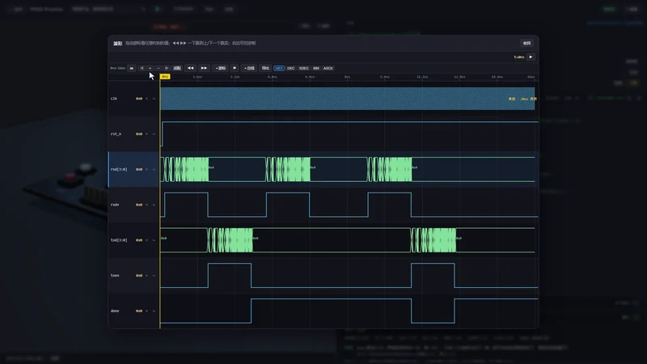</a><figcaption>协议与存储<h3>UDP：收发数据总线</h3>
接收有效、发送使能与数据总线成组出现，能对照多段收发过程。
点击看完整原图 ↗</figcaption></figure><figure class="gallery-card" data-group="运行与保存"><a class="case-image-link gallery-full" href="assets/feature-tour/12-practice-pack.webp">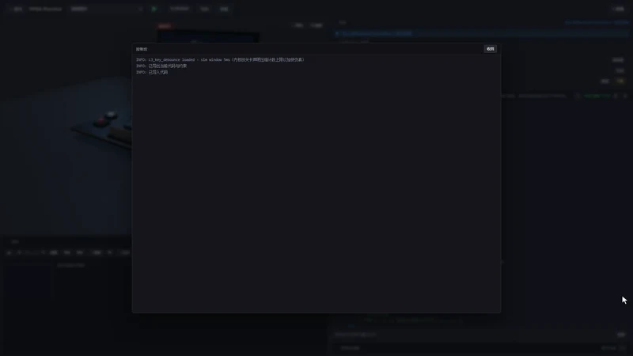</a><figcaption>运行与保存<h3>练习包导入导出的反馈</h3>
独立控制台确认当前代码已导出、已重新导入，保存操作有明确回执。
点击看完整原图 ↗</figcaption></figure><figure class="gallery-card" data-group="运行与保存"><a class="case-image-link gallery-full" href="assets/feature-tour/13-code-led.webp">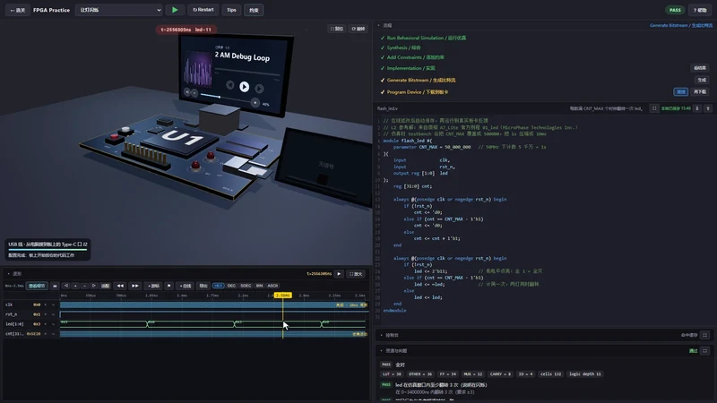</a><figcaption>运行与保存<h3>从代码运行到 LED 反馈</h3>
代码、成功流程、板卡与波形同屏呈现，看到一次完整练习的结果。
点击看完整原图 ↗</figcaption></figure><figure class="gallery-card" data-group="协议与存储"><a class="case-image-link gallery-full" href="assets/feature-tour/14-rom-wave.webp">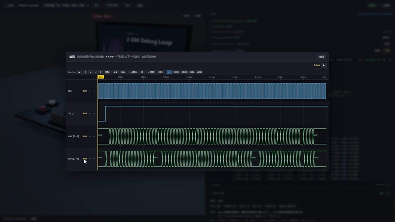</a><figcaption>协议与存储<h3>ROM：地址变化，查表输出</h3>
连续地址访问与 dout 数据变化放在同一时间轴，观察查表逻辑。
点击看完整原图 ↗</figcaption></figure><figure class="gallery-card" data-group="协议与存储"><a class="case-image-link gallery-full" href="assets/feature-tour/15-ram-wave.webp">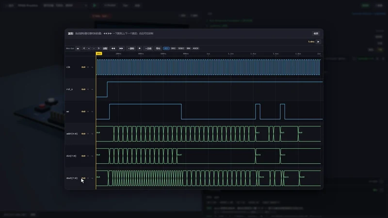</a><figcaption>协议与存储<h3>RAM：写进去，再读出来</h3>
写使能、地址、输入数据和输出数据同时显示，跟踪存储器读写关系。
点击看完整原图 ↗</figcaption></figure><figure class="gallery-card" data-group="协议与存储"><a class="case-image-link gallery-full" href="assets/feature-tour/16-spi-sd-wave.webp">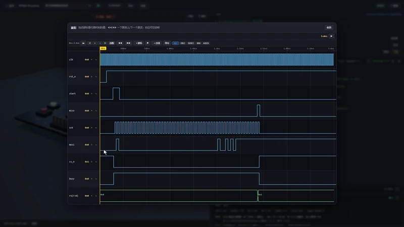</a><figcaption>协议与存储<h3>SPI / SD：命令与响应</h3>
片选、时钟、MOSI、MISO、忙状态和响应值在一张波形中展开。
点击看完整原图 ↗</figcaption></figure><figure class="gallery-card" data-group="协议与存储"><a class="case-image-link gallery-full" href="assets/feature-tour/17-arp-wave.webp">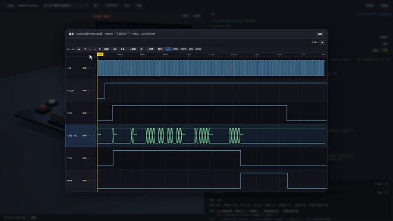</a><figcaption>协议与存储<h3>ARP：请求如何发出去</h3>
请求控制、发送数据、发送使能与完成信号组成可追踪的链路。
点击看完整原图 ↗</figcaption></figure><figure class="gallery-card" data-group="波形分析"><a class="case-image-link gallery-full" href="assets/feature-tour/18-pwm-wave.webp">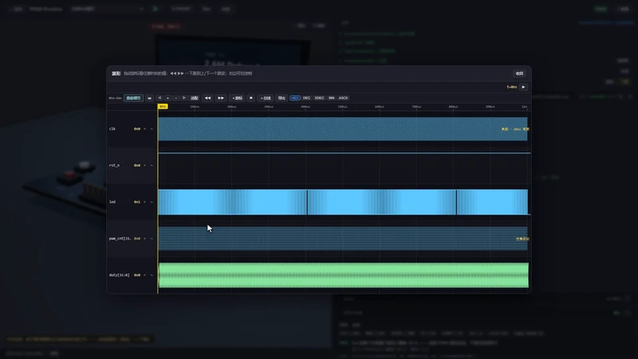</a><figcaption>波形分析<h3>PWM：密集脉冲与占空比</h3>
完整时间窗展示 PWM 脉冲密度与 duty 变化，适合说明为何需要进一步放大分析。
点击看完整原图 ↗</figcaption></figure><figure class="gallery-card" data-group="波形分析"><a class="case-image-link gallery-full" href="assets/feature-tour/19-traffic-state.webp">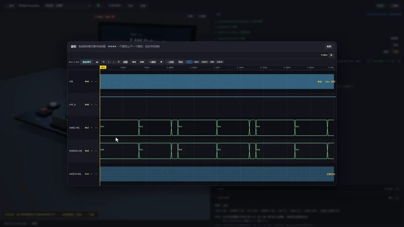</a><figcaption>波形分析<h3>状态机：状态与 LED 一起看</h3>
state 与 led 总线在同一刻度变化，观察交通灯状态之间的切换关系。
点击看完整原图 ↗</figcaption></figure><figure class="gallery-card" data-group="4.1 外设实验"><a class="case-image-link gallery-full" href="assets/feature-tour/20-hardware-overview.webp">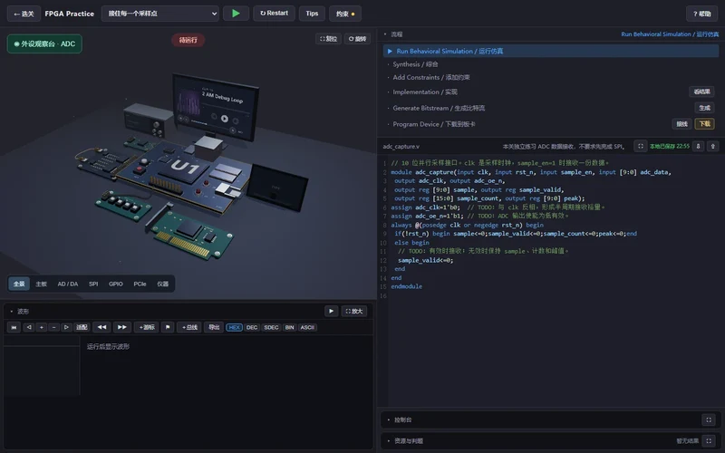</a><figcaption>4.1 外设实验<h3>外设齐备的 3D 硬件桌面</h3>
主板、AD/DA、SPI、GPIO、PCIe、屏幕与仪器组成一个可切换观察的实验桌面。
点击看完整原图 ↗</figcaption></figure><figure class="gallery-card" data-group="4.1 外设实验"><a class="case-image-link gallery-full" href="assets/feature-tour/21-adc-capture.webp">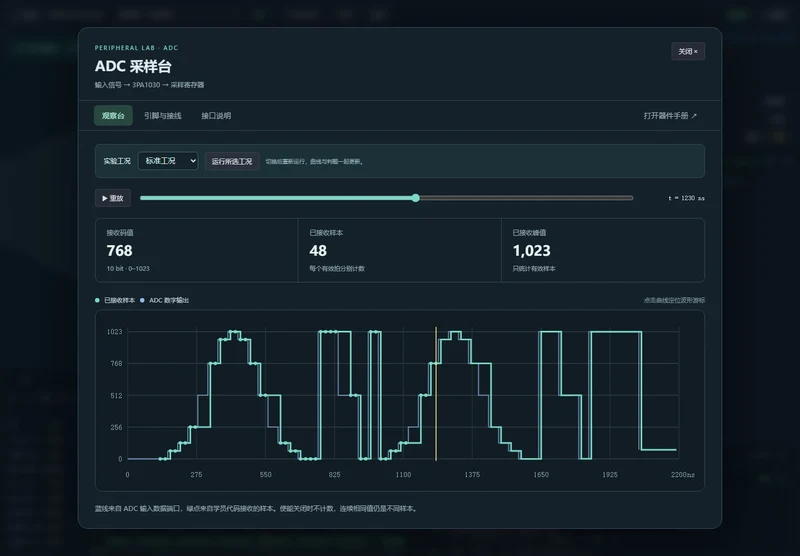</a><figcaption>4.1 外设实验<h3>ADC：采样曲线与统计</h3>
接收码值、样本数、峰值和采样曲线同屏显示，区分输入数据与已接收样本。
点击看完整原图 ↗</figcaption></figure><figure class="gallery-card" data-group="4.1 外设实验"><a class="case-image-link gallery-full" href="assets/feature-tour/22-dac-wave.webp">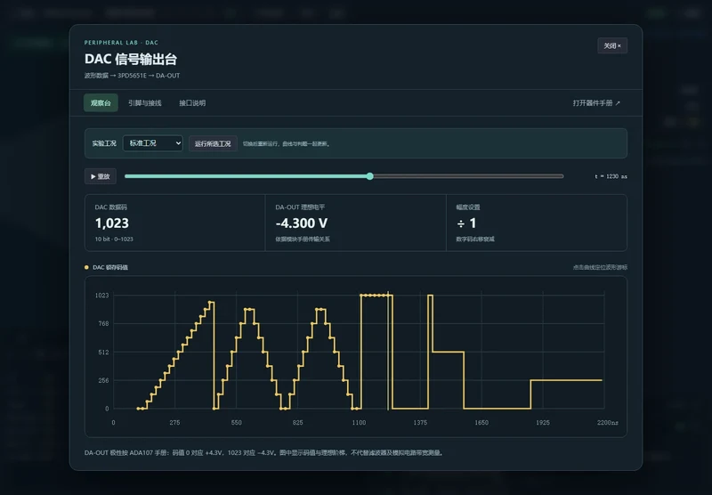</a><figcaption>4.1 外设实验<h3>DAC：数字码与输出曲线</h3>
显示 DAC 码值、幅度设置与锁存输出曲线，观察波形生成和保持。
点击看完整原图 ↗</figcaption></figure><figure class="gallery-card" data-group="4.1 外设实验"><a class="case-image-link gallery-full" href="assets/feature-tour/23-spi-register.webp">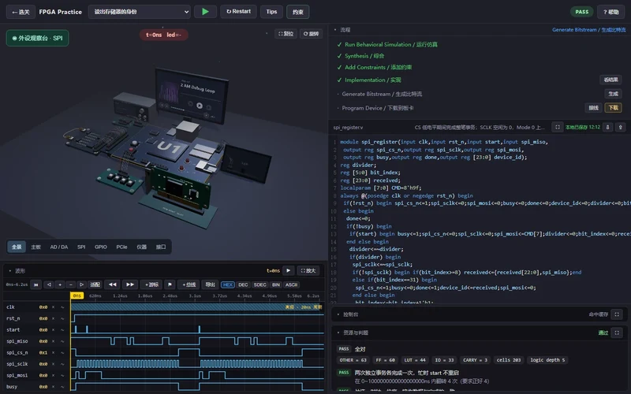</a><figcaption>4.1 外设实验<h3>SPI：读取存储器身份</h3>
实际 SPI 时序、Verilog 与通过结果同屏，观察命令发送和接收过程。
点击看完整原图 ↗</figcaption></figure><figure class="gallery-card" data-group="4.1 外设实验"><a class="case-image-link gallery-full" href="assets/feature-tour/24-gpio-direction.webp">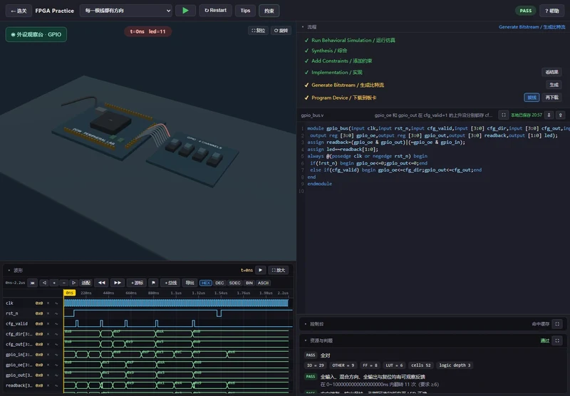</a><figcaption>4.1 外设实验<h3>GPIO：方向配置与读回</h3>
四路 GPIO 实验与配置代码同屏，波形展示方向、输出和读回的变化。
点击看完整原图 ↗</figcaption></figure><figure class="gallery-card" data-group="4.1 外设实验"><a class="case-image-link gallery-full" href="assets/feature-tour/25-pcie-transactions.webp">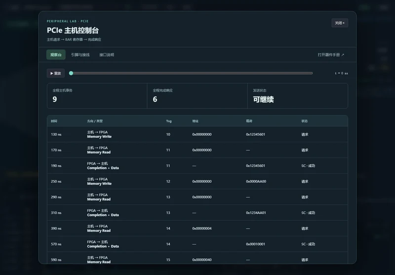</a><figcaption>4.1 外设实验<h3>PCIe：请求与完成响应</h3>
事务表列出 Memory Write、Memory Read 与 Completion + Data，对照 Tag、地址和载荷。
点击看完整原图 ↗</figcaption></figure><figure class="gallery-card" data-group="4.1 外设实验"><a class="case-image-link gallery-full" href="assets/feature-tour/26-pin-manual.webp">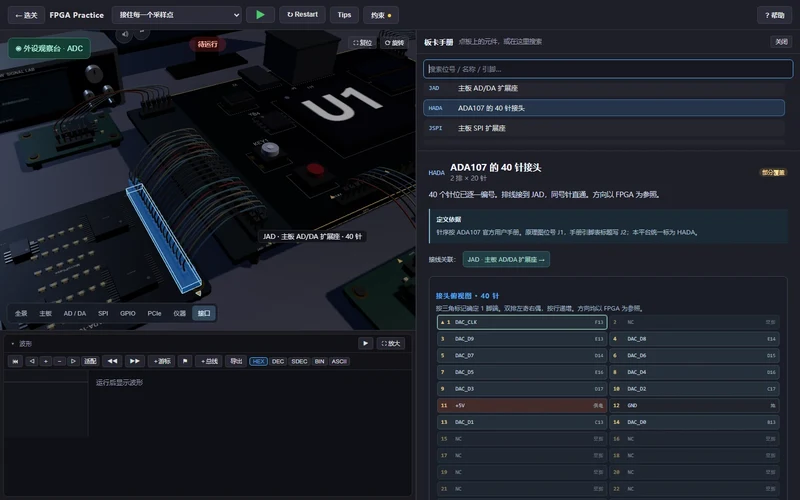</a><figcaption>4.1 外设实验<h3>逐针手册与实体接线相互对应</h3>
选中 40 针接口后，同时查看接线关联、定义依据与逐针编号表。
点击看完整原图 ↗</figcaption></figure><figure class="gallery-card" data-group="4.1 外设实验"><a class="case-image-link gallery-full" href="assets/feature-tour/27-scope-view.webp">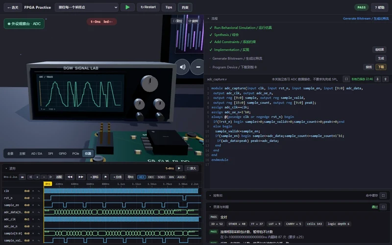</a><figcaption>4.1 外设实验<h3>仪器、代码和波形联动</h3>
桌面仪器显示 ADC 曲线，旁边保留对应代码、数字波形与通过结果。
点击看完整原图 ↗</figcaption></figure><figure class="gallery-card" data-group="课程与吉祥物"><a class="case-image-link gallery-full" href="assets/feature-tour/28-course-hardware.webp">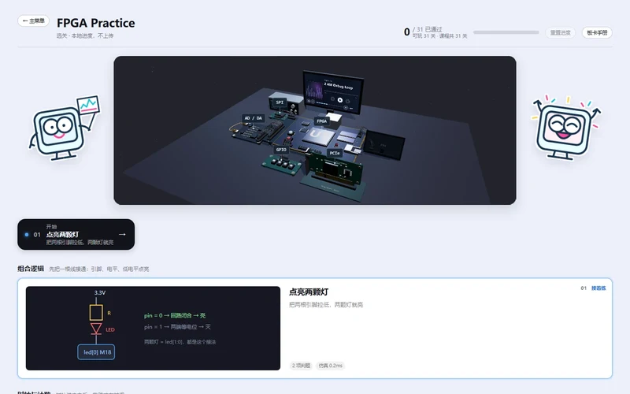</a><figcaption>课程与吉祥物<h3>课程入口与硬件全景</h3>
课程页以硬件全景、少量设备标注和两侧吉祥物引导学习入口。
点击看完整原图 ↗</figcaption></figure>
</section>

## 从图里，继续动手

[[platform|平台功能与实际演示]] · [[hardware|交互 3D 板卡与手册]] · [[waveform|波形台详细介绍]] · [免费开始练习](https://dgwfpga.cn/practice/)
