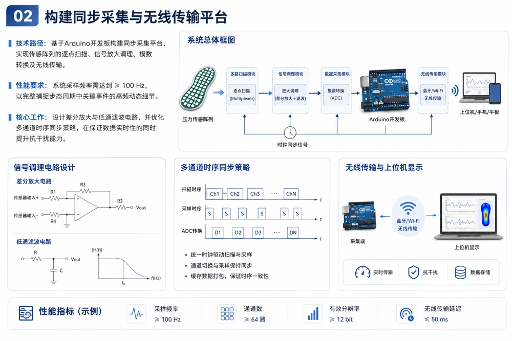
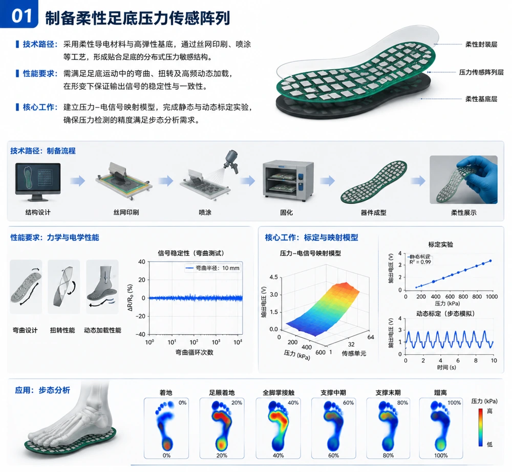
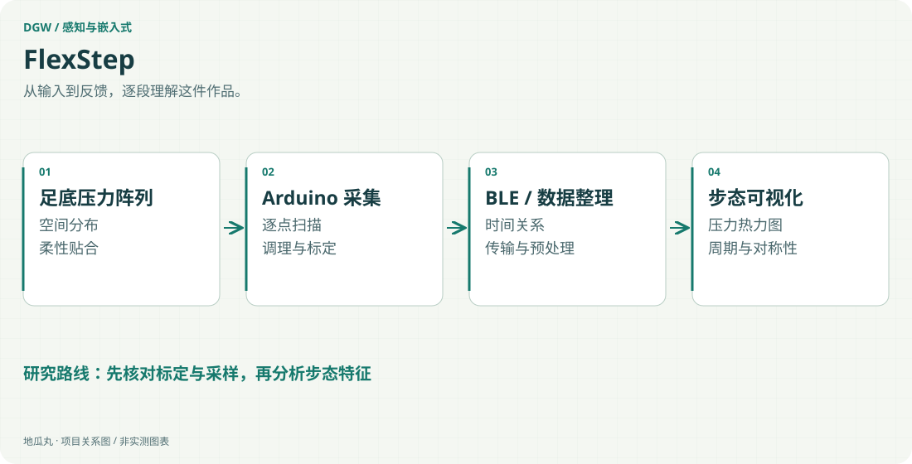

地瓜丸的工作室 · 其他项目
让足底受力成为可以观察、比较和解释的连续信息。

柔性压力阵列Arduino多通道采集BLE压力热力图

<aside class="project-stage"><strong>这件作品进行到哪里</strong>方案与立项材料；采集整机及动态指标仍需实测验证</aside>

<nav class="evidence-nav" aria-label="项目截图导览"><strong>本页图像 · 2 张</strong><a href="#shot-flexstep-sampling-plan">01</a><a href="#shot-flexstep-array-plan">02</a></nav>

<figure id="shot-flexstep-sampling-plan" class="evidence-shot"><figcaption>原汇报方案图原汇报中的采集与无线传输方案：阵列扫描、调理、ADC 与上位机之间的关系。图中指标为方案要求或示例。点击看原图 ↗</figcaption></figure>

## 把一次行走拆成可观察的过程

FlexStep 面向足底压力与步态分析。它希望把足跟着地、足弓过渡、前掌离地这些连续变化，转成能够在界面里追踪的压力分布，让使用者看见脚底怎样受力，以及左右脚是否呈现明显差异。项目围绕柔性鞋垫形态组织传感、采集和反馈，将一次行走的连续变化保留下来。

## 从阵列到热力图

技术路线由柔性足底压力阵列、Arduino 多通道扫描、信号调理、数据传输和上位机分析组成。阵列给出不同位置的电信号，采集端按统一节奏读取，经过标定与预处理后形成压力热力图，再继续提取步态周期、支撑与摆动阶段、受力对称性以及压力中心迁移等信息。每一步的输入与输出要能对应，才便于定位误差来源。

## 关键工作是标定与同步

柔性材料会弯曲，也可能出现迟滞、漂移和个体差异。因此，方案把静态线性度、重复性与动态跟随测试放在算法之前；多通道扫描也需要明确时间关系，避免将先后读到的数据误当成严格同时采样。轻量化与低成本是设计方向，不能替代传感器可靠性的检验。

<figure id="shot-flexstep-array-plan" class="evidence-shot"><figcaption>原汇报方案图原汇报中的柔性阵列设计、制备和标定思路。结构、曲线与热力图是方案示意，非本轮实物测量。点击看原图 ↗</figcaption></figure>

## 技术路径与后续验证

已有资料包括立项依据与阶段汇报，明确了柔性阵列、Arduino 采集、BLE 传输和步态可视化路线。机器学习识别、长期穿戴、康复评估与异常提示属于后续研究方向；本页不把方案里的采样目标或识别率写成已完成的实测指标。作品的价值首先是把材料、电子采集与可解释反馈组织成一条能逐步验证的系统路径。

## 与教学平台的联系

这类项目也反向影响我的教学思路：传感器给了什么、电路采到了什么、程序又显示了什么，需要放在同一条证据链里解释。

查看功能路径示意

<figure class="case-figure"><a class="case-image-link" href="assets/projects/flexstep.svg"><picture><source media="(max-width:600px)" srcset="assets/projects/flexstep-mobile.svg" width="460" height="1000"></picture></a><figcaption>依据项目资料整理的功能关系示意；实际阶段见正文。点击查看大图 ↗</figcaption></figure>

## 继续阅读

[[projects|更多作品]] · [[platform|地瓜丸的 FPGA 教学平台]] · [[contact|去找地瓜丸→]]

