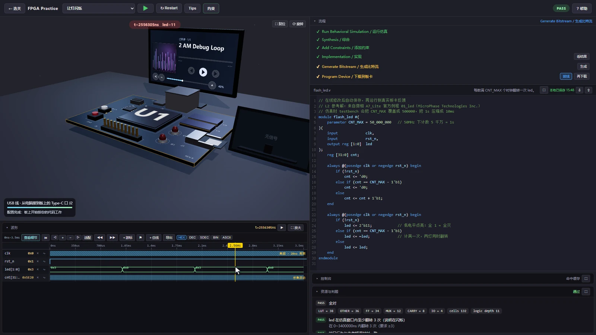
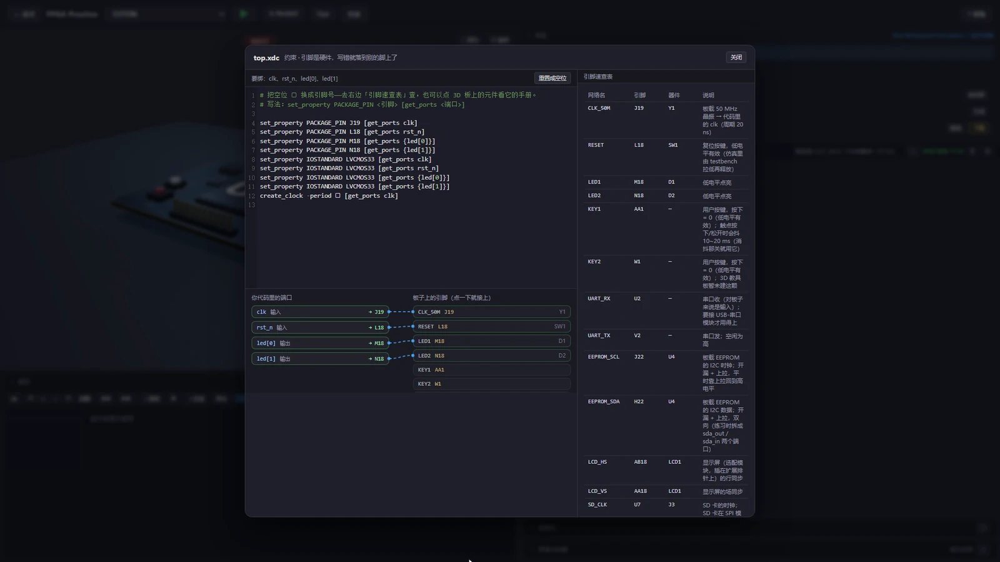
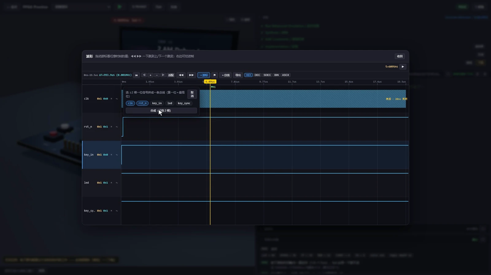

地瓜丸 · FPGA 实践
写完 Verilog， 下一步看哪里？

灯不亮时，代码可能已经编译通过了。要继续查输出电平、端口约束和观察时间。我的教学平台把这些工具放在同一张工作台里。

<dl class="field-facts">
<dt>练习范围</dt><dd>31 关 / 8 章</dd>

<dt>主要操作</dt><dd>写代码、连引脚、看波形</dd>

<dt>从这里开始</dt><dd><a href="https://dgwfpga.cn/practice/#/level/L1_led_on">点亮两颗灯 ↗</a></dd>
</dl><figure class="case-figure field-frame"><figcaption>一次成功运行的实际画面。代码输出、板卡上的灯和下方波形可以对照着看。点击看原图 ↗</figcaption></figure>

## 灯不亮，我会按这个顺序查

<table class="field-table"><thead><tr><th>先查什么</th><th>具体看哪里</th><th>为什么要查</th></tr></thead><tbody><tr><td>输出是不是预期电平</td><td>在波形里找到 led 信号，移动时间游标。</td><td>先确认逻辑输出，再判断板卡表现。</td></tr><tr><td>端口接到哪根引脚</td><td>打开约束区，对照图形连线和生成的 XDC。</td><td>代码里的端口名，需要落到实际针位。</td></tr><tr><td>是不是还没等到翻转</td><td>检查计数上限、复位释放和当前时间窗口。</td><td>计数器还没数满时，看起来会像一直没反应。</td></tr><tr><td>两处看的是不是同一时刻</td><td>对照游标位置与虚拟 LED 的状态。</td><td>用同一个时间点检查波形和灯。</td></tr></tbody></table>
<figure class="case-figure field-frame"><figcaption>接线完成后，约束语句已经出现在右侧。图形操作和文字约束能相互核对。点击看原图 ↗</figcaption></figure>

## 这 8 章，各自练什么

01<section><b>先让输出有反应</b>
点亮两颗 LED，建立端口、电平和引脚的对应关系。
</section>

02<section><b>给电路一个节拍</b>
计数分频、按键消抖、流水灯；把时钟快慢和肉眼观察联系起来。
</section>

03<section><b>状态与占空比</b>
交通灯状态机、PWM 呼吸灯，观察状态切换和输出变化。
</section>

04<section><b>让数据走到外面</b>
UART、I²C 和显示时序，继续看彩条、移动方块与图像输出。
</section>

05<section><b>存起来，再组合</b>
同步 FIFO，以及按键触发串口发送的综合练习。
</section>

06<section><b>存储和网络报文</b>
ROM、RAM、SD 卡命令、校验和，以及 ARP、ICMP、UDP。
</section>

07<section><b>处理停顿与跨时钟</b>
Ready/Valid、Skid Buffer、异步 FIFO、流式 CRC32。
</section>

08<section><b>独立外设实验</b>
ADC、DAC、SPI、GPIO 与 PCIe 事务读写，各自有观察目标。
</section>

## 同一段代码，换一个角度检查

<figure class="case-figure field-frame"><figcaption>密集信号先定位活动区，再进入细节。测量结果来自选定的时间位置。点击看原图 ↗</figcaption></figure>
<table class="field-table"><thead><tr><th>任务</th><th>可以看到的结果</th><th>继续查看</th></tr></thead><tbody><tr><td>显示时序</td><td>由 de / rgb 等信号恢复出来的彩条、图片和动画。</td><td><a href="feature-tour.html">显示实景图鉴 →</a></td></tr><tr><td>FIFO 与 RAM</td><td>写入、读出、空满或读回数据的时间关系。</td><td><a href="streaming.html">数据流与外设 →</a></td></tr><tr><td>板上接口</td><td>逐针编号、方向、供电和接线对端。</td><td><a href="hardware.html">3D 板卡与手册 →</a></td></tr></tbody></table>
<nav class="field-read-next" aria-label="继续阅读"><a href="https://dgwfpga.cn/practice/">打开练习平台 →</a><a href="feature-tour.html">看 29 张功能实景 →</a><a href="tide-technology.html">看我的 FPGA 实物作品 →</a></nav>
