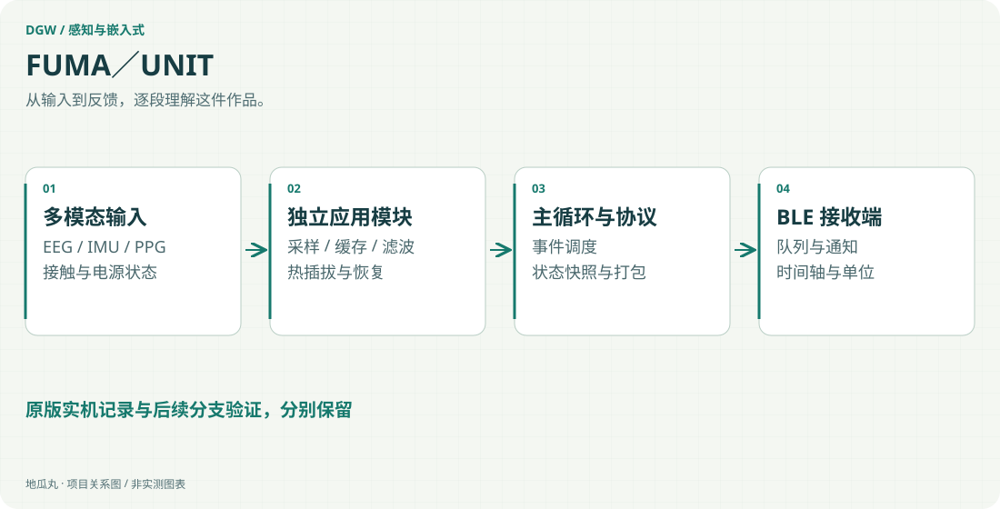

地瓜丸的工作室 · 其他项目
把采样、传感器状态、无线传输与电源管理组织成可维护的固件。

nRF52832nRF5 SDKCSAADC / DMABLEEEG / IMU / PPG

<aside class="project-stage"><strong>这件作品进行到哪里</strong>FUMA 原版 OTA 有实机记录；UNIT Float V9 为编译与离线仿真阶段</aside>

<figure class="case-figure"><a class="case-image-link" href="assets/projects/fuma-unit.svg"><picture><source media="(max-width:600px)" srcset="assets/projects/fuma-unit-mobile.svg" width="460" height="1000"></picture></a><figcaption>依据项目资料整理的功能关系示意；实际阶段见正文。点击查看大图 ↗</figcaption></figure>

## 多传感器共同运行，先把职责分清

FUMA／UNIT 围绕脑电、惯性与光电信息采集展开。与只让某个传感器输出数值不同，固件需要同时管理采样节拍、缓存、滤波、接触状态、无线发送和电源提示。一次传感器异常，不应让其他任务失去可解释的运行状态。

## 采样与传输之间有完整路径

现有 UNIT 模块化实现基于 nRF52832、nRF5 SDK 和 S132。脑电侧由定时与硬件触发组织 SAADC 采样，经过双缓冲、环形缓存及可配置数字滤波进入数据打包；IMU、PPG 与电极接触检测由各自模块管理状态。BLE 层处理连接、队列和通知，接收端再依据数据类型还原时间轴与单位。

## 为什么把模块边界做明确

主调度负责初始化与事件处理，传感器驱动只回答“怎样访问芯片”，应用模块决定“何时采集、怎样恢复”。跨模块通过状态快照交换信息，减少共享变量造成的隐式耦合。热插拔、传输失败和电源状态也进入明确的状态机，而不是把错误吞掉后继续显示正常数据。

## 升级能力与采集能力分别验证

原 FUMA 的首刷与蓝牙 Secure DFU 有实机通过记录；后续 UNIT Float V9 虽已完成编译和离线仿真，仍未进行实板验收。这两个版本的结果分别说明，不用原版的升级记录证明新采样分支已经上板，也不把可生成固件文件当成整机验证。

## 从固件到可维护的系统

分层方法、数据链路和逐版本验证共同组成交付：先确定采样条件与信号质量，再核对接收端的数据与时间关系。记录版本和验证条件，让后续调整有明确的起点。

## 继续阅读

[[projects|更多作品]] · [[platform|地瓜丸的 FPGA 教学平台]] · [[contact|去找地瓜丸→]]

