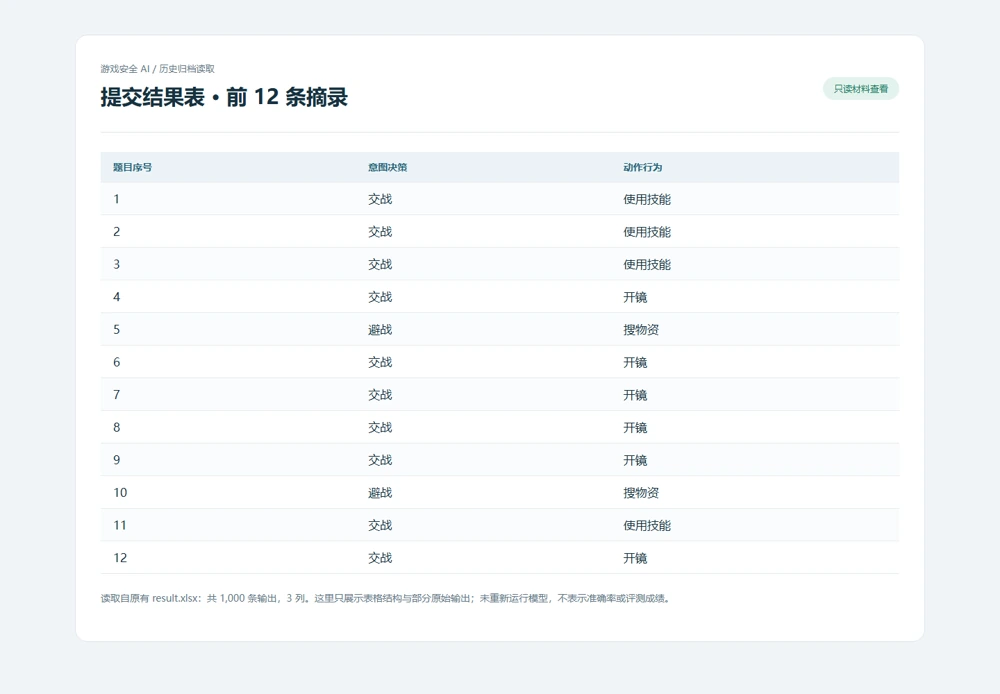
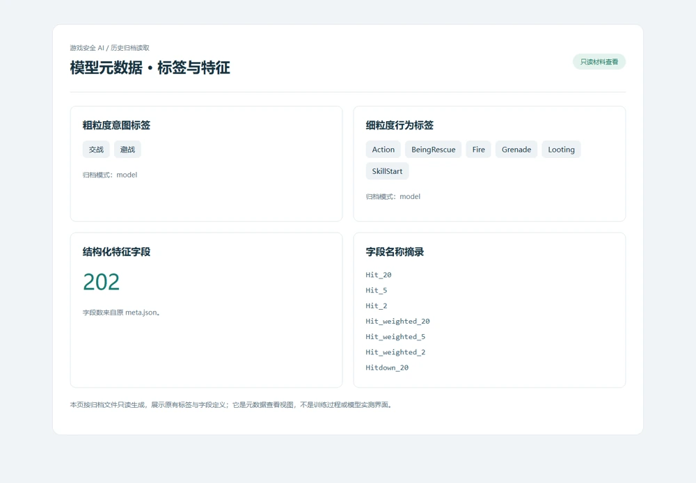

地瓜丸的工作室 · 其他项目
从游戏事件记录提取特征，按意图与行为分层分类，交付可核对的结果表。

PythonTF-IDFLogistic RegressionRandom ForestSGD模型与结果归档

<aside class="project-stage"><strong>这件作品进行到哪里</strong>已读取原结果表与模型元数据；未加载模型或复算评测成绩</aside>

<nav class="evidence-nav" aria-label="项目截图导览"><strong>本页图像 · 2 张</strong><a href="#shot-game-results">01</a><a href="#shot-game-metadata">02</a></nav>

<figure id="shot-game-results" class="evidence-shot"><figcaption>原结果表读取视图原提交结果表的只读摘录：显示前 12 条输出，归档总计 1,000 条。未重新运行模型。点击看原图 ↗</figcaption></figure>

## 分类结果之前，需要完整的处理路径

这项初赛实践读取游戏事件记录，先判断“交战／避战”等意图，再给出对应动作。归档中同时保留特征向量器、粗细两级分类模型、训练数据、结果表与调试输出，说明工作不止于生成一个预测标签，还需要将输入、特征、分类层级和最终交付组织成一致的流程。

## 用明确的基线回答具体问题

材料中包含 TF-IDF 向量器，以及 Logistic Regression、Random Forest 和 SGD 等模型文件，按 coarse 与 fine 两个层级保存。这样的结构便于围绕不同粒度的类别开展对照：输入先经过一致的特征处理，再进入分类器，最后将输出映射到任务要求的结果格式。模型名字不能替代实际对照实验，但让实验结构更容易被检查。

<figure id="shot-game-metadata" class="evidence-shot"><figcaption>原模型元数据读取视图从原归档读取的两级标签和 202 个特征字段定义，不是训练实测结果。点击看原图 ↗</figcaption></figure>

## 训练与推理的边界要守住

向量器与标签映射必须跟随对应模型保存，不能在推理阶段重新拟合测试数据。粗细层级的含义、未知输入与异常行也需要明确处理，否则一个格式正确的表格仍可能包含系统性错误。调试输出与正式结果分开，有助于检查样本怎样经过各环节，而不改动最终交付格式。

## 归档中能够确认的内容

已有本人初赛交付归档，包含代码、向量器、多组模型、训练文件及结果和分析材料。本轮读取了原结果表的 1,000 条输出和元数据中的 202 个结构化特征字段，没有加载 joblib 模型、运行分类脚本或重新计算指标，因此不公布没有依据的准确率、排名和比赛奖项；正式赛事名称仍应以参赛资料进一步核对。

## 展示的是实验组织能力

公开页只说明特征、分层分类和结果核查的方法，不分发竞赛数据或训练好的模型。对这类实践，我更希望留下可解释的比较对象、可追踪的版本和能复查的输出，而不是只展示一张脱离评测条件的成绩截图。

查看功能路径示意

<figure class="case-figure"><a class="case-image-link" href="assets/projects/game-security-ai.svg"><picture><source media="(max-width:600px)" srcset="assets/projects/game-security-ai-mobile.svg" width="460" height="1000"></picture></a><figcaption>依据项目资料整理的功能关系示意；实际阶段见正文。点击查看大图 ↗</figcaption></figure>

## 继续阅读

[[projects|更多作品]] · [[platform|地瓜丸的 FPGA 教学平台]] · [[contact|去找地瓜丸→]]

