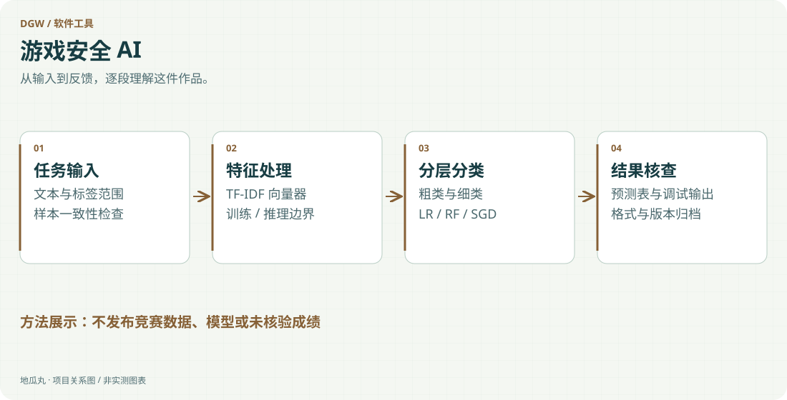

地瓜丸的工作室 · 其他项目
围绕文本特征、分层分类与结果交付，留下可复查的实验材料。

PythonTF-IDFLogistic RegressionRandom ForestSGD模型与结果归档

<aside class="project-stage"><strong>这件作品进行到哪里</strong>已核对初赛归档文件组成；未加载模型或复算评测成绩</aside>

<figure class="case-figure"><a class="case-image-link" href="assets/projects/game-security-ai.svg"><picture><source media="(max-width:600px)" srcset="assets/projects/game-security-ai-mobile.svg" width="460" height="1000"></picture></a><figcaption>依据项目资料整理的功能关系示意；实际阶段见正文。点击查看大图 ↗</figcaption></figure>

## 分类结果之前，需要完整的处理路径

这项初赛实践围绕游戏安全方向的文本分类展开。归档中同时保留特征向量器、粗细两级分类模型、训练数据、结果表与调试输出，说明工作不止于生成一个预测标签，还需要将输入、特征、分类层级和最终交付组织成一致的流程。

## 用明确的基线回答具体问题

材料中包含 TF-IDF 向量器，以及 Logistic Regression、Random Forest 和 SGD 等模型文件，按 coarse 与 fine 两个层级保存。这样的结构便于围绕不同粒度的类别开展对照：输入先经过一致的特征处理，再进入分类器，最后将输出映射到任务要求的结果格式。模型名字不能替代实际对照实验，但让实验结构更容易被检查。

## 训练与推理的边界要守住

向量器与标签映射必须跟随对应模型保存，不能在推理阶段重新拟合测试数据。粗细层级的含义、未知输入与异常行也需要明确处理，否则一个格式正确的表格仍可能包含系统性错误。调试输出与正式结果分开，有助于检查样本怎样经过各环节，而不改动最终交付格式。

## 归档中能够确认的内容

已有本人初赛交付归档，包含代码、向量器、多组模型、训练文件及结果和分析材料。本轮仅核对文件清单，没有加载 joblib 模型、运行分类脚本或重新计算指标，因此不公布没有依据的准确率、排名和比赛奖项；正式赛事名称仍应以参赛资料进一步核对。

## 展示的是实验组织能力

公开页只说明特征、分层分类和结果核查的方法，不分发竞赛数据或训练好的模型。对这类实践，我更希望留下可解释的比较对象、可追踪的版本和能复查的输出，而不是只展示一张脱离评测条件的成绩截图。

## 继续阅读

[[projects|更多作品]] · [[platform|地瓜丸的 FPGA 教学平台]] · [[contact|去找地瓜丸→]]

