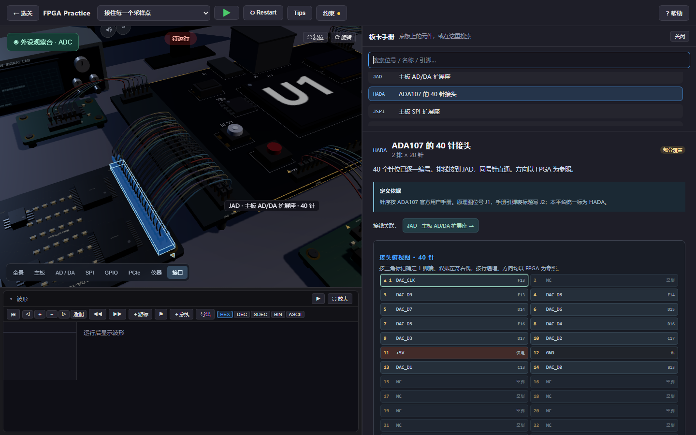
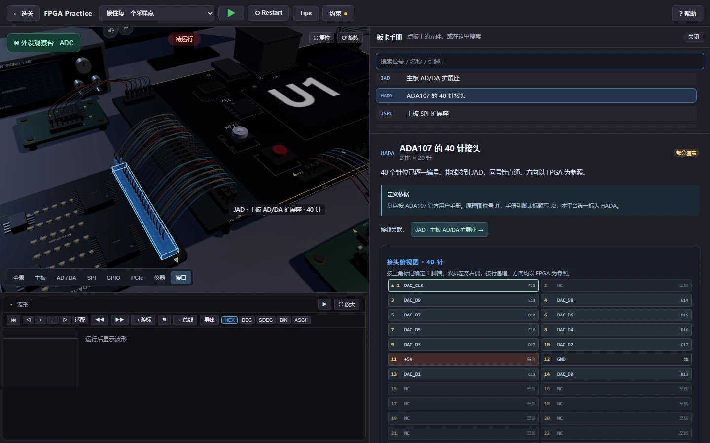

地瓜丸 · 3D 板卡与逐针手册
点一下器件， 沿着接线找到针脚。

所有关卡共用完整硬件桌面。4.1 的 ADC、DAC、SPI、GPIO 和 PCIe 外设，也可以在同一张桌面上查看。

和练习平台相同的硬件模型<h3>从主板，到每一块外设。</h3>
拖动观察、切换视角，再点开元件。先熟悉这张桌面，再回到关卡里让代码与波形接上。
<button type="button" data-load-board="https://dgwfpga.cn/portfolio-media/20261109/board-viewer/">打开 3D 硬件桌面 →</button>

## 看接口时，别只看元件名称

<figure class="case-figure field-frame"><figcaption>40 针接口的实际手册画面：接线关联、定义依据和逐针表在一起。点击看原图 ↗</figcaption></figure>
<table class="field-table"><thead><tr><th>查阅位置</th><th>能核对什么</th></tr></thead><tbody><tr><td>接口的两端</td><td>主板扩展座和外设接头是否对应。</td></tr><tr><td>逐针编号</td><td>信号落在哪个针位，奇偶列和方向如何排列。</td></tr><tr><td>信号方向</td><td>输入、输出、供电与地线是否区分清楚。</td></tr><tr><td>接线关联</td><td>沿链接跳到对端，继续核对同一条连接。</td></tr><tr><td>XDC 约束</td><td>代码端口名与图形接线是否落到同一个引脚。</td></tr></tbody></table>

## 这套手册怎么改过来的

接线<section><b>先解决“线没落到针上”。</b> 把主板接口、扩展接头和逐针编号对齐，界面上的每根线有明确去向。</section>

目录<section><b>再解决横向挤压。</b> 改为纵向查阅，让接口目录和正文能分别滚动。</section>

对比度<section><b>深色背景里仍要看清标题。</b> 调整 ADA107 等说明文字的颜色，并检查手机阅读。</section>

<nav class="field-read-next" aria-label="继续阅读"><a href="https://dgwfpga.cn/practice/">回到练习操作 →</a><a href="streaming.html">查看五类外设任务 →</a><a href="interaction.html">查看其他界面改动 →</a></nav>
