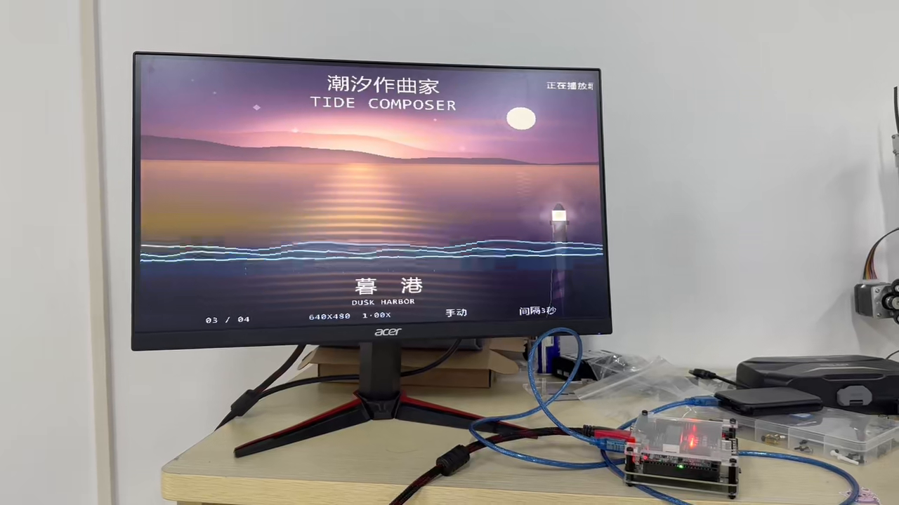
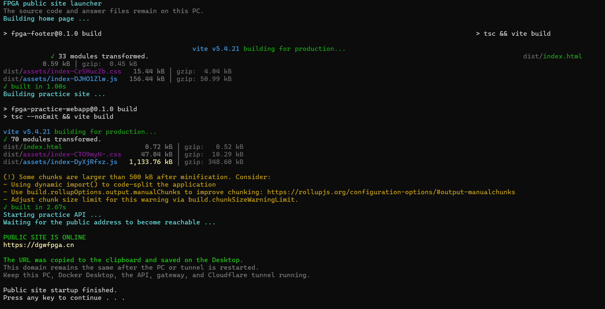

地瓜丸 · 个人工作室

做电路，也做能用的作品。

我是地瓜丸。从 FPGA 教学、板端音画到网页产品，我记录想法怎样落地，以及与 AI 一起调试和迭代的过程。

<a href="./skills.html">从作品了解我的能力 ↗</a><a href="./graph/">探索关系图 ↗</a>

## 先看三件具体的事

在线产品 · 持续维护<h3><a href="platform.html">我的 FPGA 教学平台</a></h3>
31 个关卡、8 个章节，让代码、波形、约束与硬件现象在一次练习里连接起来。
<a class="work-more" href="platform.html">看练习流程与设计取舍 →</a>

FPGA 实物 · 已固化<h3><a href="tide-composer.html">潮汐作曲家</a></h3>
从 TF 卡到 HDMI，完成海洋音画展示、实时缩放、转场与板端交互。
<a class="work-more" href="tide-composer.html">看实物与验证过程 →</a>

产品维护 · 持续迭代<h3><a href="maintenance.html">网站怎样持续运行</a></h3>
从本机服务到云部署，把“打不开”和“总弹窗”拆成可以检查的问题。
<a class="work-more" href="maintenance.html">看问题与处理方法 →</a>

## 每件作品，都有过程可以看

<a href="skills.html"><strong>能力与作品证据</strong>产品、FPGA、联调、交互、维护与表达</a><a href="ai-collaboration.html"><strong>我怎样与 AI 做项目</strong>目标、判断、实现与验收分别做什么</a><a href="timeline.html"><strong>更新与成长记录</strong>从反馈到改动，持续保留已完成结果</a>

## 继续认识我

[[about|关于地瓜丸]] · [[now|最近在做什么]] · [[content-creation|教学与功能演示]] · [[contact|账号与联系入口]]

[体验 FPGA 教学平台](https://dgwfpga.cn/) · [直接开始练习](https://dgwfpga.cn/practice/) · [AI 可读档案](profile.json)

最近整理：**2026-11-08**。公开案例按当前材料记录具体工作、协作方式和验证范围。
