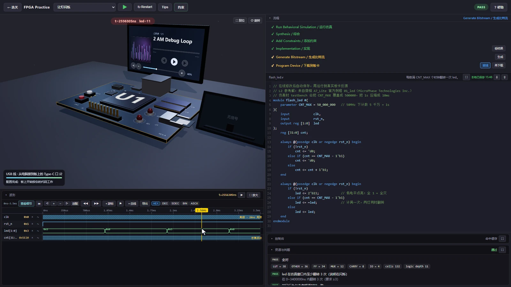

<section class="product-hero">
地瓜丸 · 个人工作室 / FREE ONLINE FPGA LAB<h2>想象力， 遇上能运行的电路。</h2>
从第一颗 LED，到显示、数据流与外设。 在浏览器里写 Verilog，让代码、波形和硬件现象对上。

<a href="https://dgwfpga.cn/practice/">免费开始练习 ↗</a><a href="platform.html">先看平台能做什么 →</a>

<b>31</b> 个公开关卡<b>8</b> 个学习章节<b>4.1</b> 外设实验室

<a class="hero-image case-image-link gallery-full" href="assets/feature-tour/13-code-led.webp">真实运行实景 · 点击查看完整原图</a></section>

## 一次练习，走完从想法到现象

<em>01</em><h3>理解目标</h3>
先知道这一关要发生什么，哪些信号值得观察。

<em>02</em><h3>编写与连接</h3>
编辑代码，手写 XDC，或者把端口连到具体针脚。

<em>03</em><h3>运行并观察</h3>
将运行反馈、波形与 LED、显示屏一起对照。

<em>04</em><h3>定位再重试</h3>
找到行为不符的时间点，修改后再检验一次。

## 功能不是一句话，展开看实际操作

01 / 动手写<strong>代码、约束与一次运行</strong><b>展开演示 ＋</b>

先读任务，再写 Verilog；编辑器、约束、运行反馈和观察窗口连在一起。每次修改后都可以重新运行，沿着信号与检查结果继续定位，而不是只猜语法有没有写对。
<figure class="case-figure "><figcaption>一个学习目标，放在同一张工作台上。点击看大图 ↗</figcaption></figure>

02 / 接得上<strong>点选连线，约束跟着落下</strong><b>展开演示 ＋</b>

代码里的端口不是凭空存在的。图形连线将端口、板上针脚和 XDC 联系起来；接线后还要查看自动填写的约束。手写和图形方式都留在练习里，方便理解二者对应关系。
<figure class="case-figure "><figcaption>真实操作录屏：端口连接到针脚，约束随之填写。点击看大图 ↗</figcaption></figure>

03 / 看得清<strong>沿波形找到问题发生的那一拍</strong><b>展开演示 ＋</b>

从长时间窗口定位密集活动，再进入局部细节。平移、缩放、跳变定位、双游标测量与进制切换各有用途：先确认要观察的问题，再选择能解释它的工具。
<figure class="case-figure "><figcaption>真实操作录屏：时间窗口、信号和游标位置。点击看大图 ↗</figcaption></figure>

04 / 有现象<strong>LED 与屏幕，让结果看得见</strong><b>展开演示 ＋</b>

灯为什么亮、什么时候翻转，需要和代码里的计数、状态及输出电平一起看。教学桌面让波形中的变化有直观反馈；显示关卡还可以把行场时序还原成一帧画面。
<figure class="case-figure "><figcaption>真实操作录屏：波形时间位置与虚拟 LED 对应。点击看大图 ↗</figcaption></figure>

05 / 查得到<strong>元件不是摆设，手册紧挨着器件</strong><b>展开演示 ＋</b>

从器件名称到接口，再到针号、方向和对端，资料应能顺着问题找到。完整硬件桌面覆盖所有关卡，逐针手册帮助学习者核对连线，而不是在好几个文档之间来回找。
<figure class="case-figure "><figcaption>真实操作录屏：点击板上元件，继续查资料。点击看大图 ↗</figcaption></figure>

06 / 往深处走<strong>从一颗灯，走到数据流与外设</strong><b>展开演示 ＋</b>

31 个公开关卡分成 8 章，从组合逻辑、时钟计数和状态机，延伸到 UART、I²C、显示、FIFO、网络、高速流及独立外设实验。每关先抓住一个能观察、能判断的关键行为。
<figure class="case-figure "><figcaption>真实显示关卡录屏：彩条、像素位置与时序说明。点击看大图 ↗</figcaption></figure>

<a href="platform.html">查看完整平台介绍 →</a><a href="waveform.html">深入波形台 →</a><a href="hardware.html">硬件与逐针手册 →</a>

<!-- feature-gallery-20261109 -->

## 不止看一张板卡，继续看功能实景

写代码、接线、看波形、观察屏幕，再把存储、通信与外设连起来。这里先看 12 个不同画面，完整图鉴里有 29 张可放大的截图。

<section class="feature-gallery gallery-overview">
<figure class="gallery-card" data-group="编辑与约束"><figcaption>编辑与约束<h3>当前工作台：主板、外设与代码同屏</h3>
本轮从正式站拍摄的 ADC 关卡初始界面：代码为待完成模板，尚未运行。
点击看完整原图 ↗</figcaption></figure><figure class="gallery-card" data-group="波形分析"><figcaption>波形分析<h3>时间测量、标记与虚拟总线入口</h3>
波形放大后可见 ΔT 测量值、M1 标记，以及选择信号组成虚拟总线的入口。
点击看完整原图 ↗</figcaption></figure><figure class="gallery-card" data-group="屏幕与交互"><figcaption>屏幕与交互<h3>从行场时序到彩条</h3>
屏幕放大后呈现彩条，旁边保留像素、行场同步与数据使能信息。
点击看完整原图 ↗</figcaption></figure><figure class="gallery-card" data-group="协议与存储"><figcaption>协议与存储<h3>UART：把一个字节逐位发送</h3>
串口 tx 信号与时钟、复位、发送状态一起观察，分析串行发送过程。
点击看完整原图 ↗</figcaption></figure><figure class="gallery-card" data-group="运行与保存"><figcaption>运行与保存<h3>练习包导入导出的反馈</h3>
独立控制台确认当前代码已导出、已重新导入，保存操作有明确回执。
点击看完整原图 ↗</figcaption></figure><figure class="gallery-card" data-group="4.1 外设实验"><figcaption>4.1 外设实验<h3>外设齐备的 3D 硬件桌面</h3>
主板、AD/DA、SPI、GPIO、PCIe、屏幕与仪器组成一个可切换观察的实验桌面。
点击看完整原图 ↗</figcaption></figure><figure class="gallery-card" data-group="课程与吉祥物"><figcaption>课程与吉祥物<h3>课程入口与硬件全景</h3>
课程页以硬件全景、少量设备标注和两侧吉祥物引导学习入口。
点击看完整原图 ↗</figcaption></figure><figure class="gallery-card" data-group="编辑与约束"><figcaption>编辑与约束<h3>编辑器与错误定位</h3>
故意引入错误后，编辑器定位行号，控制台与判题区共同给出反馈。
点击看完整原图 ↗</figcaption></figure><figure class="gallery-card" data-group="波形分析"><figcaption>波形分析<h3>PWM：密集脉冲与占空比</h3>
完整时间窗展示 PWM 脉冲密度与 duty 变化，适合说明为何需要进一步放大分析。
点击看完整原图 ↗</figcaption></figure><figure class="gallery-card" data-group="屏幕与交互"><figcaption>屏幕与交互<h3>让数字信号变成一幅图</h3>
显示屏从 de/rgb 信号恢复图像，直接查看实际显示内容。
点击看完整原图 ↗</figcaption></figure><figure class="gallery-card" data-group="协议与存储"><figcaption>协议与存储<h3>I2C：两根线上的通信</h3>
SCL、SDA 输出、从机应答与状态计数在同一时间轴上展开。
点击看完整原图 ↗</figcaption></figure><figure class="gallery-card" data-group="运行与保存"><figcaption>运行与保存<h3>从代码运行到 LED 反馈</h3>
代码、成功流程、板卡与波形同屏呈现，看到一次完整练习的结果。
点击看完整原图 ↗</figcaption></figure>
<a class="gallery-more" href="feature-tour.html">打开全部 29 张功能实景，按主题筛选 →</a></section>

## 把我们的 3D 板卡，直接放到你面前

浏览器里的硬件桌面<h3>亲手转一圈，点开每个器件。</h3>
主板、AD/DA、SPI、GPIO、PCIe 与接口，在同一张桌面上。
<button type="button" data-load-board="https://dgwfpga.cn/portfolio-media/20261109/board-viewer/">打开交互式 3D 板卡 →</button><small>按需加载 · 拖动旋转 · 元件可点击</small>

## 用一段完整演示认识它

<figure class="video-feature"><video controls playsinline preload="none" poster="assets/notes/promo-cover.png" aria-label="地瓜丸 FPGA 教学平台 · 实际功能操作演示"><source src="https://dgwfpga.cn/portfolio-media/20261109/videos/fpga-platform.mp4" type="video/mp4"><a href="https://dgwfpga.cn/portfolio-media/20261109/videos/fpga-platform.mp4">打开演示视频</a></video><figcaption>地瓜丸 FPGA 教学平台 · 实际功能操作演示 · 点击播放，支持全屏。<a href="https://dgwfpga.cn/portfolio-media/20261109/videos/fpga-platform.mp4" target="_blank" rel="noopener">单独打开 ↗</a></figcaption></figure>

## 这座实验室里，还有一个小伙伴

<section class="mascot-intro">
MEET OUR MASCOT<h3>圆眼镜、小显示器，陪你把电路想明白。</h3>
它会讲解、会思考，也会在排查故障时拿起扳手。贯穿平台、教程和这个介绍站的小角色，让每次练习都有熟悉的陪伴。
<a href="mascot.html">认识吉祥物与整套表情 →</a>
</section>

<section class="owner-teaser">
平台维护 · 已接入<h3>运行可追踪，备份可核对。</h3>
学员控制台显示本次运行编号，站主可在独立管理端查询请求、区分学习问题与平台故障，并核对备份状态。
<a href="maintenance.html">看看管理台与维护实践 →</a>
</section>

## 围绕平台，继续认识地瓜丸

<a href="about.html"><strong>为什么做这个教学平台</strong>我的方向、取舍与持续迭代</a><a href="skills.html"><strong>从作品看实践能力</strong>教学、FPGA、交互与维护</a><a href="projects.html"><strong>工作室的其他项目</strong>潮汐作曲家、柔性感知、控制、工具与游戏</a><a href="contact.html"><strong>去找地瓜丸→</strong>抖音、B站与 FPGA 学习交流群</a>

平台是这里的主线。其他作品与 AI 协作记录，沿着具体项目继续展开。课程状态整理于 2026-11-09。

