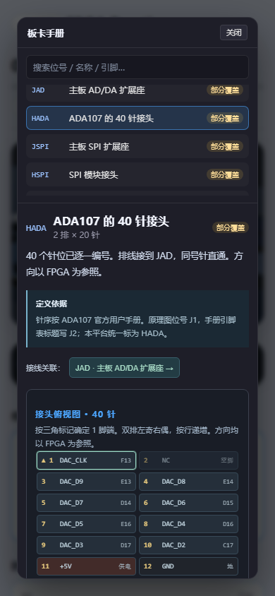

功能做出来以后，还需要让使用者有机会发现它、看懂它并顺利操作。

<!-- note-visuals-20261108 -->

<figure class="case-figure note-visual portrait"><figcaption>手机真实截图：目录、针位资料和内容区按小屏阅读组织。点击查看大图 ↗</figcaption></figure>

## 从逼仄的工作区开始

代码、控制台、资源与判题可以弹出更大的查看区域；手册可以搜索和沿接线关系跳转；波形提供独立观察空间。这些调整回应的是实际阅读和分析需求。

## 社区动态的例子

连续运行同一关时，每次都展示一条“有人运行了”会把其他信息挤掉。现在连续同关运行合并为真实次数，通关单独保留，累计统计不变。

## 装饰也要服从内容

吉祥物漫画放在课程空位，空间不足时换行，手机再调整排列。保留趣味的同时，课程按钮与文字必须始终能正常使用。

## 继续探索

- [[platform|我的 FPGA 教学平台]]
- [[web|把功能做成可用的网页]]
- [[hardware|把硬件与手册放在一起]]
- [[debugging|从反馈里找到真正的问题]]

[[index|回到档案首页]]
