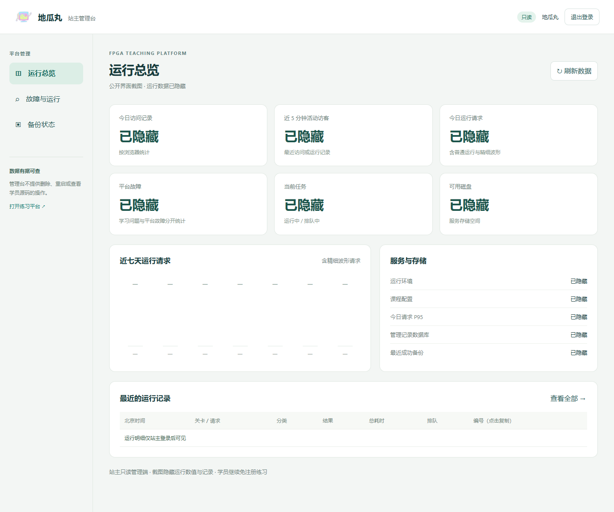
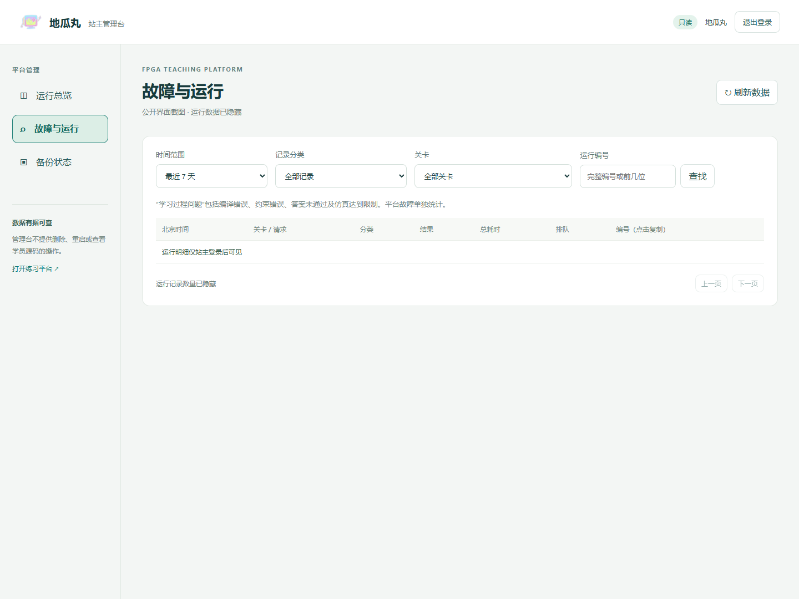
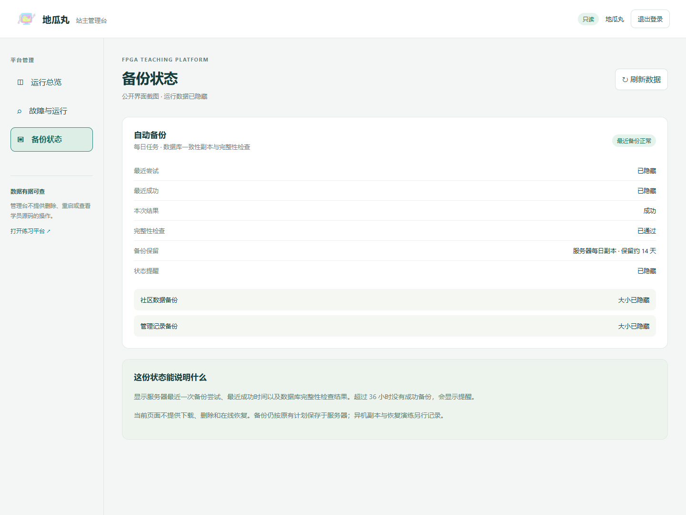
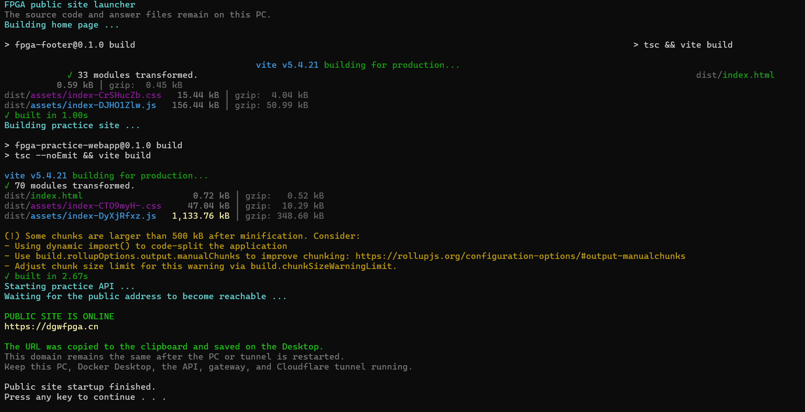
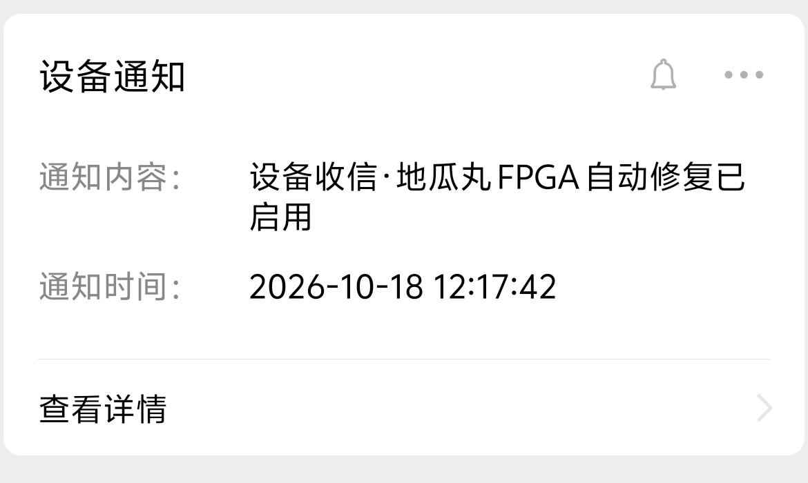

CASE 03 · 产品维护与故障排查
网站上线之后， 把“打不开”追到具体环节。

这个平台先在个人电脑上运行，再提供外网访问，后来迁移到云服务器。维护过程包括发现故障、通知、软件拉起、备份与发布后的验证。

<strong>本机 → 云端</strong>随使用需求调整部署方式

<strong>发现 → 处理 → 复查</strong>把恢复结果重新验证

<strong>备份 → 更新 → 验收</strong>每次变更有可追溯记录

## 站主管理台：把维护放进一个界面

OWNER OPERATIONS · 已上线<h3>一边让学员顺畅练习， 一边让问题有处可查。</h3>
平台已有独立登录的只读管理端，将访问概况、运行请求、排队和服务状态集中呈现。维护时可以顺着一个运行编号查记录，核对问题发生的关卡、分类与耗时。

<figure class="case-figure owner-public-image"><figcaption>正式站管理页面的公开截图：运行数值、记录和服务指标均已隐藏，保留实际布局与功能入口。点击查看大图 ↗</figcaption></figure>

<section>01 / 看清情况<h3>运行总览</h3>
访问、运行、活动访客、排队、服务与磁盘信息放在同一页；七天趋势帮助回看变化。
</section><section>02 / 找到记录<h3>故障与学习问题分开</h3>
编译错误、约束与答案问题单独归类；服务异常和排队超时归入平台故障，支持编号检索。
</section><section>03 / 确认备份<h3>有时间，也有校验结果</h3>
查看最近尝试、最近成功与数据库完整性检查；超过预设时间没有成功备份时提醒检查。
</section>

<figure class="case-figure owner-public-image"><figcaption>同一问题可以沿运行编号检索；公开截图隐藏记录明细。点击查看大图 ↗</figcaption></figure><figure class="case-figure owner-public-image"><figcaption>备份页显示成功与校验状态；公开截图隐藏具体时间、文件名称和大小。点击查看大图 ↗</figcaption></figure>

## 一个运行编号，怎样帮助排查

<ol class="case-flow"><li>01<strong>学员提供编号</strong>
在控制台或错误提示中复制本次运行编号。
</li><li>02<strong>站主检索</strong>
按编号、关卡和时间找到相应请求。
</li><li>03<strong>区分问题</strong>
确认是学习过程中的错误，还是运行服务异常。
</li><li>04<strong>复查结果</strong>
结合复现步骤处理，并重新验证。
</li></ol>

<section>数据管理<h3>诊断摘要与临时产物各有用途</h3>
管理记录保留请求时间、关卡、状态和耗时，不收集学员源码与原始运行日志。请求明细设置保留期限与数量上限，临时波形仍由原有策略回收。
</section><section>访问与备份<h3>管理入口独立保护</h3>
只读后台需要独立登录，包含登录保护与操作留痕。社区和管理记录分别生成一致性备份，再核验数据库完整性；当前展示的是服务器本地每日备份。
</section>

<aside class="mascot-note">
<strong>学习方式保持轻便</strong>
站主管理账号用于维护平台；学员继续免注册练习，草稿与进度仍保存在当前浏览器。账号云同步不属于本次功能。

</aside>

## 网站怎样提供一次练习

<figure class="case-figure "><figcaption>维护对象是一个持续迭代的在线教学产品，包含练习、波形、外设和资料查阅。点击查看大图 ↗</figcaption></figure>

<ol class="case-flow"><li>01<strong>浏览器访问</strong>
加载页面与必要资源。
</li><li>02<strong>网站入口</strong>
把页面请求与 API 请求送到对应服务。
</li><li>03<strong>练习服务</strong>
接收任务，运行仿真并整理结果。
</li><li>04<strong>回到页面</strong>
显示结果和波形，供学习者继续分析。
</li></ol>

把这条路径拆开之后，“主页能打开”和“练习能运行”就成为两个可以分别检查的问题。处理故障时先找出失败环节，再决定重启、修复还是回退。

## 我推进的维护工作

<section>我推进的工作
提出微信通知、自动拉起和简要回执的需求；反馈弹窗干扰与跨网络访问问题；选择云部署并审查更新结果。
</section><section>AI 辅助的工作
协助监控与启动脚本、部署配置、管理台页面、运行诊断记录、备份校验和维护教程实现。
</section><section>工程基础与协作
监测、通知、本机脚本和云端服务承担不同工作；每次检查保留范围与结果，避免把一次启动当成全部恢复。
</section>

## 三个真实问题，三种处理方式

### 01　有些地区打开很慢，其他设备却流畅

**现象：** 学习者反馈不同省份、网络和设备上的表现不同，部分电脑长时间加载。

**判断：** 先检查域名、页面资源、接口和运行任务是否分别可达，再对照设备负载。只在站主的网络里打开一次，无法说明其他人的访问体验。

**处理：** 调整页面与交互负担，并从本机外网方案迁移到云端部署。后续仍需跨网络复测；本页不以单点结果推断全国速度。

### 02　启动脚本执行了，练习服务却没准备好

**现象：** 早期公网启动过程出现本地网关等待超时。构建结束不代表页面入口和练习 API 都已经就绪。

**处理：** 分别检查构建、API、网关和外网入口。软件拉起后重新探测，再发送简要结果，保留失败环节和日志供继续定位。

<figure class="case-figure "><figcaption>历史存档：本机做服务器时期的成功启动界面。它用于解释当时的启动链路，不代表当前云端的运行方式。点击查看大图 ↗</figcaption></figure>

### 03　监控在运行，黑色窗口却总是一闪而过

**现象：** 定时任务直接启动 PowerShell，即使设置隐藏，也可能先创建控制台窗口再隐藏，影响日常使用。

<section>原来的启动方式<h3>任务直接创建控制台</h3>
窗口可能在隐藏参数生效前出现；重复检查时，闪窗会反复打扰使用者。
</section><section>采用的处理<h3>由无窗口宿主启动检查</h3>
改为通过 WScript 的隐藏启动方式调用原检查，并等待检查结束，保留任务防重入设置。
</section>

**复查：** 核对任务入口，手动触发后检查返回状态和新的日志记录。原有检测与通知逻辑继续保留。

<aside class="mascot-note">
<strong>维护也包含使用体验</strong>
检查能工作还不够：它不应每分钟打断使用者。修复启动方式时，也要保留防重入与日志，方便继续排查。

</aside>

## 微信通知与自动恢复的边界

<h3>收到消息后，知道下一步看哪里</h3>
本机服务阶段曾接入微信通知和自动拉起；发现问题后尝试恢复软件服务，再返回简要结果。

这张通知是“自动修复已启用”的历史确认，不能单独证明某次故障已修好。设备断电或本机断网时，本机脚本要等待设备恢复才能执行。

<strong>当前状态：</strong>正式站已迁移云服务器，旧本机 Tunnel 和自动修复计划任务保持停用；云端服务配置有进程异常重启和数据库备份。

<figure class="case-figure notification"><figcaption>2026-10-18 的本机阶段启用确认；不是故障恢复回执。点击查看大图 ↗</figcaption></figure>

## 更新怎样留下可复查的记录

<ol class="case-flow"><li>01<strong>备份</strong>
保存本次改动会影响的文件与版本。
</li><li>02<strong>修改</strong>
先在独立范围处理问题，保留旧记录。
</li><li>03<strong>验收</strong>
构建、入口、实际交互与手机布局分别检查。
</li><li>04<strong>发布</strong>
记录版本和结果；有问题按范围回退。
</li></ol>

## 这段经历体现的能力

- 把用户的模糊反馈转成可分别核对的网络、页面与服务问题。
- 根据个人维护成本和访问需求，调整部署方式。
- 关注启动、防重入、通知、恢复确认和可回退的更新过程。
- 把处理过程整理为教程与交接记录，让后续工作能接着做。

## 继续阅读

[[skills|能力与作品证据]] · [[debugging|从反馈定位问题]] · [[workflow|从想法到上线]] · [[platform|教学平台案例]]
