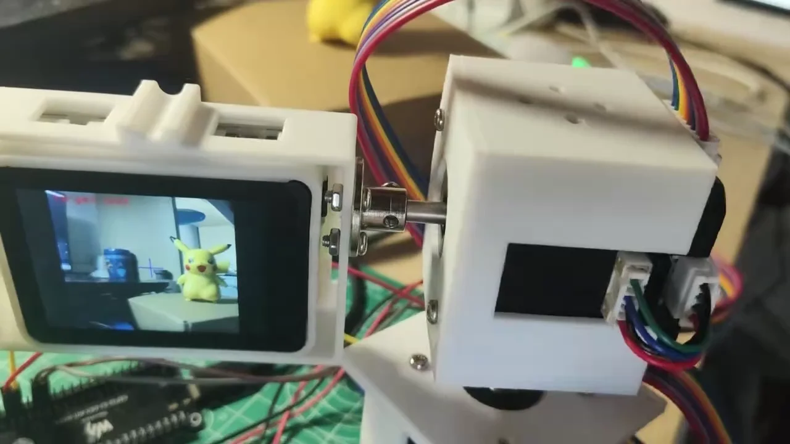
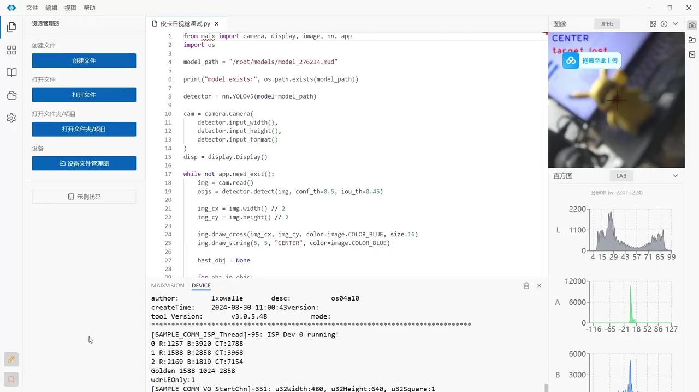
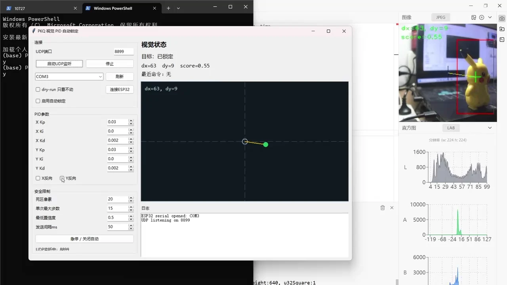

地瓜丸 · MaixCAM 自动识别瞄准
它认出了目标， 云台接下来怎么转？

我用玩偶作为示例目标，把相机识别、坐标传输、电脑控制界面和双轴机构接起来。下方视频保留了从检测画面到实机动作的过程。

<dl class="field-facts">
<dt>演示时长</dt><dd>04:52 / 完整原片</dd>

<dt>识别工具</dt><dd>MaixCAM Pro / YOLOv5</dd>

<dt>控制路径</dt><dd>UDP → PC PID → ESP32-S3</dd>
</dl><figure class="case-figure field-frame"><figcaption>视频里的实机近景：相机屏幕显示目标，双轴结构负责调整朝向。点击看原图 ↗</figcaption></figure>

## 直接看演示，也可以按章节跳转

<section class="field-video-section">
<figure class="field-media"><video id="maix-walkthrough" controls playsinline preload="none" poster="assets/project-field/maixcam-demo.webp" width="1280" height="720"><source src="https://dgwfpga.cn/portfolio-media/20261109/videos/projects/maixcam-demo.mp4" type="video/mp4">当前浏览器无法播放，可<a href="https://dgwfpga.cn/portfolio-media/20261109/videos/projects/maixcam-demo.mp4">直接打开视频</a>。</video><figcaption>04:52 / 实拍原片<strong>MaixCAM 自动识别与云台演示</strong>保留完整 4 分 52 秒原片。既能看实机，也能看识别框、坐标日志和 PID 控制界面。</figcaption></figure>
<button type="button" data-video-seek="0" data-video-target="maix-walkthrough">00:00实机与目标</button><button type="button" data-video-seek="40" data-video-target="maix-walkthrough">00:40连接相机</button><button type="button" data-video-seek="90" data-video-target="maix-walkthrough">01:30识别框与偏差</button><button type="button" data-video-seek="155" data-video-target="maix-walkthrough">02:35坐标与串口指令</button><button type="button" data-video-seek="210" data-video-target="maix-walkthrough">03:30PID 控制界面</button><button type="button" data-video-seek="270" data-video-target="maix-walkthrough">04:30回到实机</button>

点击章节，从对应位置播放。
</section>

## 先看见，再把偏差送出去

<ol class="field-path"><li><b>训练自己的目标</b>采图、标注，在 MaixHub 训练后部署模型。</li><li><b>相机计算偏差</b>MaixPy 加载 YOLOv5，计算目标中心相对画面中心的 dx / dy。</li><li><b>电脑判断动作</b>UDP 接收坐标，GUI 显示状态，PID 生成控制命令。</li><li><b>双轴机构响应</b>经 ESP32-S3 输出电机控制，调整相机朝向。</li></ol>

<figure class="case-figure field-frame"><figcaption>原片截帧：识别代码、画面中心与目标检测画面。点击看原图 ↗</figcaption></figure>
<h3>这个框，只回答“找到了谁”</h3>
检测结果还要转换为目标中心和画面中心的偏差。接着核对坐标符号、置信度与目标选择，才知道该把哪个方向的命令交给云台。

画面里的 <code>target lost</code> 表示当前没有满足条件的目标；重新找到目标后再更新状态。

<figure class="case-figure field-frame"><figcaption>原片截帧：目标状态、二维偏差点、PID 参数和安全限制。点击看原图 ↗</figcaption></figure>
<h3>在动作前，先把命令看明白</h3>
控制界面把 dx / dy 画成偏差点，同时显示锁定状态、串口和最近命令。可以先开 dry-run，只看命令；方向和幅度确认后，再启用自动锁定。

死区、最大步数、最低置信度和发送间隔是联调参数。画面显示的是这次调试的配置，不代表通用最优值。

## 我怎么区分问题出在哪一段

<table class="field-table"><thead><tr><th>看到的现象</th><th>先检查</th><th>对应工具</th></tr></thead><tbody><tr><td>目标在画面里，但没有框</td><td>模型文件、目标类别、检测阈值。</td><td>相机识别画面。</td></tr><tr><td>有框，电脑没有坐标</td><td>UDP 接收端是否启动、地址与端口是否一致。</td><td>坐标日志与 GUI 目标状态。</td></tr><tr><td>有坐标，云台方向相反</td><td>dx / dy 的符号和轴方向是否匹配。</td><td>dry-run、X / Y 反向设置。</td></tr><tr><td>云台能跟，靠近中心来回摆</td><td>死区、增益、单次步数和发送间隔。</td><td>偏差轨迹、最近命令与实机动作。</td></tr></tbody></table>

展开看模型训练与部署

数据准备要包含不同背景和距离。训练后核对模型文件、识别程序、PC GUI 与主控固件的对应关系，再把识别与动作逐段接起来。

展开看这个演示的范围

原片以玩偶目标展示识别、坐标反馈与双轴控制。它能说明这套系统如何联调；其他目标或不同光照需要重新准备数据与测试。

<nav class="field-read-next" aria-label="继续阅读"><a href="ball-balance.html">看车载滚球实拍 →</a><a href="mouse-gimbal.html">看两版鼠标云台 →</a><a href="projects.html">其他作品 →</a></nav>
