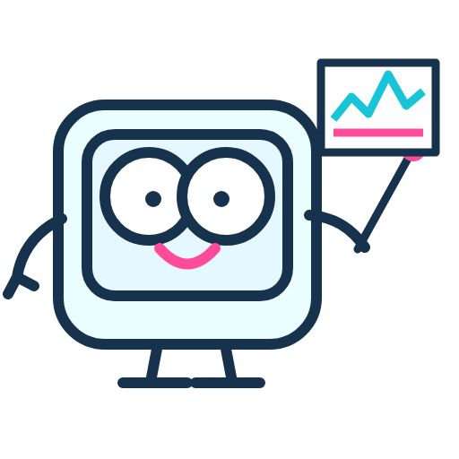
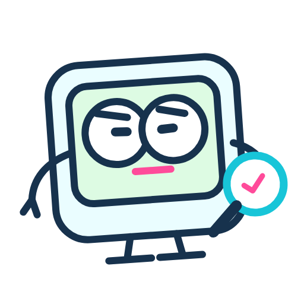
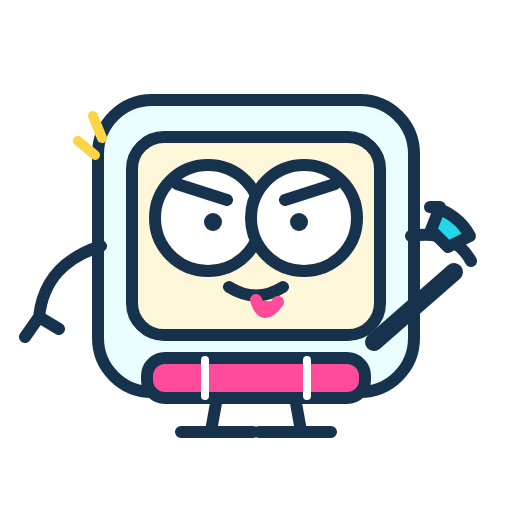
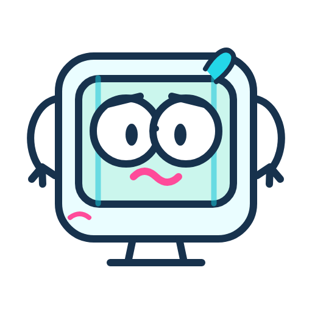
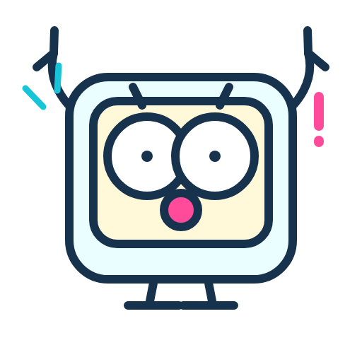
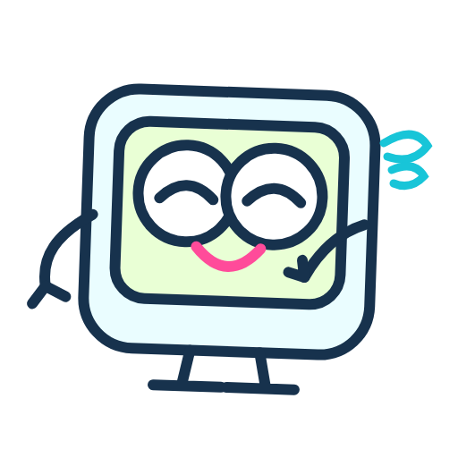

<section class="mascot-intro">
OUR LITTLE LAB COMPANION<h2>先认住这副圆眼镜。</h2>
方形显示器是身体，短支架像小小的双脚，青色与粉色留下熟悉的轮廓。它把 FPGA 教学里偏硬的信号、接口和时序，变成一个可以跟着逛、一起思考的角色。

</section>

## 同一个角色，八种心情

<section><h3>讲解</h3>
拿起波形卡片，把关键变化讲清楚。
</section><section><h3>思考</h3>
遇到新问题，先停下来找规律。
</section><section><h3>专注</h3>
观察一根信号，也值得认真一点。
</section><section><h3>维修</h3>
代码没对上现象，一起查查哪里出了错。
</section><section><h3>紧张</h3>
第一次点运行前，难免有点忐忑。
</section><section><h3>惊讶</h3>
预期之外的结果，也可能是新线索。
</section><section><h3>松口气</h3>
找到原因，终于能解释刚才发生了什么。
</section><section><h3>庆祝</h3>
跑通这一关，给自己的耐心鼓个掌。
</section>

## 它怎样出现在这个网站里

在教学入口，它引导你去看一次真实操作；在排查与方法页，它陪着整理问题；在功能演示和更新里，它为不同段落留下统一的记忆。右下方的小伙伴可以随时展开导航，回到练习、认识角色或找到创作者。

## 可爱之外，也有分寸

吉祥物出现的位置要为内容留出空间。文字、按钮和波形先被看清，表情再为这一刻添一点温度；手机采用更小的导航角色，访客不用追着动效才能完成操作。

[[platform|看看它陪伴的教学平台]] · [[content-creation|功能演示与视频]] · [[contact|去找地瓜丸→]]
