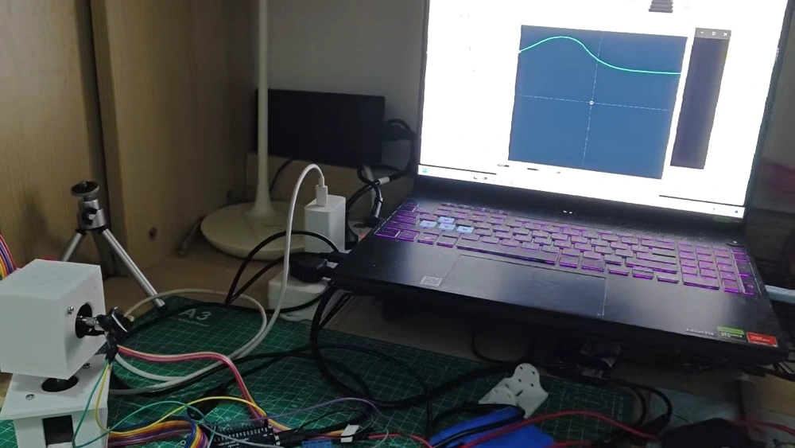
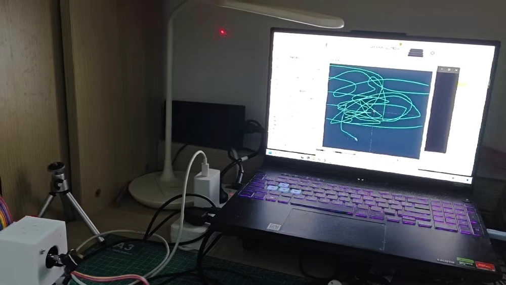
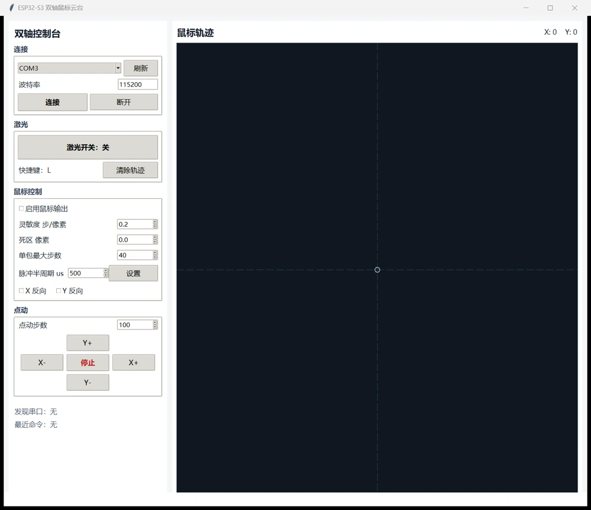
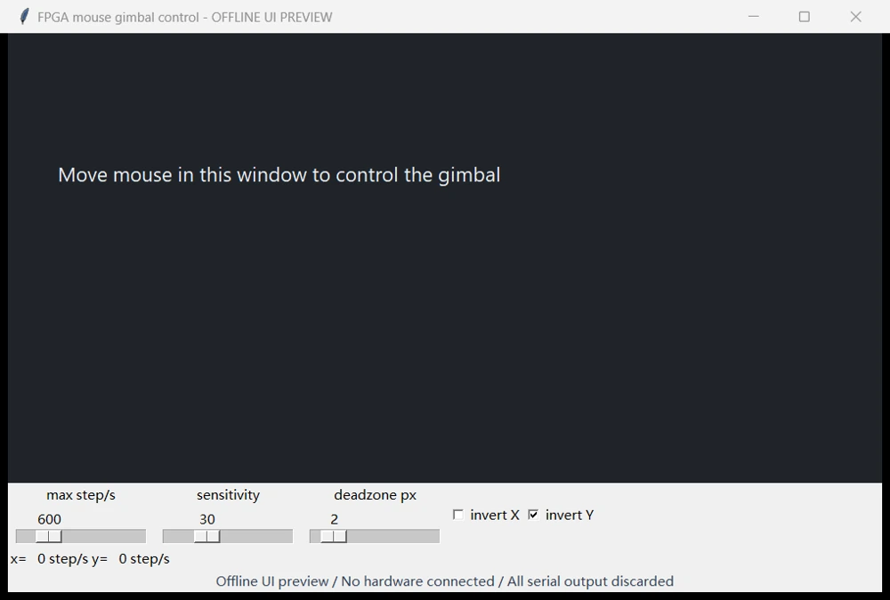
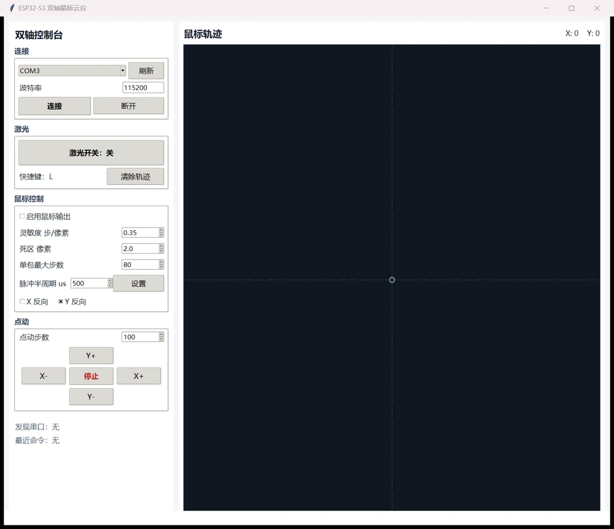
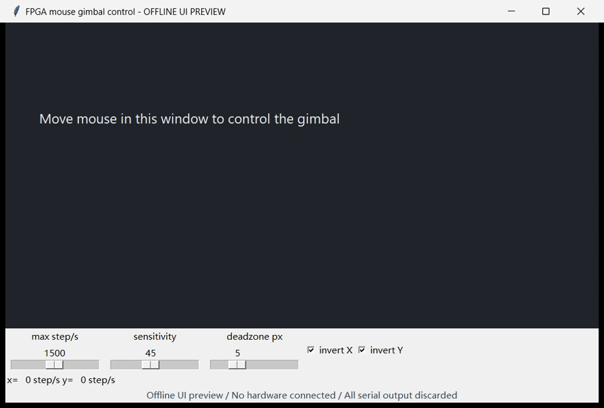
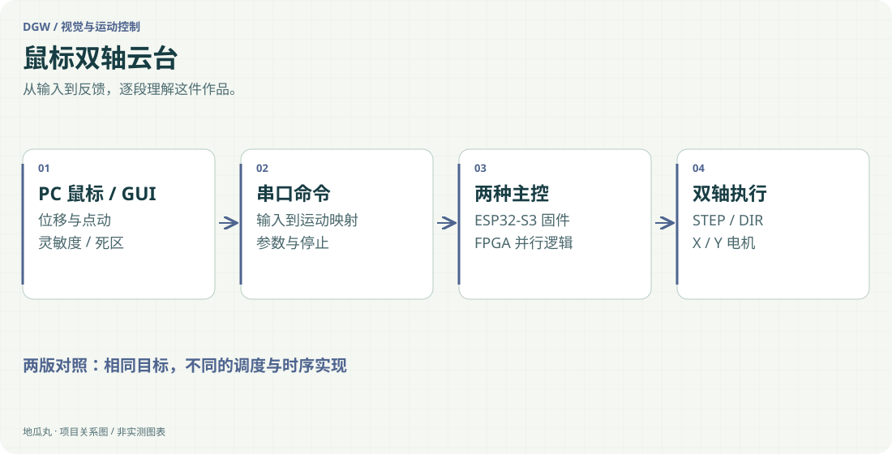

地瓜丸的工作室 · 其他项目
同一个鼠标输入，沿两条主控路线驱动双轴机构。

Python GUIUARTESP32-S3 / ESP-IDFVerilog RTLSTEP / DIRZDT X42S

<aside class="project-stage"><strong>这件作品进行到哪里</strong>新增鼠标控制云台完整实拍；ESP32-S3 与 FPGA 两版接口和参数分别对照</aside>

<section aria-label="鼠标云台现场演示"><figure id="shot-mouse-gimbal-hardware" class="evidence-shot"><figcaption>现场实拍截帧鼠标控制云台的现场布置；电脑轨迹窗口、主控连线与两轴机构同时可见。点击看原图 ↗</figcaption></figure>

<figure id="video-mouse-gimbal-live-20261110" class="field-media"><video controls playsinline preload="none" poster="assets/project-evidence/mouse-gimbal-trail.webp"><source src="https://dgwfpga.cn/portfolio-media/20261109/videos/projects/mouse-gimbal-live-20261110.mp4" type="video/mp4">当前浏览器不支持内嵌视频，可使用下方原视频入口。</video><figcaption>完整实拍 · 15 秒<strong>鼠标一动，轨迹与机构一起看</strong>完整 14.6 秒实拍，观察电脑端鼠标轨迹以及现场云台与指向变化。 <a href="https://dgwfpga.cn/portfolio-media/20261109/videos/projects/mouse-gimbal-live-20261110.mp4" target="_blank" rel="noopener">打开完整视频 ↗</a></figcaption></figure>

<figure id="shot-mouse-gimbal-trail" class="evidence-shot"><figcaption>现场实拍截帧轨迹区经过连续鼠标操作后的画面；可与完整视频对照。点击看原图 ↗</figcaption></figure></section>

<nav class="evidence-nav" aria-label="项目截图导览"><strong>上位机界面对照 · 5 张</strong><a href="#shot-mouse-esp32-main">01</a><a href="#shot-mouse-esp32-track">02</a><a href="#shot-mouse-fpga-main">03</a><a href="#shot-mouse-esp32-parameters">04</a><a href="#shot-mouse-fpga-parameters">05</a></nav>

<figure id="shot-mouse-esp32-main" class="evidence-shot"><figcaption>未连接设备的原 GUIESP32-S3 版初始界面：串口、点动、激光开关与鼠标参数。未连接主控。点击看原图 ↗</figcaption></figure>

## 把鼠标动作变成可控的两轴运动

这件作品以电脑鼠标作为输入，通过中文界面调节灵敏度、速度和死区，再将命令发送给主控，驱动两台闭环步进电机。除了连续鼠标控制，还保留点动和激光开关，方便先检查方向与单轴动作，再进入完整交互。

<figure id="shot-mouse-esp32-track" class="evidence-shot"><figcaption>未连接设备的原 GUI在原轨迹区移动鼠标后留下的路径；这里只演示软件输入，没有发送电机命令。点击看原图 ↗</figcaption></figure>

## 同一条链路，两种实现

ESP32-S3 版本使用 ESP-IDF 固件接收串口命令并输出 STEP／DIR 脉冲，另有 Arduino 版本备份。FPGA 版本将串口接收、命令解析与两路脉冲发生组织成硬件逻辑，并保留状态指示。两版共用“电脑解释输入、主控执行时序、电机完成动作”的分工，但不能把一版的引脚、协议与配置直接套给另一版。

<figure id="shot-mouse-fpga-main" class="evidence-shot"><figcaption>未连接设备的原 GUIFPGA 版原控制窗口与速度、灵敏度、死区设置。离线适配器阻断全部串口输出。点击看原图 ↗</figcaption></figure>

## 交互参数要能解释动作

灵敏度决定输入和运动的比例，死区减少静止附近的细小变化，速度限制则控制动作的激烈程度。鼠标停下之后怎样停止输出，同样是交互的一部分。中文 GUI 与串口协议使输入、命令和实际动作更容易逐步对照，也为后续接入视觉坐标留下清晰接口。

<figure id="shot-mouse-esp32-parameters" class="evidence-shot"><figcaption>未连接设备的原 GUIESP32-S3 版的灵敏度、死区、最大步数与方向设置；未连接设备。点击看原图 ↗</figcaption></figure>

<figure id="shot-mouse-fpga-parameters" class="evidence-shot"><figcaption>未连接设备的原 GUI调整 FPGA 版参数后的界面；展示参数入口，不代表电机已执行。点击看原图 ↗</figcaption></figure>

## 从能动到可联调

项目材料按硬件、接线、固件、GUI、协议与常见问题组织。实践时先核对供电、共地与两轴方向，再用小范围点动检查执行链；确认命令能被接收之后，才调节连续输入的手感。电机自身闭环与系统级视觉闭环是不同层次，不能因为使用闭环电机就声称完成了位置视觉反馈。

## 作品展示的重点

现有两条工程都保留实现与说明，本页对比的是软件任务与硬件并行逻辑如何承担同一种控制接口。未公开本机配置或整包工程，也不把未经同条件测量的实时性、精度和流畅程度写成胜负结论。它与自动追踪项目共用部分执行链，但鼠标版仍以人工输入为目标。

查看功能路径示意

<figure class="case-figure"><a class="case-image-link" href="assets/projects/mouse-gimbal.svg"><picture><source media="(max-width:600px)" srcset="assets/projects/mouse-gimbal-mobile.svg" width="460" height="1000"></picture></a><figcaption>依据项目资料整理的功能关系示意；实际阶段见正文。点击查看大图 ↗</figcaption></figure>

## 源码与复现

[鼠标控制双轴云台 · 两条主控路线 · 查看 GitHub 源码](https://github.com/bvsdehdshfbs300-debug/dgw-mouse-gimbal)

仓库提供代码入口、接线／协议和运行说明，按 MIT 发布；构建与验证范围单独记录。模型权重、数据集和个人配置不随代码公开。

## 继续阅读

[[projects|更多作品]] · [[platform|地瓜丸的 FPGA 教学平台]] · [[contact|去找地瓜丸→]]

