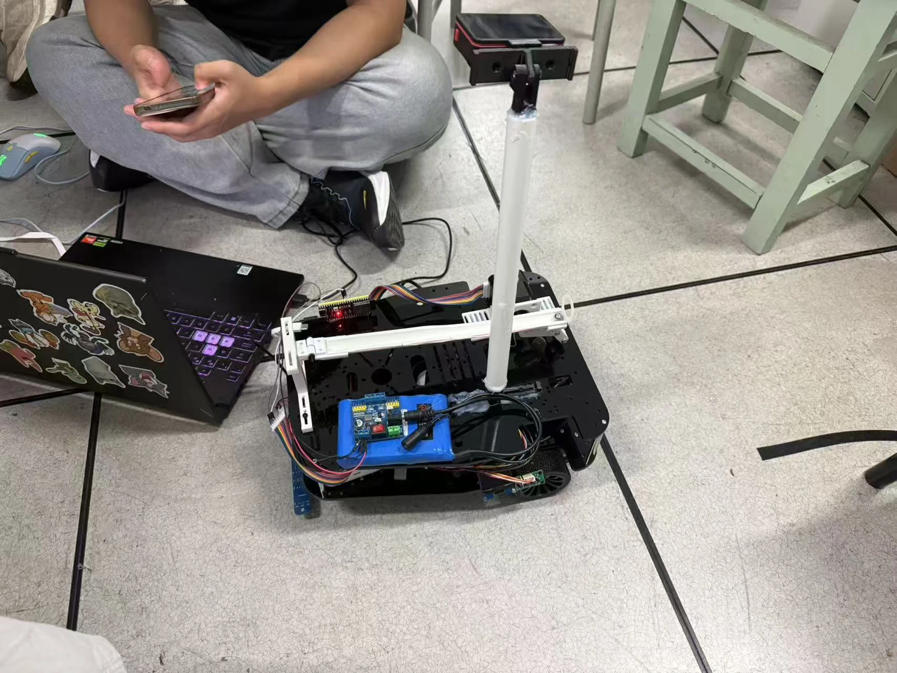

地瓜丸 · 2026.11.09
最近在补的， 是让作品自己说话的材料。

教学平台继续作为主线。介绍站新增功能实景，也把车载滚球与 MaixCAM 的原始演示放进了项目页。

<figure class="case-figure field-frame"><figcaption>新整理的车载滚球整机照片。点击看原图 ↗</figcaption></figure>
<table class="field-table"><thead><tr><th>目前可查看</th><th>具体内容</th><th>入口</th></tr></thead><tbody><tr><td>教学平台</td><td>31 关、8 章、4.1 外设与逐针手册。</td><td><a href="platform.html">平台介绍 →</a></td></tr><tr><td>功能实景</td><td>29 张不同功能截图，可分类和查看原图。</td><td><a href="feature-tour.html">打开图鉴 →</a></td></tr><tr><td>滚球系统</td><td>整机照片与 3 段实拍。</td><td><a href="ball-balance.html">看现场 →</a></td></tr><tr><td>自动识别瞄准</td><td>4 分 52 秒原片与章节跳转。</td><td><a href="maixcam-tracking.html">看演示 →</a></td></tr><tr><td>其他项目</td><td>感知、控制、桌面工具和交互原型。</td><td><a href="projects.html">项目总览 →</a></td></tr></tbody></table>

## 接下来继续从使用反馈里找问题

课程里哪里难理解，界面哪里难操作，视频哪里没把功能演示完整，都继续作为改进线索。具体完成的改动再进入项目记录。

<nav class="field-read-next" aria-label="继续阅读"><a href="timeline.html">更新记录 →</a><a href="contact.html">去找地瓜丸 →</a></nav>
