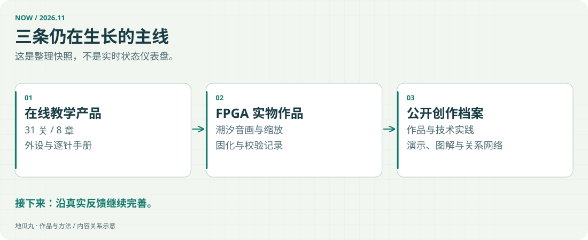

<!-- note-visuals-20261108 -->

<figure class="case-figure note-visual note-diagram"><a class="case-image-link" href="assets/notes/now.svg"><picture><source media="(max-width:600px)" srcset="assets/notes/now-mobile.svg" width="460" height="776"></picture></a><figcaption>截至 2026-11-08 的作品整理快照；具体情况见各项目页。点击查看大图 ↗</figcaption></figure>

## 已完成的近期工作

FPGA 教学平台已更新到 31 关、8 章，外设与逐针手册纳入同一套三维桌面；课程空位增加吉祥物漫画，社区动态支持连续同关运行合并。

这个公开档案把作品、能力、问题记录与协作方法连起来，方便从不同入口了解同一个项目。

## 新整理的案例

2026-11-08，为[[platform|教学平台]]、[[tide-composer|潮汐作曲家]]和[[maintenance|网站维护]]补入真实图片、具体工作与验证过程；[[skills|能力页]]可以沿作品继续阅读。

档案的 22 个内容页现均配有对应图片：功能页展示真实操作，协作与方法页用图解说明；手机使用独立排版的竖向示意图。

2026-11-09，以 FPGA 教学平台重构介绍站，新增交互板卡、完整演示、吉祥物专区与[[projects|其他项目总览]]；图片与视频使用国内服务器地址。

## 继续关注的方向

提升课程的教学价值，让复杂概念有更明确的观察方式；制作更完整的功能演示；继续改善电脑和手机上的使用体验；根据真实反馈确定下一项值得做的改动。

以上是关注方向，不代表具体功能已经排期或完成。后续确定的结果会进入更新记录。

## 资料日期

最近整理日期：2026-11-09。这里是持续维护的公开记录，不是实时运行状态页。

## 继续探索

- [[timeline|项目更新与成长记录]]
- [[decisions|做取舍的几个原则]]
- [[content-creation|教学视频与功能演示]]
- [[contact|去找地瓜丸→]]

[[index|回到档案首页]]
