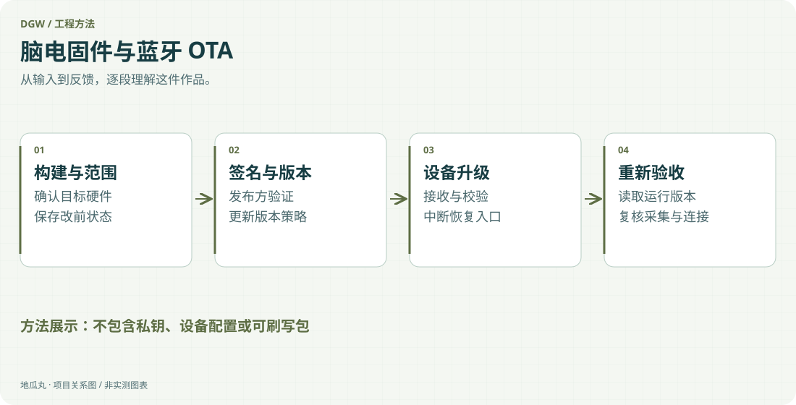

地瓜丸的工作室 · 其他项目
一次无线升级，背后是构建、签名、版本与恢复路径的配合。

Secure DFUBootloader签名验证版本策略构建与回读

<aside class="project-stage"><strong>这件作品进行到哪里</strong>只展示工程方法；不公开密钥、设备配置、固件包或签名材料</aside>

<figure class="case-figure"><a class="case-image-link" href="assets/projects/ota-method.svg"><picture><source media="(max-width:600px)" srcset="assets/projects/ota-method-mobile.svg" width="460" height="1000"></picture></a><figcaption>依据项目资料整理的功能关系示意；实际阶段见正文。点击查看大图 ↗</figcaption></figure>

## 先定义升级边界，再讨论“无线”

给采集设备加上 OTA，不只是把固件通过蓝牙发过去。应用、无线协议栈、Bootloader 与持久数据必须有清楚的责任边界，才能解释设备为什么进入升级、怎样确认包有效，以及升级之后如何返回正常采集。

## 从首刷到后续升级

这条实践路线区分两个阶段：首次通过有线调试接口建立完整启动链，后续由应用进入升级服务，再通过 BLE 接收签名包。构建产物、运行版本和设备上的实际状态需要对应，不能把普通应用镜像与首刷镜像混用。无线传输只是一段通道，真正决定是否接受更新的是设备端的校验与版本规则。

## 把可恢复性落实到流程

新包写入、完整性校验、签名验证和切换运行状态应分别留出检查点。需要关注的失败包括断连、传输中断、包不匹配和空间不足。重试能力不能靠一句“支持断点”概括，应围绕当前设备状态与明确的恢复入口检查。更新后还要复核数据输出、连接和持久配置，才算完成交付。

## 签名与版本各自解决什么

签名负责确认更新来自被信任的发布方；版本策略用于避免意外回退或同版本混淆。私钥不放在用户设备或公开项目页，公开说明也没有必要暴露设备标识、存储细节和可直接刷写的包。展示工作方法与公开可下载固件，是两种不同的交付范围。

## 怎样证明一次升级成功

已有 FUMA 分支保留首刷及 BLE OTA 的实机记录，后续 UNIT 分支有自己的编译和仿真阶段。本页只总结其中可复用的工程顺序：保存改前状态，核对兼容范围，构建并验签，执行升级，再读取版本与采集状态。它也是我处理网站上线和固件交付时共同采用的思路。

## 继续阅读

[[projects|更多作品]] · [[platform|地瓜丸的 FPGA 教学平台]] · [[contact|去找地瓜丸→]]

