
CASE 01 · 在线教学产品
让初学者在一次练习里， 把代码和电路现象对起来。

从写 Verilog、连接引脚，到运行、观察和修改，学习者可以在浏览器里走完一轮练习，再用波形和板卡手册解释眼前的结果。

<strong>31 关 / 8 章</strong>截至 2026.11 的公开课程

<strong>4.1</strong>外设实验与逐针手册

<strong>免费在线</strong>持续根据反馈迭代

<figure class="case-figure "><figcaption>4.1 功能截图：外设桌面与逐针手册一起呈现。点击查看大图 ↗</figcaption></figure>

<a href="https://dgwfpga.cn/practice/">进入练习平台 ↗</a><a href="https://dgwfpga.cn/">打开产品首页 ↗</a>

<section class="owner-teaser">
平台维护 · 已接入<h3>运行可追踪，备份可核对。</h3>
学员控制台显示本次运行编号，站主可在独立管理端查询请求、区分学习问题与平台故障，并核对备份状态。
<a href="maintenance.html">看看管理台与维护实践 →</a>
<a class="case-image-link" href="assets/owner-ops-20261111/owner-overview.png">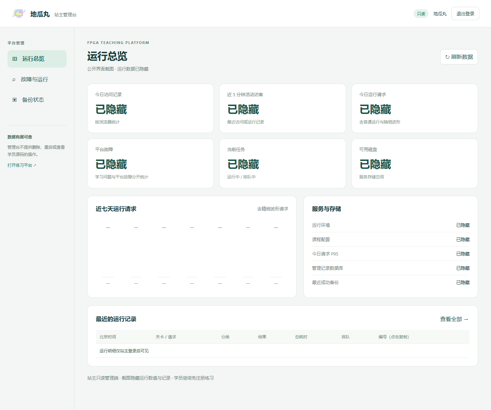</a></section>

## 一次练习怎样完成

<ol class="case-flow"><li>01<strong>理解任务</strong>
先知道目标现象和接口要求。
</li><li>02<strong>编写与接线</strong>
修改 Verilog，填写 XDC 或图形连线。
</li><li>03<strong>运行与观察</strong>
查看检查结果、波形和板卡反馈。
</li><li>04<strong>定位与重试</strong>
根据现象修改，再运行验证。
</li></ol>

<figure class="case-figure "><a class="case-image-link" href="assets/cases/platform-workspace.png">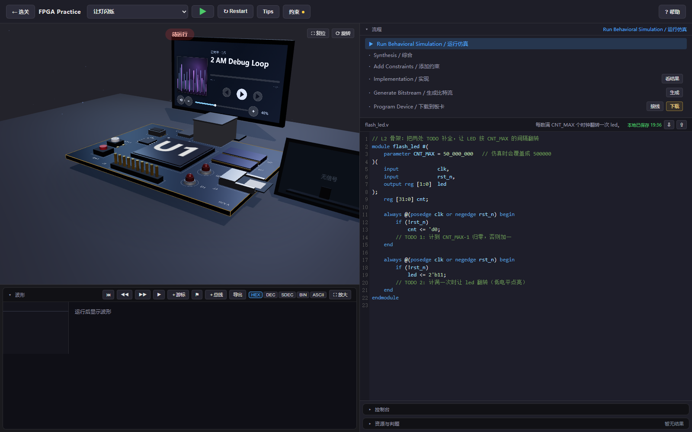</a><figcaption>练习界面存档：编辑器中的 TODO 是学员待填写模板；这张截图展示布局，未展示已通过的运行结果。点击查看大图 ↗</figcaption></figure>

## 功能逐项展开看

01 / 动手写<strong>代码、约束与一次运行</strong><b>展开演示 ＋</b>

先读任务，再写 Verilog；编辑器、约束、运行反馈和观察窗口连在一起。每次修改后都可以重新运行，沿着信号与检查结果继续定位，而不是只猜语法有没有写对。
<figure class="case-figure "><figcaption>一个学习目标，放在同一张工作台上。点击看大图 ↗</figcaption></figure>

02 / 接得上<strong>点选连线，约束跟着落下</strong><b>展开演示 ＋</b>

代码里的端口不是凭空存在的。图形连线将端口、板上针脚和 XDC 联系起来；接线后还要查看自动填写的约束。手写和图形方式都留在练习里，方便理解二者对应关系。
<figure class="case-figure "><a class="case-image-link" href="assets/showcase/constraint-wiring.gif">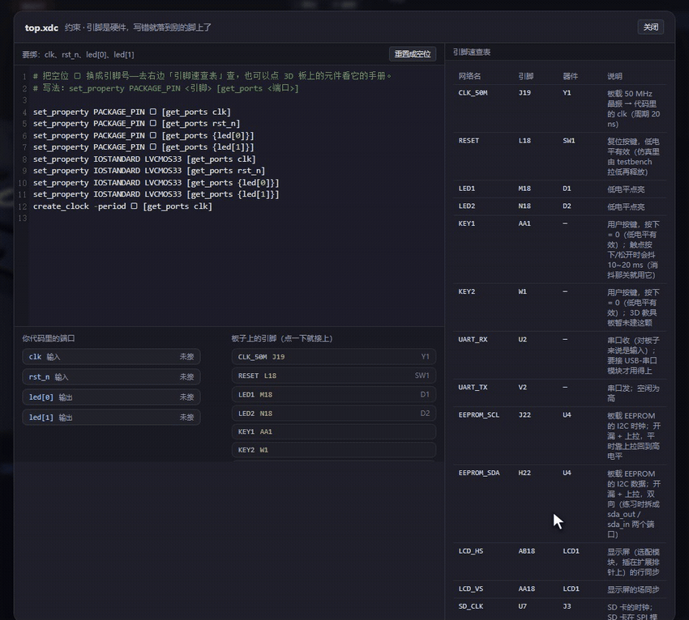</a><figcaption>真实操作录屏：端口连接到针脚，约束随之填写。点击看大图 ↗</figcaption></figure>

03 / 看得清<strong>沿波形找到问题发生的那一拍</strong><b>展开演示 ＋</b>

从长时间窗口定位密集活动，再进入局部细节。平移、缩放、跳变定位、双游标测量与进制切换各有用途：先确认要观察的问题，再选择能解释它的工具。
<figure class="case-figure "><a class="case-image-link" href="assets/notes/waveform.gif">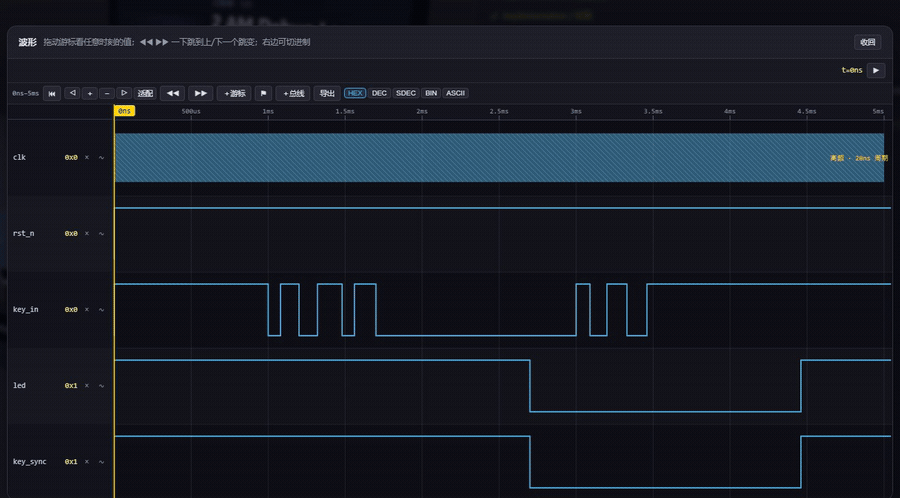</a><figcaption>真实操作录屏：时间窗口、信号和游标位置。点击看大图 ↗</figcaption></figure>

04 / 有现象<strong>LED 与屏幕，让结果看得见</strong><b>展开演示 ＋</b>

灯为什么亮、什么时候翻转，需要和代码里的计数、状态及输出电平一起看。教学桌面让波形中的变化有直观反馈；显示关卡还可以把行场时序还原成一帧画面。
<figure class="case-figure "><a class="case-image-link" href="assets/notes/led-feedback.gif">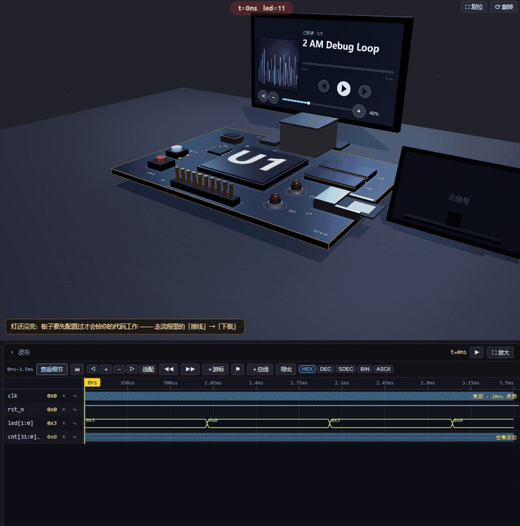</a><figcaption>真实操作录屏：波形时间位置与虚拟 LED 对应。点击看大图 ↗</figcaption></figure>

05 / 查得到<strong>元件不是摆设，手册紧挨着器件</strong><b>展开演示 ＋</b>

从器件名称到接口，再到针号、方向和对端，资料应能顺着问题找到。完整硬件桌面覆盖所有关卡，逐针手册帮助学习者核对连线，而不是在好几个文档之间来回找。
<figure class="case-figure "><a class="case-image-link" href="assets/showcase/board-manual.gif">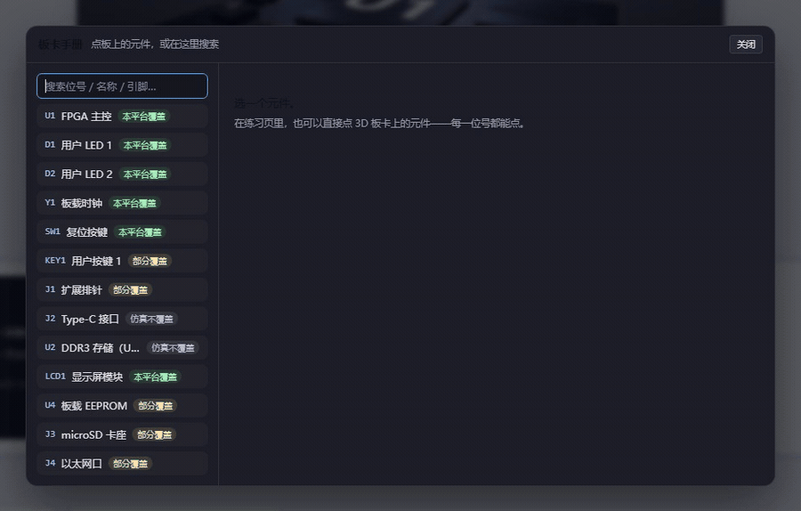</a><figcaption>真实操作录屏：点击板上元件，继续查资料。点击看大图 ↗</figcaption></figure>

06 / 往深处走<strong>从一颗灯，走到数据流与外设</strong><b>展开演示 ＋</b>

31 个公开关卡分成 8 章，从组合逻辑、时钟计数和状态机，延伸到 UART、I²C、显示、FIFO、网络、高速流及独立外设实验。每关先抓住一个能观察、能判断的关键行为。
<figure class="case-figure "><a class="case-image-link" href="assets/notes/screen-display.gif">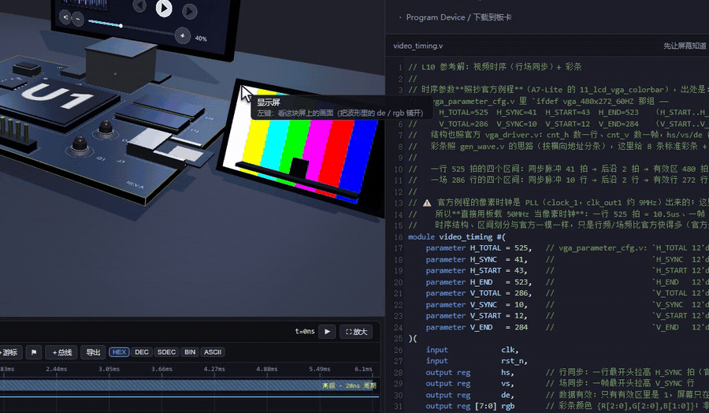</a><figcaption>真实显示关卡录屏：彩条、像素位置与时序说明。点击看大图 ↗</figcaption></figure>

<!-- feature-gallery-20261109 -->

## 29 张实景，把平台的不同侧面展开

不只给板卡一个镜头：下面分别看编辑、接线、波形、显示、数字系统与外设。点开原图可在新标签继续放大。

<section class="feature-gallery"><nav class="gallery-filter" aria-label="按功能筛选截图"><button type="button" data-gallery-group="all" aria-pressed="true">全部 29 张</button><button type="button" data-gallery-group="编辑与约束" aria-pressed="false">编辑与约束</button><button type="button" data-gallery-group="波形分析" aria-pressed="false">波形分析</button><button type="button" data-gallery-group="屏幕与交互" aria-pressed="false">屏幕与交互</button><button type="button" data-gallery-group="协议与存储" aria-pressed="false">协议与存储</button><button type="button" data-gallery-group="运行与保存" aria-pressed="false">运行与保存</button><button type="button" data-gallery-group="4.1 外设实验" aria-pressed="false">4.1 外设实验</button><button type="button" data-gallery-group="课程与吉祥物" aria-pressed="false">课程与吉祥物</button></nav>
正在展示 29 张真实功能截图

<figure class="gallery-card" data-group="编辑与约束"><a class="case-image-link gallery-full" href="assets/feature-tour/current-workspace.webp">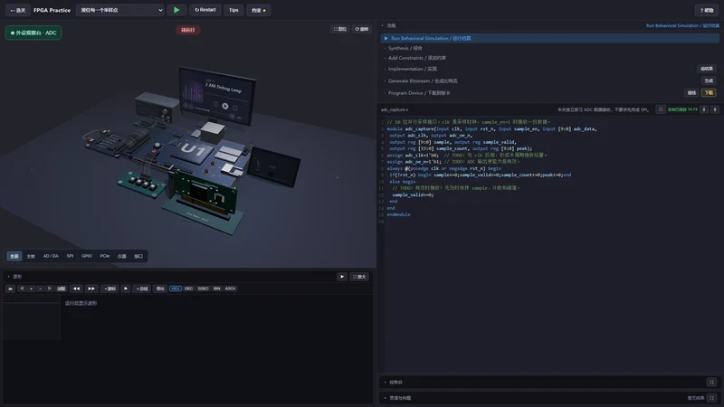</a><figcaption>编辑与约束<h3>当前工作台：主板、外设与代码同屏</h3>
本轮从正式站拍摄的 ADC 关卡初始界面：代码为待完成模板，尚未运行。
点击看完整原图 ↗</figcaption></figure><figure class="gallery-card" data-group="编辑与约束"><a class="case-image-link gallery-full" href="assets/feature-tour/01-code-diagnostics.webp">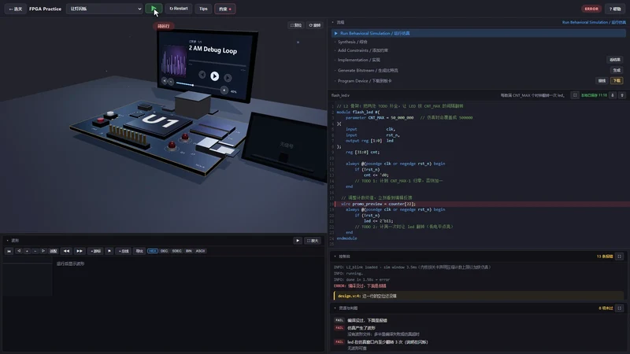</a><figcaption>编辑与约束<h3>编辑器与错误定位</h3>
故意引入错误后，编辑器定位行号，控制台与判题区共同给出反馈。
点击看完整原图 ↗</figcaption></figure><figure class="gallery-card" data-group="编辑与约束"><a class="case-image-link gallery-full" href="assets/feature-tour/02-xdc-auto-fill.webp">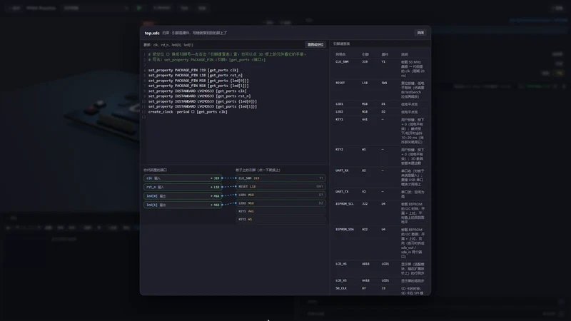</a><figcaption>编辑与约束<h3>连线之后，约束自动填写</h3>
时钟、复位与两路 LED 完成连接，生成的 XDC 语句和 20ns 时钟约束同时可见。
点击看完整原图 ↗</figcaption></figure><figure class="gallery-card" data-group="波形分析"><a class="case-image-link gallery-full" href="assets/feature-tour/03-wave-measure.webp">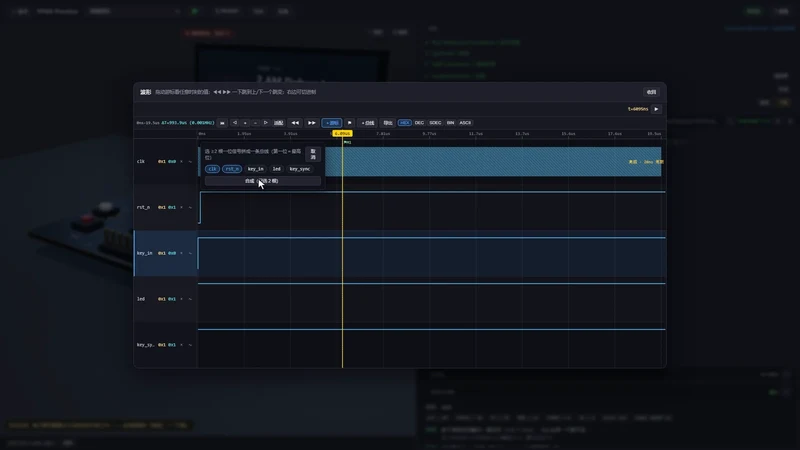</a><figcaption>波形分析<h3>时间测量、标记与虚拟总线入口</h3>
波形放大后可见 ΔT 测量值、M1 标记，以及选择信号组成虚拟总线的入口。
点击看完整原图 ↗</figcaption></figure><figure class="gallery-card" data-group="屏幕与交互"><a class="case-image-link gallery-full" href="assets/feature-tour/04-screen-colorbars.webp">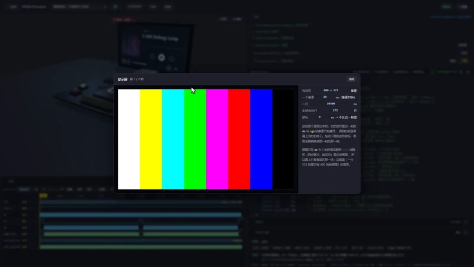</a><figcaption>屏幕与交互<h3>从行场时序到彩条</h3>
屏幕放大后呈现彩条，旁边保留像素、行场同步与数据使能信息。
点击看完整原图 ↗</figcaption></figure><figure class="gallery-card" data-group="屏幕与交互"><a class="case-image-link gallery-full" href="assets/feature-tour/05-screen-picture.webp">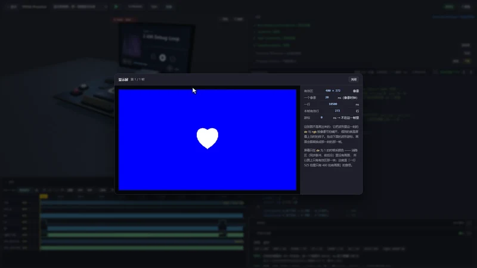</a><figcaption>屏幕与交互<h3>让数字信号变成一幅图</h3>
显示屏从 de/rgb 信号恢复图像，直接查看实际显示内容。
点击看完整原图 ↗</figcaption></figure><figure class="gallery-card" data-group="屏幕与交互"><a class="case-image-link gallery-full" href="assets/feature-tour/06-screen-animation.webp">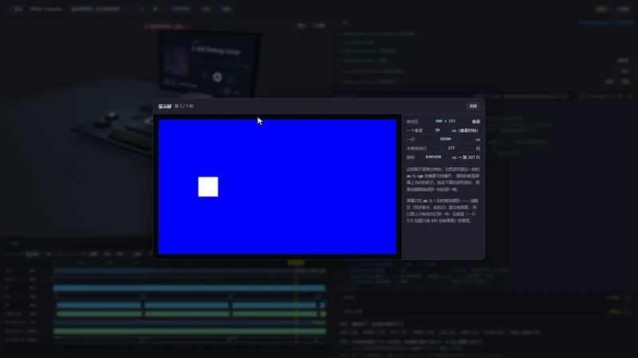</a><figcaption>屏幕与交互<h3>逐帧观察方块动画</h3>
白色方块在显示画面中出现，显示结果与运行时间相互对应。
点击看完整原图 ↗</figcaption></figure><figure class="gallery-card" data-group="屏幕与交互"><a class="case-image-link gallery-full" href="assets/feature-tour/07-key-debounce.webp">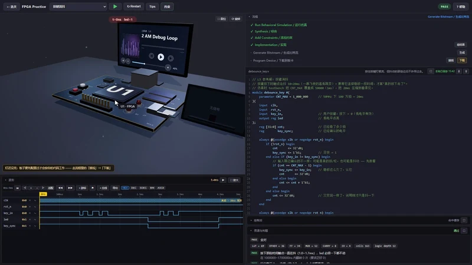</a><figcaption>屏幕与交互<h3>按键输入与消抖信号</h3>
板卡、Verilog、key_in 抖动和同步后的信号在同一工作区中对照。
点击看完整原图 ↗</figcaption></figure><figure class="gallery-card" data-group="协议与存储"><a class="case-image-link gallery-full" href="assets/feature-tour/08-uart-wave.webp">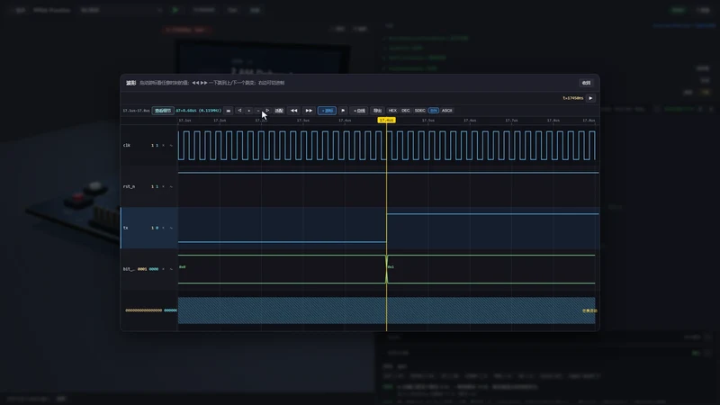</a><figcaption>协议与存储<h3>UART：把一个字节逐位发送</h3>
串口 tx 信号与时钟、复位、发送状态一起观察，分析串行发送过程。
点击看完整原图 ↗</figcaption></figure><figure class="gallery-card" data-group="协议与存储"><a class="case-image-link gallery-full" href="assets/feature-tour/09-i2c-wave.webp">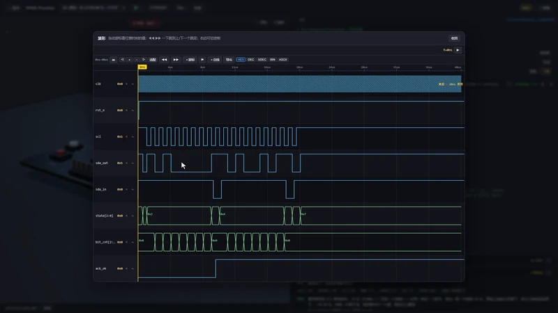</a><figcaption>协议与存储<h3>I2C：两根线上的通信</h3>
SCL、SDA 输出、从机应答与状态计数在同一时间轴上展开。
点击看完整原图 ↗</figcaption></figure><figure class="gallery-card" data-group="协议与存储"><a class="case-image-link gallery-full" href="assets/feature-tour/10-fifo-wave.webp">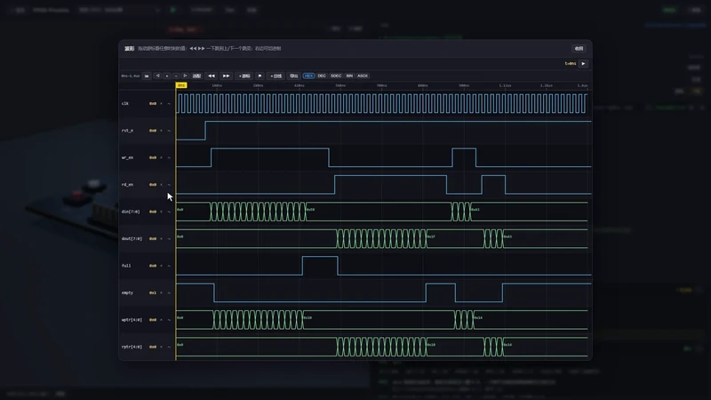</a><figcaption>协议与存储<h3>FIFO：写入、读出与满空状态</h3>
写使能、读使能、数据总线、满空标志和读写指针共同展示先入先出的行为。
点击看完整原图 ↗</figcaption></figure><figure class="gallery-card" data-group="协议与存储"><a class="case-image-link gallery-full" href="assets/feature-tour/11-udp-wave.webp">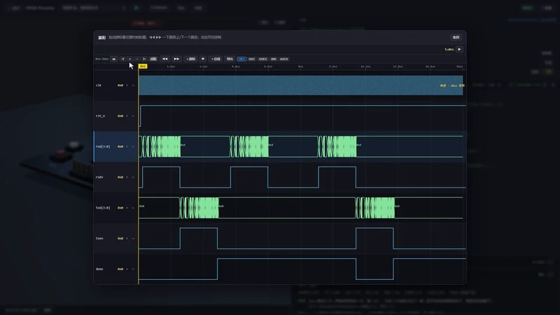</a><figcaption>协议与存储<h3>UDP：收发数据总线</h3>
接收有效、发送使能与数据总线成组出现，能对照多段收发过程。
点击看完整原图 ↗</figcaption></figure><figure class="gallery-card" data-group="运行与保存"><a class="case-image-link gallery-full" href="assets/feature-tour/12-practice-pack.webp">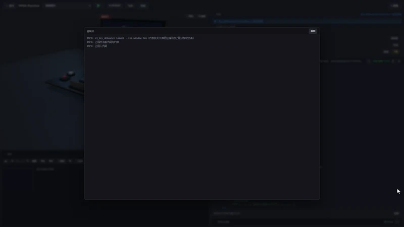</a><figcaption>运行与保存<h3>练习包导入导出的反馈</h3>
独立控制台确认当前代码已导出、已重新导入，保存操作有明确回执。
点击看完整原图 ↗</figcaption></figure><figure class="gallery-card" data-group="运行与保存"><a class="case-image-link gallery-full" href="assets/feature-tour/13-code-led.webp">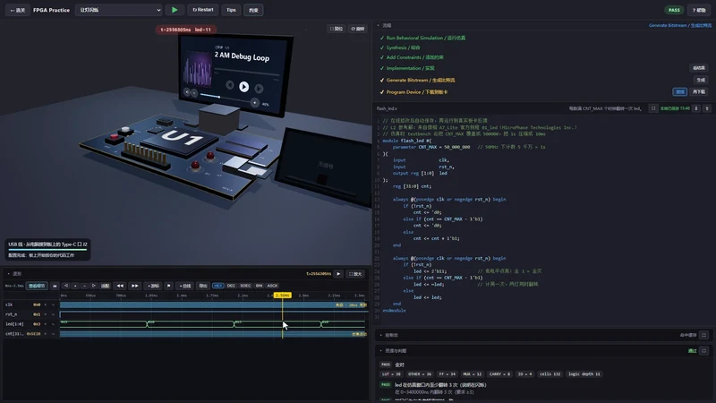</a><figcaption>运行与保存<h3>从代码运行到 LED 反馈</h3>
代码、成功流程、板卡与波形同屏呈现，看到一次完整练习的结果。
点击看完整原图 ↗</figcaption></figure><figure class="gallery-card" data-group="协议与存储"><a class="case-image-link gallery-full" href="assets/feature-tour/14-rom-wave.webp">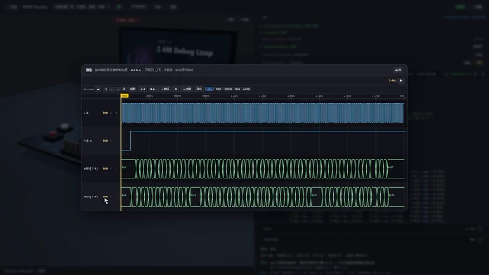</a><figcaption>协议与存储<h3>ROM：地址变化，查表输出</h3>
连续地址访问与 dout 数据变化放在同一时间轴，观察查表逻辑。
点击看完整原图 ↗</figcaption></figure><figure class="gallery-card" data-group="协议与存储"><a class="case-image-link gallery-full" href="assets/feature-tour/15-ram-wave.webp">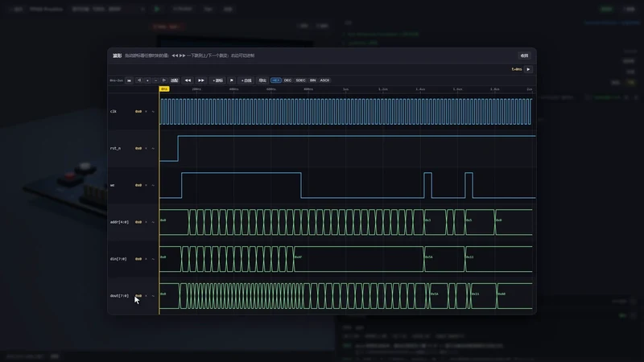</a><figcaption>协议与存储<h3>RAM：写进去，再读出来</h3>
写使能、地址、输入数据和输出数据同时显示，跟踪存储器读写关系。
点击看完整原图 ↗</figcaption></figure><figure class="gallery-card" data-group="协议与存储"><a class="case-image-link gallery-full" href="assets/feature-tour/16-spi-sd-wave.webp">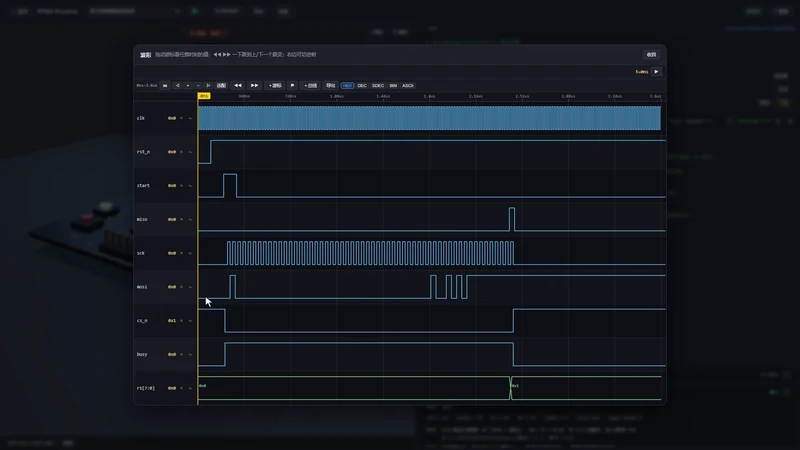</a><figcaption>协议与存储<h3>SPI / SD：命令与响应</h3>
片选、时钟、MOSI、MISO、忙状态和响应值在一张波形中展开。
点击看完整原图 ↗</figcaption></figure><figure class="gallery-card" data-group="协议与存储"><a class="case-image-link gallery-full" href="assets/feature-tour/17-arp-wave.webp">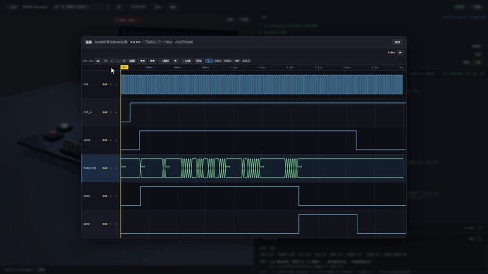</a><figcaption>协议与存储<h3>ARP：请求如何发出去</h3>
请求控制、发送数据、发送使能与完成信号组成可追踪的链路。
点击看完整原图 ↗</figcaption></figure><figure class="gallery-card" data-group="波形分析"><a class="case-image-link gallery-full" href="assets/feature-tour/18-pwm-wave.webp">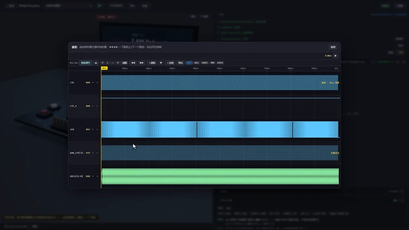</a><figcaption>波形分析<h3>PWM：密集脉冲与占空比</h3>
完整时间窗展示 PWM 脉冲密度与 duty 变化，适合说明为何需要进一步放大分析。
点击看完整原图 ↗</figcaption></figure><figure class="gallery-card" data-group="波形分析"><a class="case-image-link gallery-full" href="assets/feature-tour/19-traffic-state.webp">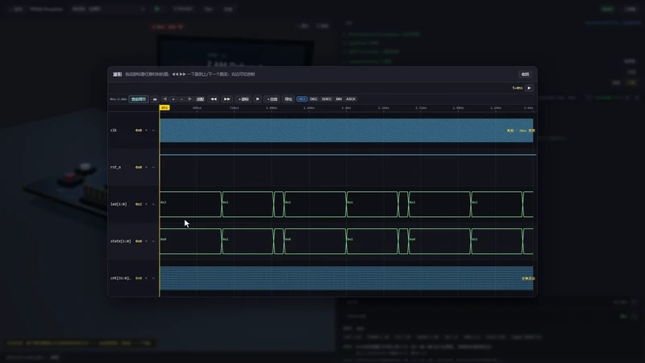</a><figcaption>波形分析<h3>状态机：状态与 LED 一起看</h3>
state 与 led 总线在同一刻度变化，观察交通灯状态之间的切换关系。
点击看完整原图 ↗</figcaption></figure><figure class="gallery-card" data-group="4.1 外设实验"><a class="case-image-link gallery-full" href="assets/feature-tour/20-hardware-overview.webp">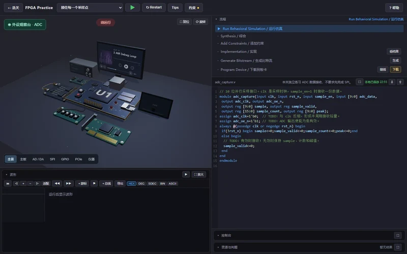</a><figcaption>4.1 外设实验<h3>外设齐备的 3D 硬件桌面</h3>
主板、AD/DA、SPI、GPIO、PCIe、屏幕与仪器组成一个可切换观察的实验桌面。
点击看完整原图 ↗</figcaption></figure><figure class="gallery-card" data-group="4.1 外设实验"><a class="case-image-link gallery-full" href="assets/feature-tour/21-adc-capture.webp">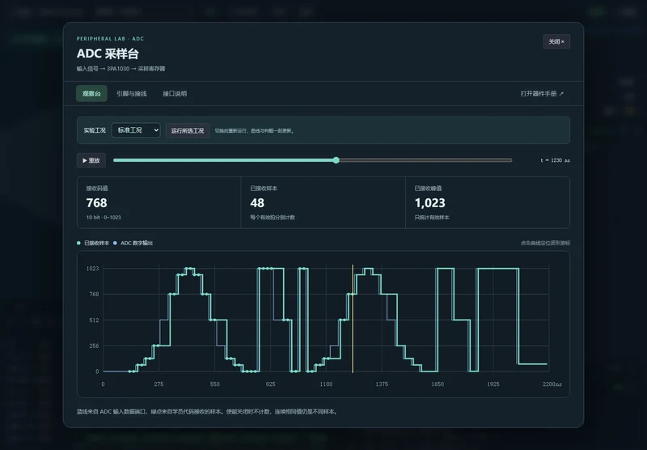</a><figcaption>4.1 外设实验<h3>ADC：采样曲线与统计</h3>
接收码值、样本数、峰值和采样曲线同屏显示，区分输入数据与已接收样本。
点击看完整原图 ↗</figcaption></figure><figure class="gallery-card" data-group="4.1 外设实验"><a class="case-image-link gallery-full" href="assets/feature-tour/22-dac-wave.webp">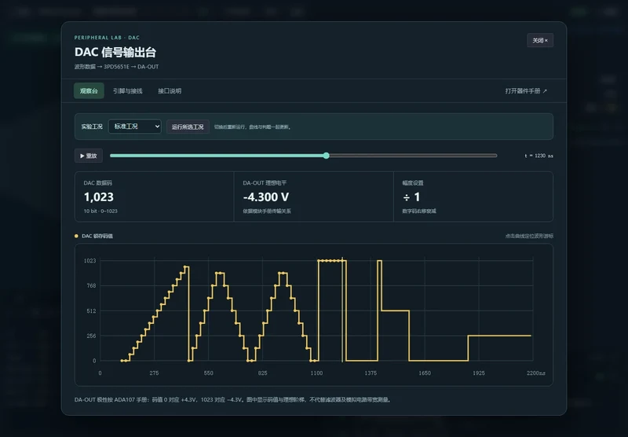</a><figcaption>4.1 外设实验<h3>DAC：数字码与输出曲线</h3>
显示 DAC 码值、幅度设置与锁存输出曲线，观察波形生成和保持。
点击看完整原图 ↗</figcaption></figure><figure class="gallery-card" data-group="4.1 外设实验"><a class="case-image-link gallery-full" href="assets/feature-tour/23-spi-register.webp">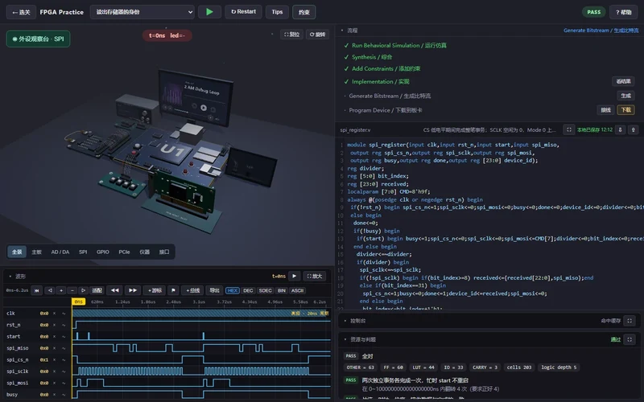</a><figcaption>4.1 外设实验<h3>SPI：读取存储器身份</h3>
实际 SPI 时序、Verilog 与通过结果同屏，观察命令发送和接收过程。
点击看完整原图 ↗</figcaption></figure><figure class="gallery-card" data-group="4.1 外设实验"><a class="case-image-link gallery-full" href="assets/feature-tour/24-gpio-direction.webp">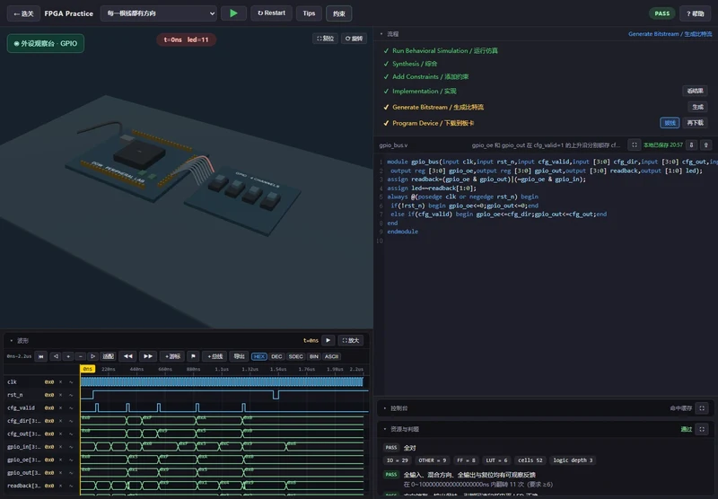</a><figcaption>4.1 外设实验<h3>GPIO：方向配置与读回</h3>
四路 GPIO 实验与配置代码同屏，波形展示方向、输出和读回的变化。
点击看完整原图 ↗</figcaption></figure><figure class="gallery-card" data-group="4.1 外设实验"><a class="case-image-link gallery-full" href="assets/feature-tour/25-pcie-transactions.webp">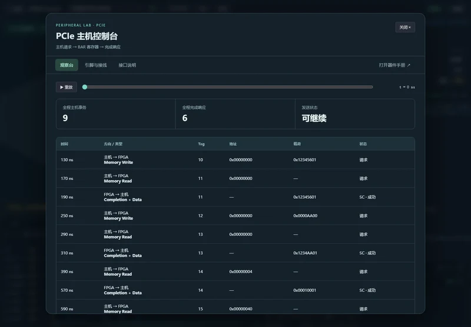</a><figcaption>4.1 外设实验<h3>PCIe：请求与完成响应</h3>
事务表列出 Memory Write、Memory Read 与 Completion + Data，对照 Tag、地址和载荷。
点击看完整原图 ↗</figcaption></figure><figure class="gallery-card" data-group="4.1 外设实验"><a class="case-image-link gallery-full" href="assets/feature-tour/26-pin-manual.webp">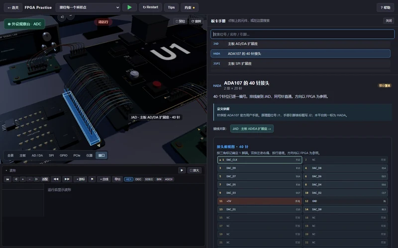</a><figcaption>4.1 外设实验<h3>逐针手册与实体接线相互对应</h3>
选中 40 针接口后，同时查看接线关联、定义依据与逐针编号表。
点击看完整原图 ↗</figcaption></figure><figure class="gallery-card" data-group="4.1 外设实验"><a class="case-image-link gallery-full" href="assets/feature-tour/27-scope-view.webp">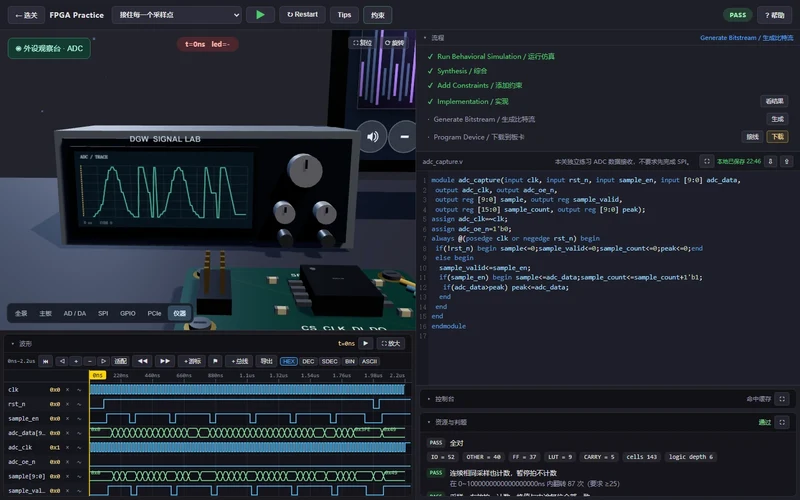</a><figcaption>4.1 外设实验<h3>仪器、代码和波形联动</h3>
桌面仪器显示 ADC 曲线，旁边保留对应代码、数字波形与通过结果。
点击看完整原图 ↗</figcaption></figure><figure class="gallery-card" data-group="课程与吉祥物"><a class="case-image-link gallery-full" href="assets/feature-tour/28-course-hardware.webp">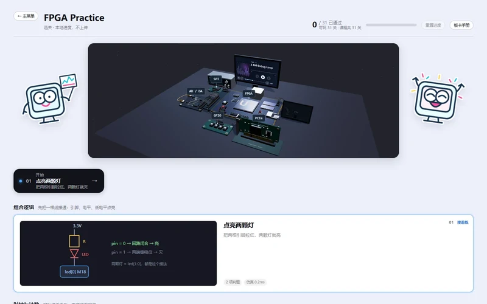</a><figcaption>课程与吉祥物<h3>课程入口与硬件全景</h3>
课程页以硬件全景、少量设备标注和两侧吉祥物引导学习入口。
点击看完整原图 ↗</figcaption></figure>
</section>

## 3D 硬件桌面，直接动手试

浏览器里的硬件桌面<h3>亲手转一圈，点开每个器件。</h3>
主板、AD/DA、SPI、GPIO、PCIe 与接口，在同一张桌面上。
<button type="button" data-load-board="https://dgwfpga.cn/portfolio-media/20261109/board-viewer/">打开交互式 3D 板卡 →</button><small>按需加载 · 拖动旋转 · 元件可点击</small>

## 完整操作演示

<figure class="video-feature"><video controls playsinline preload="none" poster="assets/notes/promo-cover.png" aria-label="平台功能实操宣传片"><source src="https://dgwfpga.cn/portfolio-media/20261109/videos/fpga-platform.mp4" type="video/mp4"><a href="https://dgwfpga.cn/portfolio-media/20261109/videos/fpga-platform.mp4">打开演示视频</a></video><figcaption>平台功能实操宣传片 · 点击播放，支持全屏。<a href="https://dgwfpga.cn/portfolio-media/20261109/videos/fpga-platform.mp4" target="_blank" rel="noopener">单独打开 ↗</a></figcaption></figure>

## 我怎样推进这个产品

<section>我推进的工作
确定教学方向和交互要求；检查预览；根据学员反馈选择下一项改动，并决定何时上线。
</section><section>AI 辅助的工作
协助页面与关卡实现、测试脚本、部署操作和更新文档；实现结果经过预览与验收。
</section><section>工程基础与协作
使用开源网页与数字逻辑工具构建；课程与界面在持续反馈中迭代。
</section>

## 三次具体的设计取舍

<section>01 / 观察<h3>密集波形看不清</h3>
长时间窗口里，时钟跳变会挤成一片。波形台增加测量、跳变定位与局部精细查看，让学习者能进入具体时间段。
<a href="waveform.html">查看波形设计 →</a></section><section>02 / 接线<h3>元件和手册要对应</h3>
板上排针、接线终点与手册采用一致编号，查元件时能继续查到每一针，减少在多个页面间来回寻找。
<a href="hardware.html">查看硬件与手册 →</a></section><section>03 / 阅读<h3>小屏幕也要能查资料</h3>
手册目录和正文分别滚动，长文本换行，调整暗色背景下的文字对比度；代码、控制台等区域也提供更大的查看空间。
<a href="interaction.html">查看交互改动 →</a></section>

<h3>从功能存在，到功能能被找到</h3>
我反复检查的不是页面里放了多少功能，而是学习者在需要时能否找到、看清并使用它。手机手册与桌面界面的阅读方式因此分别处理。

这些调整同时连接教学设计、界面设计与反馈处理。

<figure class="case-figure portrait"><a class="case-image-link" href="assets/cases/platform-manual-mobile.png">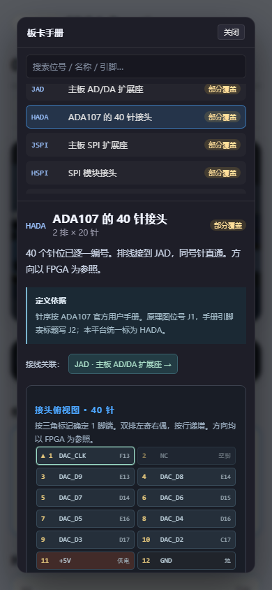</a><figcaption>手机手册真实截图；与桌面采用不同的阅读布局。点击查看大图 ↗</figcaption></figure>

## 结果与当前阶段

- 平台已公开提供从数字逻辑基础到高速数据流、ADC / DAC / SPI / GPIO / PCIe 的练习路径。
- 代码、约束、波形、三维教具和手册放在同一套练习流程中。
- 网页中的板卡用于学习与观察；实体硬件的电气、时序和板级验证有单独的工作。

<aside class="mascot-note">
<strong>这件作品对应的能力</strong>
把学习目标转成产品流程，再用预览、学员反馈和验证推动改进。可以沿右侧能力入口，继续看其他案例。

</aside>

## 继续阅读

[[skills|技术能力与作品]] · [[maintenance|网站如何持续运行]] · [[tide-composer|潮汐作曲家：另一个 FPGA 实物项目]]
