<section class="mascot-intro">
BEYOND THE TEACHING PLATFORM<h2>把不同的想法，继续做成作品。</h2>
FPGA 教学平台是主线。这里收录工作室的其他实践：有实物、有完整工程，也有需要继续验证的方案与原型。每页都写清具体技术路径和当前阶段。
<a href="platform.html">先看我们的 FPGA 教学平台 →</a>
</section>

## 先看 FPGA 实物音画作品

<section class="project-tile"><a href="tide-composer.html">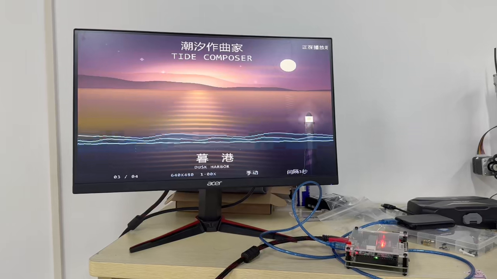</a>
FPGA / HDMI / 图像与音频<h3><a href="tide-composer.html">潮汐作曲家</a></h3>
从 TF 卡素材、SDRAM 帧缓存到 HDMI 输出，结合转场、缩放与板端控制。完整演示、原版海报、实物图与技术架构放在一起阅读。
<a href="tide-composer.html">看实物、海报和视频 →</a>
</section>

## 感知、控制、工具与交互

<section class="project-tile"><a href="flexstep.html">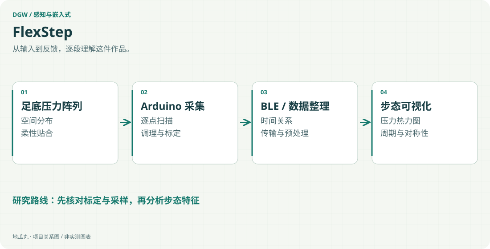</a>
柔性压力阵列 / Arduino / 多通道采集<h3><a href="flexstep.html">FlexStep｜人体步态柔性感知系统</a></h3>
让足底受力成为可以观察、比较和解释的连续信息。
<a href="flexstep.html">看技术路径与项目过程 →</a>
</section><section class="project-tile"><a href="acoustic-terminal.html">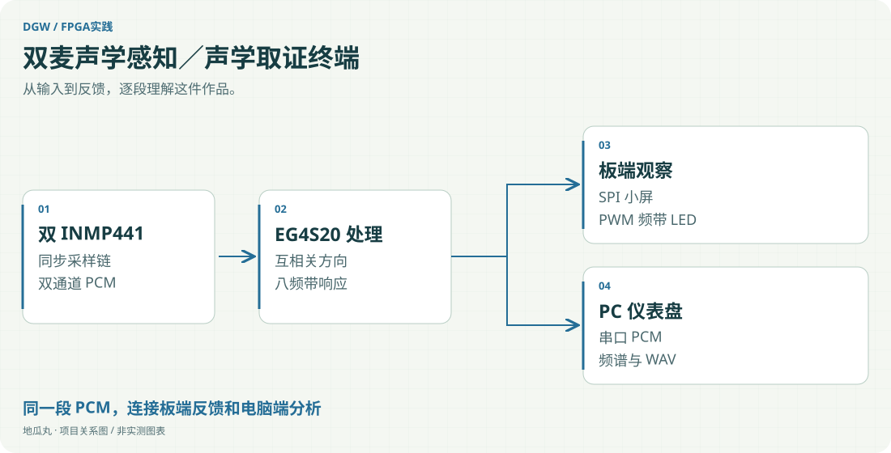</a>
EG4S20 FPGA / INMP441 ×2 / I2S<h3><a href="acoustic-terminal.html">双麦声学感知／声学取证终端</a></h3>
从两路麦克风采样，到方向、频带、波形与录音的完整观察链。
<a href="acoustic-terminal.html">看技术路径与项目过程 →</a>
</section><section class="project-tile"><a href="wearifi.html">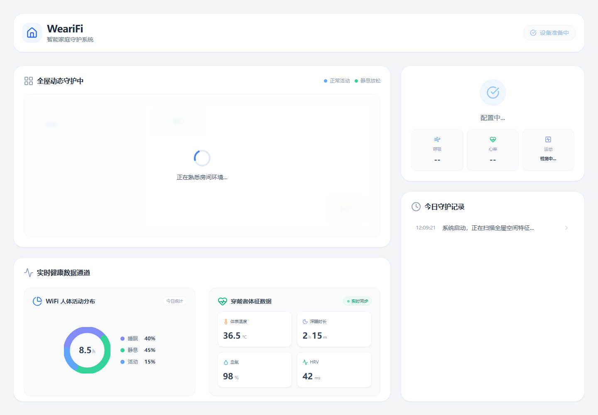</a>
ESP32-S3 / WiFi CSI / nRF / BLE / Django REST<h3><a href="wearifi.html">WeariFi｜柔域智感</a></h3>
把空间感知与可穿戴感知放在同一个监护流程里。
<a href="wearifi.html">看技术路径与项目过程 →</a>
</section><section class="project-tile"><a href="fuma-unit.html">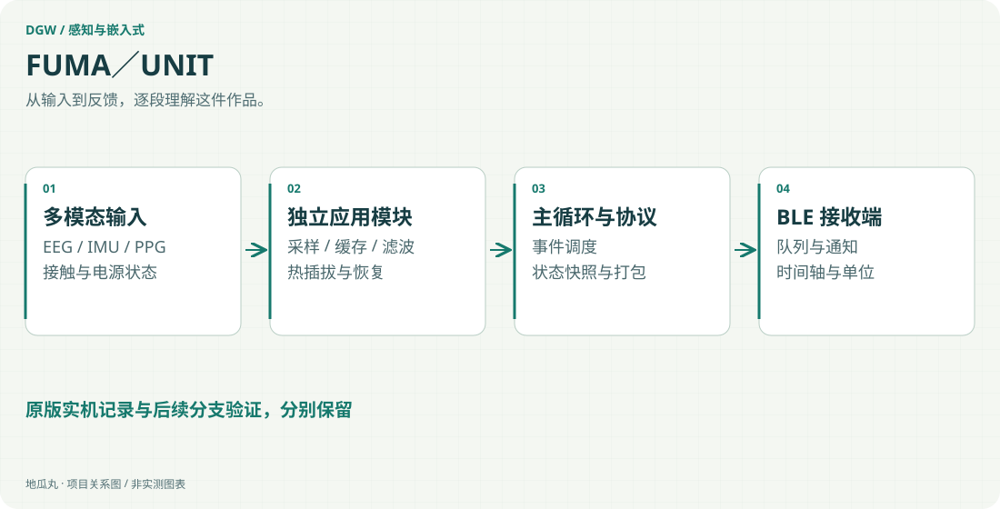</a>
nRF52832 / nRF5 SDK / C<h3><a href="fuma-unit.html">FUMA／UNIT｜多模态脑电固件</a></h3>
把采样、传感器状态、无线传输与电源管理组织成可维护的固件。
<a href="fuma-unit.html">看技术路径与项目过程 →</a>
</section><section class="project-tile"><a href="ota-method.html">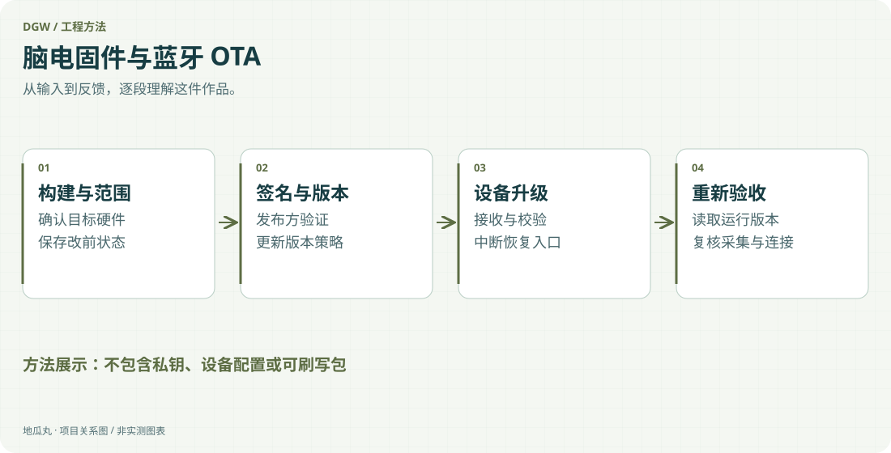</a>
Secure DFU / Bootloader / 签名验证<h3><a href="ota-method.html">脑电固件与蓝牙 OTA｜方法笔记</a></h3>
一次无线升级，背后是构建、签名、版本与恢复路径的配合。
<a href="ota-method.html">看技术路径与项目过程 →</a>
</section><section class="project-tile"><a href="auto-aim.html">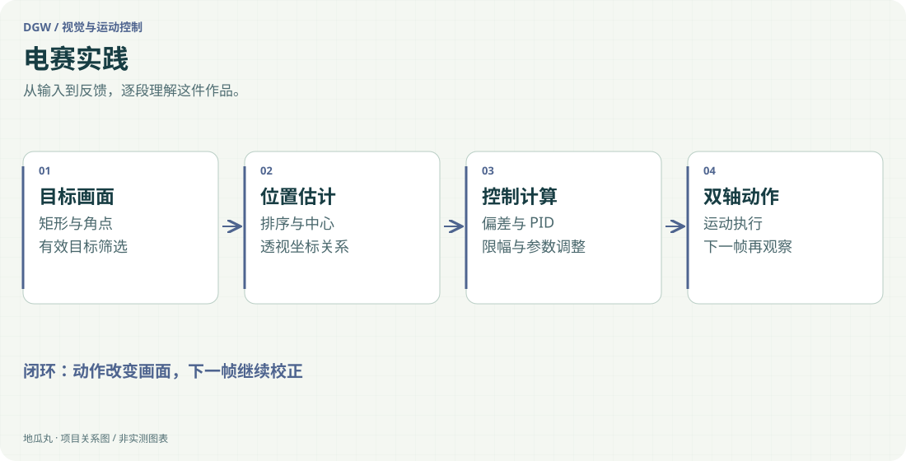</a>
嵌入式视觉 / Python / 矩形识别<h3><a href="auto-aim.html">电赛实践｜简易自行瞄准装置</a></h3>
从识别目标，到把视觉误差变成云台动作。
<a href="auto-aim.html">看技术路径与项目过程 →</a>
</section><section class="project-tile"><a href="ball-balance.html">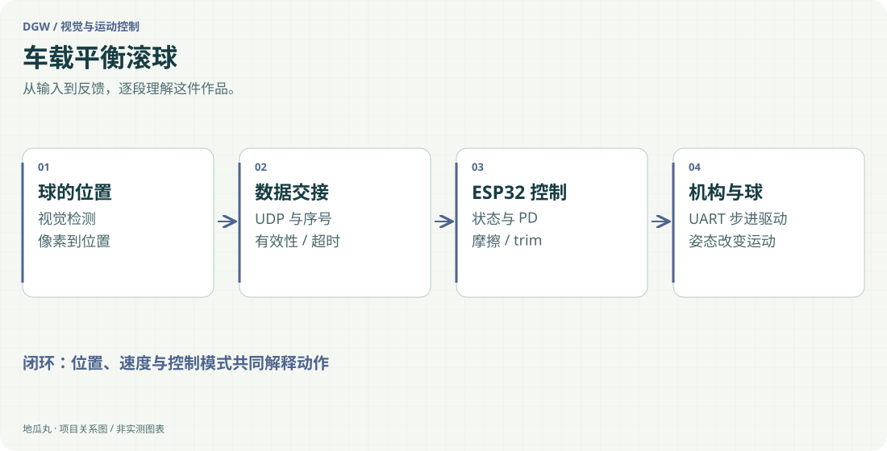</a>
MaixCAM2 / YOLOv5 / UDP<h3><a href="ball-balance.html">车载平衡滚球｜视觉与运动控制</a></h3>
看见球的位置，还要处理速度、摩擦、平衡点和失联。
<a href="ball-balance.html">看技术路径与项目过程 →</a>
</section><section class="project-tile"><a href="mouse-gimbal.html">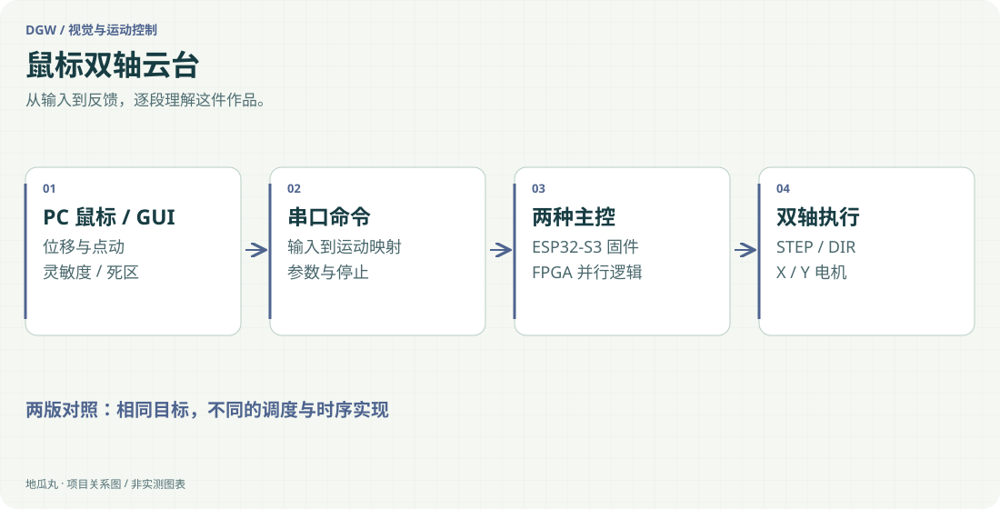</a>
Python GUI / UART / ESP32-S3 / ESP-IDF<h3><a href="mouse-gimbal.html">鼠标双轴云台｜ESP32-S3 与 FPGA 两版</a></h3>
同一个鼠标输入，沿两条主控路线驱动双轴机构。
<a href="mouse-gimbal.html">看技术路径与项目过程 →</a>
</section><section class="project-tile"><a href="maixcam-tracking.html">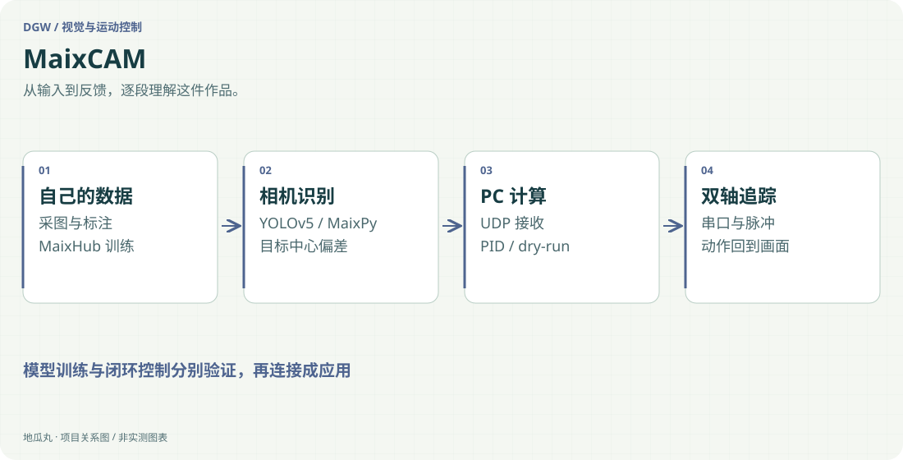</a>
MaixCAM Pro / MaixHub / YOLOv5<h3><a href="maixcam-tracking.html">MaixCAM｜模型训练与二维追踪</a></h3>
从自己的训练图片，到目标坐标与云台动作的完整应用路径。
<a href="maixcam-tracking.html">看技术路径与项目过程 →</a>
</section><section class="project-tile"><a href="ai-monitor.html">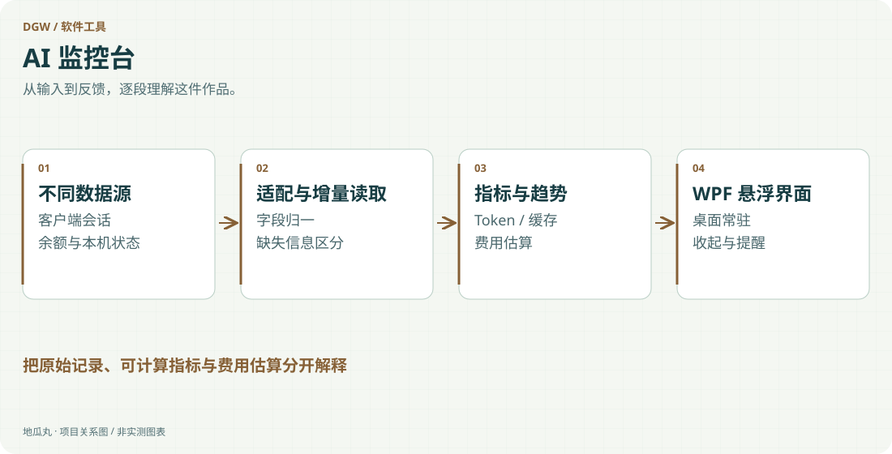</a>
PowerShell / WPF / 增量日志解析<h3><a href="ai-monitor.html">AI 监控台｜从悬浮窗到用量仪表</a></h3>
把分散在不同客户端的用量，整理成桌面上随时能看懂的状态。
<a href="ai-monitor.html">看技术路径与项目过程 →</a>
</section><section class="project-tile"><a href="everyday.html">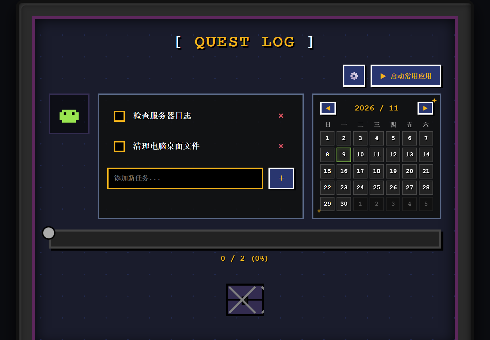</a>
Electron / HTML / CSS / JavaScript<h3><a href="everyday.html">Everyday｜像素任务清单与启动中控台</a></h3>
把日常计划、完成反馈与常用应用启动，放进一块像素桌面。
<a href="everyday.html">看技术路径与项目过程 →</a>
</section><section class="project-tile"><a href="game-security-ai.html">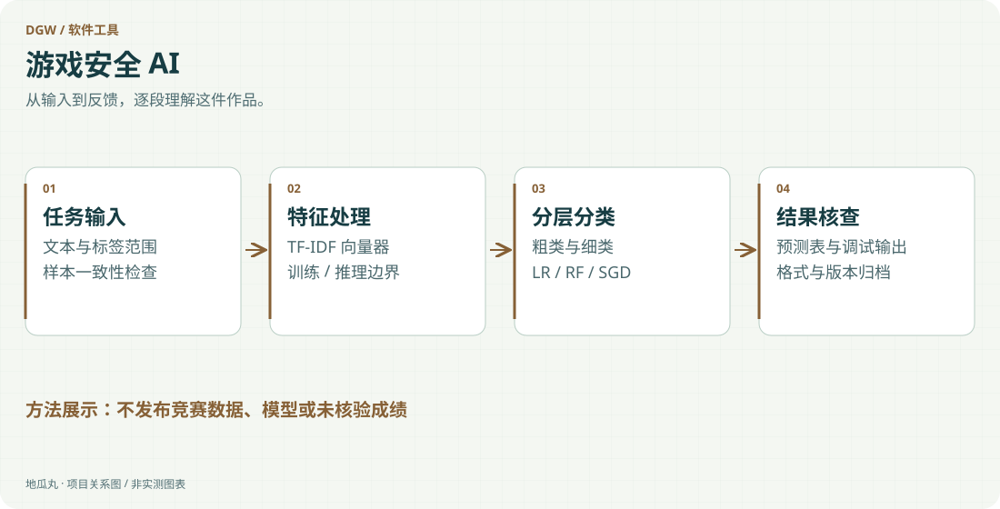</a>
Python / TF-IDF / Logistic Regression<h3><a href="game-security-ai.html">游戏安全 AI｜初赛分类实践</a></h3>
围绕文本特征、分层分类与结果交付，留下可复查的实验材料。
<a href="game-security-ai.html">看技术路径与项目过程 →</a>
</section><section class="project-tile"><a href="ural-echo.html">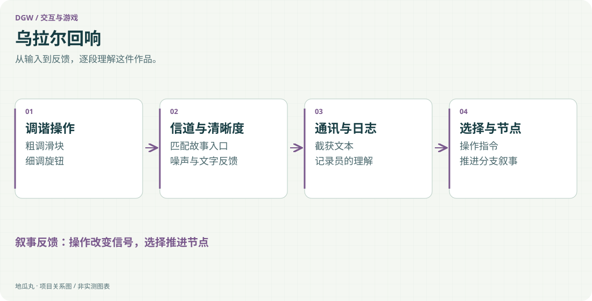</a>
HTML / CSS / JavaScript / Web Audio<h3><a href="ural-echo.html">乌拉尔回响｜交互叙事实验</a></h3>
用调频、噪声和通讯文本，让玩家通过操作进入故事。
<a href="ural-echo.html">看技术路径与项目过程 →</a>
</section><section class="project-tile"><a href="sword-duel.html">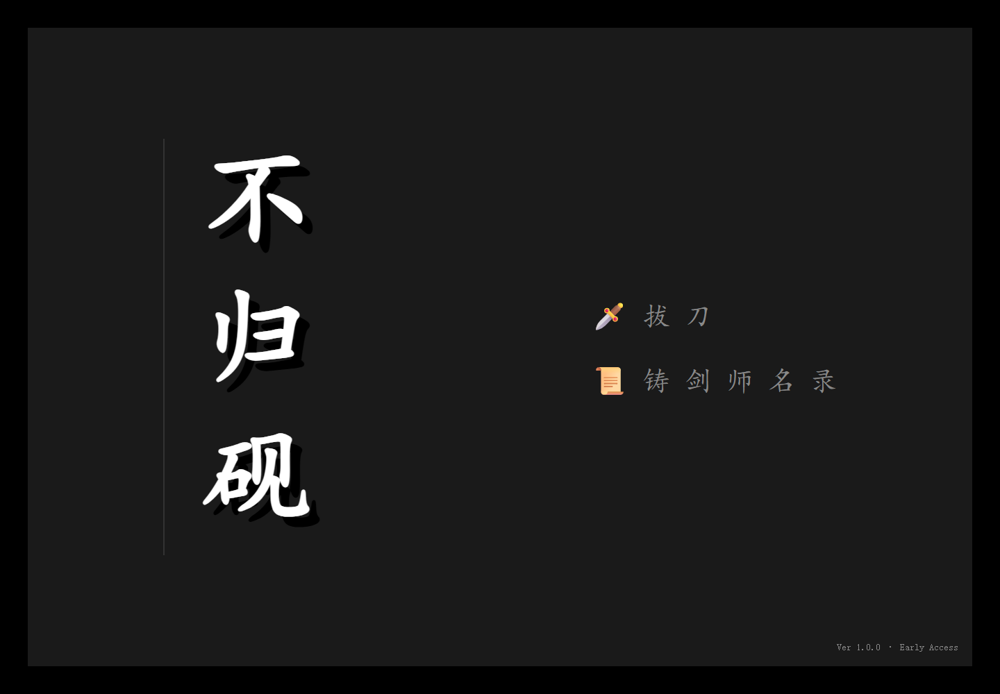</a>
Canvas 2D / JavaScript / 动作状态机<h3><a href="sword-duel.html">不归砚／Sword Duel｜动作交互原型</a></h3>
用清晰的动作状态、命中反馈与节奏，试做一场有手感的对决。
<a href="sword-duel.html">看技术路径与项目过程 →</a>
</section>

## 这些实践，怎样回到教学

传感器、电机、显示器和桌面界面面对不同问题，却都需要把输入、处理与结果解释清楚。把系统拆成能观察、能核对的环节，是我在这些作品之间持续积累的方法。

[[platform|回到 FPGA 教学平台]] · [[skills|能力与作品证据]] · [[about|关于地瓜丸]] · [[contact|去找地瓜丸→]]
