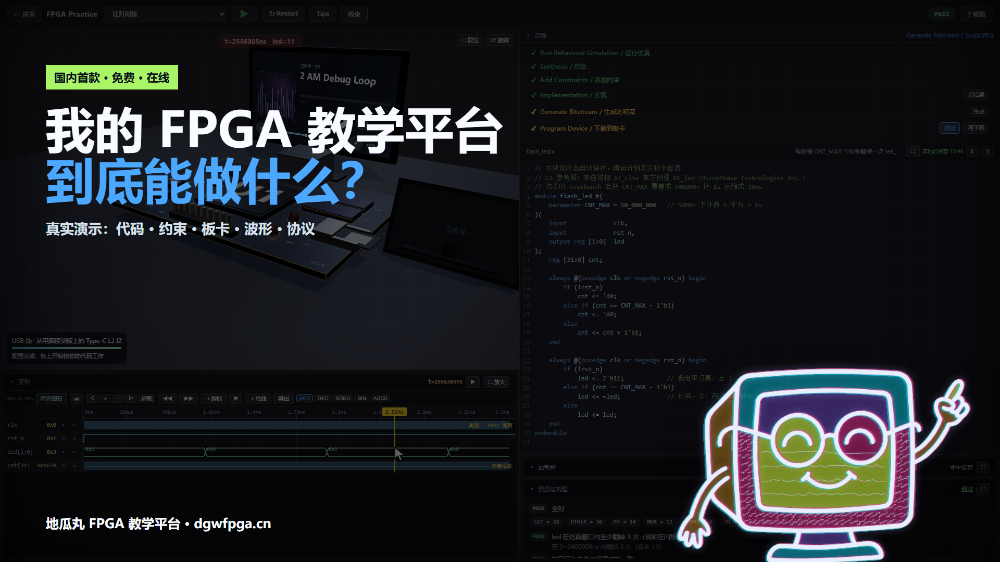
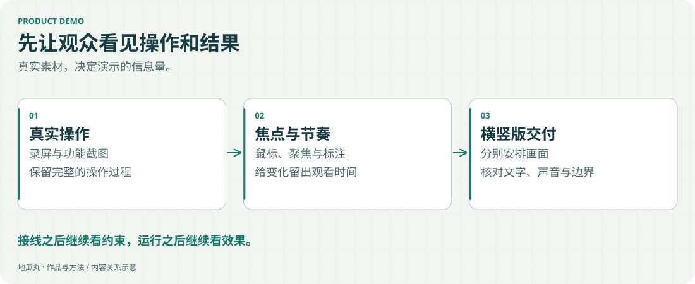

Remotion 是我制作平台宣传、波形更新介绍与维护教程的工具之一。重点是把功能变化组织成能跟随的演示。

<!-- note-visuals-20261108 -->

<figure class="case-figure note-visual "><figcaption>实际交付封面存档；横竖屏构图与导出分别处理。点击查看大图 ↗</figcaption></figure>

<figure class="case-figure note-visual note-diagram"><a class="case-image-link" href="assets/notes/filmmaking.svg"><picture><source media="(max-width:600px)" srcset="assets/notes/filmmaking-mobile.svg" width="460" height="776"></picture></a><figcaption>从素材到成片的内容组织示意。点击查看大图 ↗</figcaption></figure>

## 画面需要有证据

真实截图与录屏承担功能证据；聚焦、鼠标点击与适量标注帮助观众找到正在发生的事情。吉祥物与品牌视觉负责串联，不遮挡关键文字。

## 动态的分寸

统一运镜和缓动，避免所有元素同时移动。把视觉重点留给操作与结果，并给阅读留出时间。横竖版分别处理，不能只把横屏中心裁下来。

## 交付需要检查

声音、二维码、文字遮挡、框选准确性与最终编码后的画面都需要核对。项目文件、素材与导出版本也要有清楚的对应记录。

## 继续探索

- [[content-creation|教学视频与功能演示]]
- [[workflow|从想法到上线的工作流]]
- [[ai-collaboration|我怎样与 AI 一起做项目]]
- [[skills|我的实践方向]]

[[index|回到档案首页]]
