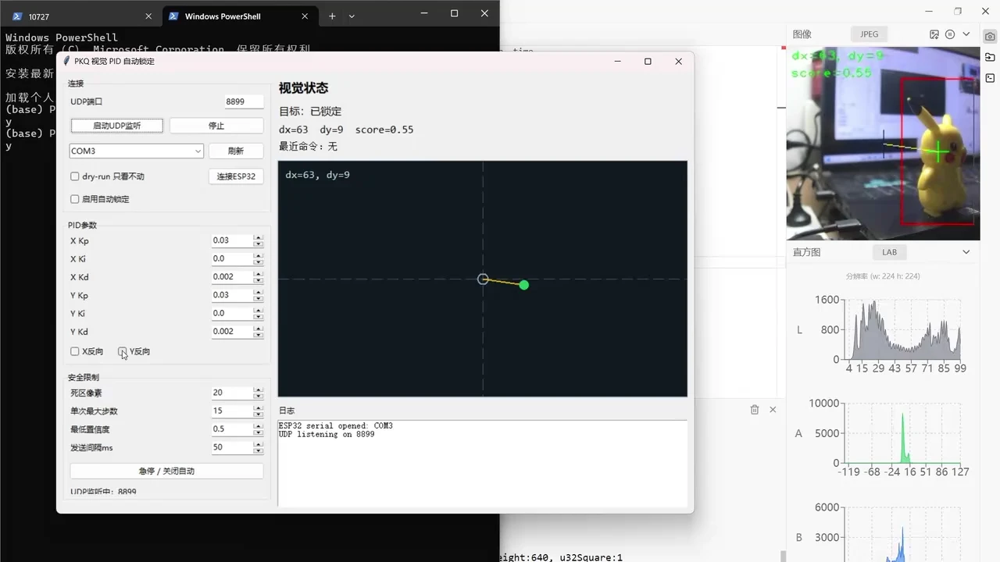

地瓜丸 · 系统开发与工程交付
从板端逻辑到在线产品， 把系统设计、联调与交付接起来。

我的实践覆盖 FPGA 音画处理、嵌入式视觉、闭环运动控制与 Web 产品。围绕自己推进的项目，我组织技术方案、软硬件接口、可视化和验证，并搭建 AI 协作流程，让实现、演示和长期维护能够衔接。

<figure class="case-figure field-frame"><figcaption>FPGA 教学平台：代码、硬件反馈和波形放在同一张工作台。点击看原图 ↗</figcaption></figure>

## 在线教学产品与全栈系统集成

<table class="field-table"><thead><tr><th>工作</th><th>落在哪个功能里</th><th>可以查看的材料</th></tr></thead><tbody><tr><td>课程与产品架构</td><td>将 31 关学习目标组织为 8 章，覆盖数字逻辑、接口、数据流及外设。</td><td><a href="fpga.html">8 章课程路线与观察例子 →</a></td></tr><tr><td>交互系统整合</td><td>连接编辑器、图形约束、3D、逐针手册与观察反馈。</td><td><a href="hardware.html">手册和 3D 桌面 →</a></td></tr><tr><td>问题定位与产品迭代</td><td>从使用反馈定位数据、时序、界面和部署问题，推进对应修复。</td><td><a href="debugging.html">具体问题与处理 →</a></td></tr><tr><td>部署与持续交付</td><td>云端部署、状态通知、数据备份、版本留档和上线验收。</td><td><a href="maintenance.html">维护过程记录 →</a></td></tr></tbody></table>

## FPGA 数字系统与图像音频处理

<figure class="case-figure field-frame"><figcaption>潮汐作曲家：板卡与显示器同框的实物运行画面。点击看原图 ↗</figcaption></figure>
<table class="field-table"><thead><tr><th>作品里的工作</th><th>技术内容</th><th>展开查看</th></tr></thead><tbody><tr><td>把素材送到屏幕</td><td>SD 卡、SDRAM 帧缓存、HDMI 输出。</td><td><a href="tide-technology.html">系统架构 →</a></td></tr><tr><td>让画面实时改变</td><td>缩放地址映射，转场期间提交状态。</td><td><a href="tide-technology.html">缩放与转场设计 →</a></td></tr><tr><td>核对写入与实物现象</td><td>构建报告、Flash 回读和 TF 镜像检查。</td><td><a href="tide-composer.html">作品与验证过程 →</a></td></tr></tbody></table>

## 嵌入式视觉与闭环运动控制

<figure class="case-figure field-frame"><figcaption>MaixCAM 项目的控制界面实录：目标状态、偏差点与 PID 参数。点击看原图 ↗</figcaption></figure>
<table class="field-table"><thead><tr><th>作品</th><th>系统开发与联调</th><th>实拍入口</th></tr></thead><tbody><tr><td>车载平衡滚球</td><td>视觉位置、速度估计、摩擦补偿与步进控制。</td><td><a href="ball-balance.html">照片和 3 段实拍 →</a></td></tr><tr><td>MaixCAM 自动识别瞄准</td><td>模型部署、坐标反馈、GUI 与双轴机构联调。</td><td><a href="maixcam-tracking.html">4 分 52 秒演示 →</a></td></tr><tr><td>鼠标双轴云台</td><td>ESP32-S3 与 FPGA 两条主控路线。</td><td><a href="mouse-gimbal.html">两版实现介绍 →</a></td></tr></tbody></table>

## 软件工具与技术表达

<table class="field-table"><thead><tr><th>方向</th><th>具体作品或工作</th><th>入口</th></tr></thead><tbody><tr><td>桌面工具</td><td>AI 用量监控台、Everyday 像素任务与启动中控。</td><td><a href="projects.html">其他项目 →</a></td></tr><tr><td>视频制作</td><td>功能实录、截图聚焦、横竖屏分别构图。</td><td><a href="content-creation.html">演示与镜头安排 →</a></td></tr><tr><td>与 AI 合作</td><td>我提出目标、检查预览和决定取舍，AI 协助实现与验证。</td><td><a href="ai-collaboration.html">按一次改动看分工 →</a></td></tr></tbody></table>

## AI 协作工程化与交付管理

<ol class="field-path"><li><b>需求与系统拆解</b>把目标、约束和验收标准写成具体工作包。</li><li><b>上下文与素材复用</b>组织已有工程、演示素材与决策记录，减少重复准备。</li><li><b>预览与验证</b>先看可操作结果，再按改动检查界面、运行或部署。</li><li><b>版本与交接</b>保存提交、备份、验证证据和待办，使项目可以继续接手。</li></ol>

在这个过程中，我把控目标、技术取舍和实际体验，结合 AI 辅助实现、分析与检查。<a href="workflow.html">查看这套工作流怎样搭建 →</a>

<nav class="field-read-next" aria-label="继续阅读"><a href="projects.html">全部作品 →</a><a href="contact.html">去找地瓜丸 →</a></nav>
