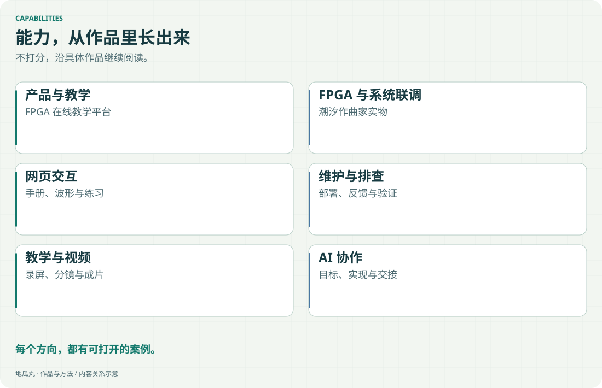
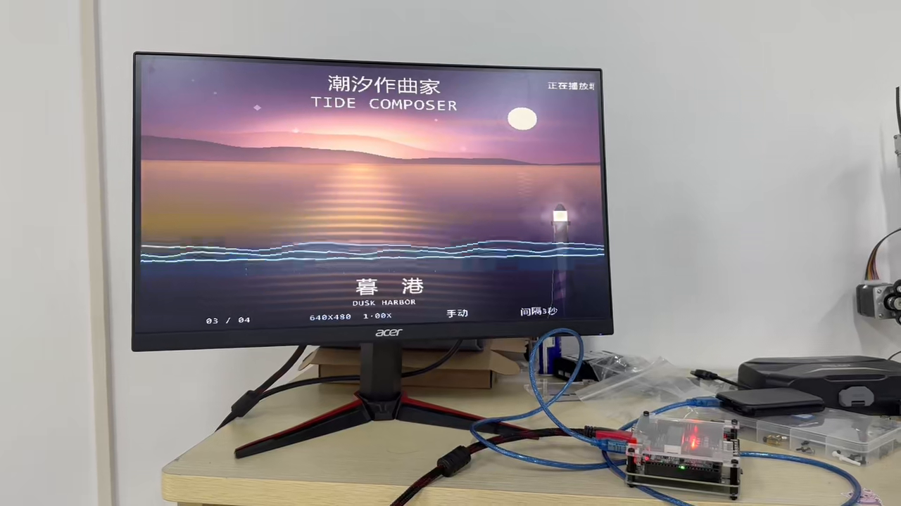
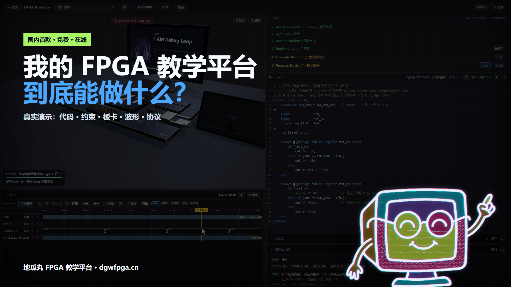

能力 × 作品 × 过程
从做过的事， 认识我的实践能力。

每个方向都连接到具体案例：我推进什么、怎样与 AI 和工程基础协作，以及结果能由什么材料说明。

<!-- note-visuals-20261108 -->

<figure class="case-figure note-visual note-diagram"><a class="case-image-link" href="assets/notes/capabilities.svg"><picture><source media="(max-width:600px)" srcset="assets/notes/capabilities-mobile.svg" width="460" height="840"></picture></a><figcaption>能力地图：不以星级打分，用下方的具体案例继续核对。点击查看大图 ↗</figcaption></figure>

## 教学与产品设计

把学习目标拆成任务、操作、观察和反馈，让一次练习能连续完成。持续收集“看不清、找不到、用起来挤”的反馈，决定功能优先级。

**对应案例：** [[platform|FPGA 教学平台]]。可以看练习流程、手册截图和三次设计取舍。

<figure class="case-figure note-visual"><figcaption>产品与教学：用真实界面查看练习工具怎样放在一起。点击查看大图 ↗</figcaption></figure>

## FPGA 图像与音频实践

围绕图像缓存、读地址、转场状态和 HDMI 输出，推进音画作品的功能实现与效果迭代。实时缩放涉及的不只是一个视觉开关，还需要状态和地址映射配合。

**对应案例：** [[tide-composer|潮汐作曲家]]。有实物照片、处理链路和缩放方案对照。[[tide-technology|技术介绍页]]进一步展示系统架构、创新点和技术栈。

<figure class="case-figure note-visual"><figcaption>FPGA 实践：显示器与板卡同框，具体功能继续查看项目与技术页。点击查看大图 ↗</figcaption></figure>

## 板端调试与系统联调

把文件、接口、板卡和显示结果连成完整路径，区分行为仿真、构建报告、写入校验与实物现象各自说明什么。

**对应案例：** [[tide-composer|潮汐作曲家]] 的板端照片、Flash 回读与 TF 镜像校验记录；[[hardware|教学平台逐针手册]]展示了对接口资料一致性的关注。

## 网页交互与信息呈现

把复杂界面整理为需要时能找到、看得清的工具。关注目录、弹层、文字对比度和手机阅读，验证界面改动是否帮助使用者完成任务。

**对应案例：** [[platform|教学平台案例]]与[[interaction|交互与信息呈现]]。

## 部署与网站维护

从个人电脑提供服务到云部署，逐步建立监测、通知、服务恢复、数据备份与更新验收。根据成本和使用条件选择合适方式。

**对应案例：** [[maintenance|个人网站的维护实践]]。包含历史启动截图、通知记录与当前部署阶段。

## 故障定位与验证

先把问题缩小到可以检查的环节，再针对原因修改。保留之前的状态，分别验证功能、交互和部署结果，记录仍然没有证明的部分。

**对应案例：** [[maintenance|黑窗闪现与启动就绪检查]]、[[tide-composer|缩放和写入验证]]、[[debugging|反馈处理方法]]。

## 教学表达与视频创作

使用真实录屏、截图聚焦、动态演示和横竖屏构图，帮助观众理解功能如何操作以及结果是什么。

**对应记录：** [[remotion|Remotion 产品演示]]、[[content-creation|教学与功能演示]]。

<figure class="case-figure note-visual"><figcaption>教学表达：以真实操作为主的功能演示成片封面存档。点击查看大图 ↗</figcaption></figure>

## 我的判断与 AI 协作

我确定目标、反馈现象、检查预览并决定取舍；AI 辅助实现、分析、测试与整理。案例中分别说明这些工作，以过程和结果作为阅读依据。

[[ai-collaboration|了解协作方式]] · [[workflow|查看工作流]] · [[contact|找到我]]
