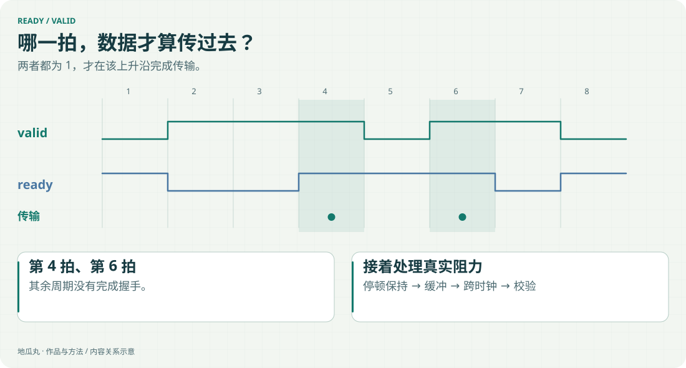

进阶课程需要有可观察的目标。仅把协议名字放进关卡标题，学习者很难知道自己到底要实现什么。

<!-- note-visuals-20261108 -->

<figure class="case-figure note-visual note-diagram"><a class="case-image-link" href="assets/notes/handshake.svg"><picture><source media="(max-width:600px)" srcset="assets/notes/handshake-mobile.svg" width="460" height="710"></picture></a><figcaption>教学时序示例：第 4、6 个采样沿同时满足 valid 与 ready；不是实测抓取。点击查看大图 ↗</figcaption></figure>

## 已加入的方向

高速数据流包括 Ready/Valid、Skid Buffer、双时钟异步 FIFO 与流式 CRC32。外设实验室将 ADC、DAC、SPI、GPIO、PCIe 分成独立关卡。

## 每关只抓住一个关键问题

什么时候算传输成功？下游停住时数据怎么保留？两路时钟怎样安全交接？寄存器读写该怎样回应？这些问题比一上来堆砌完整协议更适合逐步学习。

## 当前边界

PCIe 关卡聚焦事务接口中的 BAR 读写等行为，不包含物理层收发器和链路训练。公开介绍会说明练习范围，避免把课程模型当作完整芯片实现。

## 继续探索

- [[fpga|FPGA 与数字逻辑]]
- [[hardware|把硬件与手册放在一起]]
- [[waveform|把波形真正看清]]
- [[decisions|做取舍的几个原则]]

[[index|回到档案首页]]
