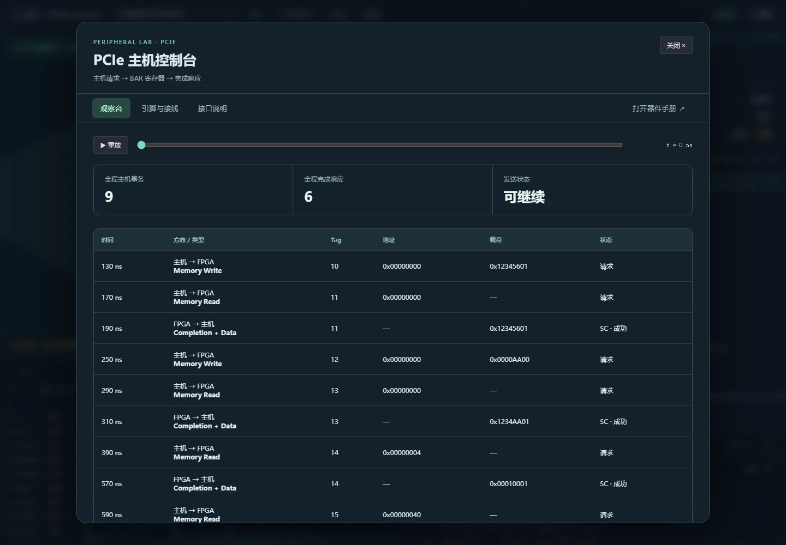
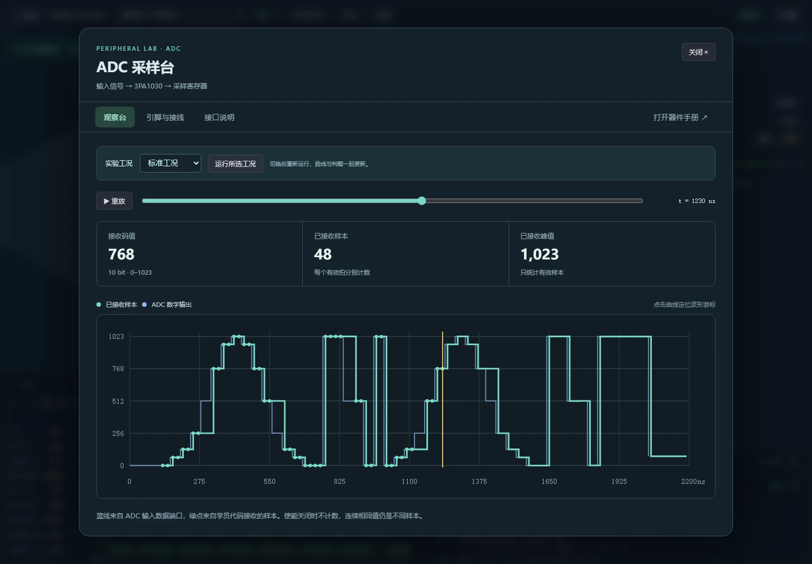

地瓜丸 · 数据流与外设
接口名字后面， 要有一个能动手的问题。

四关数据流处理停顿、跨时钟和校验；五关外设各有独立任务。选一个方向，可以直接进入对应练习。

<figure class="case-figure field-frame"><figcaption>PCIe 事务观察台：请求和完成响应按表格显示，Tag、地址和载荷可以逐项对照。点击看原图 ↗</figcaption></figure>

## 数据流的四个关口

<table class="field-table"><thead><tr><th>关卡</th><th>要解决的问题</th><th>入口</th></tr></thead><tbody><tr><td>Ready / Valid</td><td>哪一个时钟沿，才算这一拍数据已经被接收？</td><td><a href="https://dgwfpga.cn/practice/#/level/L23_ready_valid">进入第 23 关 ↗</a></td></tr><tr><td>Skid Buffer</td><td>下游突然停住，已发出的最后一拍放哪里？</td><td><a href="https://dgwfpga.cn/practice/#/level/L24_skid_buffer">进入第 24 关 ↗</a></td></tr><tr><td>异步 FIFO</td><td>两路时钟不同步，空满判断如何安全交接？</td><td><a href="https://dgwfpga.cn/practice/#/level/L25_async_fifo">进入第 25 关 ↗</a></td></tr><tr><td>流式 CRC32</td><td>每经过一个字节，校验状态怎样更新？</td><td><a href="https://dgwfpga.cn/practice/#/level/L26_stream_crc32">进入第 26 关 ↗</a></td></tr></tbody></table>

## 五类外设，分别观察

<table class="field-table"><thead><tr><th>实验</th><th>写什么</th><th>看什么</th></tr></thead><tbody><tr><td><a href="https://dgwfpga.cn/practice/#/level/L27_adc_capture">ADC ↗</a></td><td>接收并行采样。</td><td>接收样本数、峰值与采样曲线。</td></tr><tr><td><a href="https://dgwfpga.cn/practice/#/level/L28_dac_wave">DAC ↗</a></td><td>生成数字码，处理幅度和暂停。</td><td>输出波形与保持状态。</td></tr><tr><td><a href="https://dgwfpga.cn/practice/#/level/L29_spi_register">SPI ↗</a></td><td>发出读身份命令，逐位接收。</td><td>命令、时钟与返回的 JEDEC ID。</td></tr><tr><td><a href="https://dgwfpga.cn/practice/#/level/L30_gpio_bus">GPIO ↗</a></td><td>配置方向、驱动输出并读回。</td><td>四路线的方向与数据。</td></tr><tr><td><a href="https://dgwfpga.cn/practice/#/level/L31_pcie_bar">PCIe ↗</a></td><td>解码单 DWORD 读写和字节使能。</td><td>BAR 寄存器与 Completion 响应。</td></tr></tbody></table>
<figure class="case-figure field-frame"><figcaption>ADC 实际运行界面：已接收样本、计数和峰值与曲线同屏。点击看原图 ↗</figcaption></figure>

<strong>PCIe 这一关的范围</strong> 练习 BAR 读写等事务行为。物理层收发器和链路训练不在本关任务内。

<nav class="field-read-next" aria-label="继续阅读"><a href="hardware.html">先认识外设与接线 →</a><a href="feature-tour.html">看外设实景 →</a><a href="waveform.html">观察时序细节 →</a></nav>
