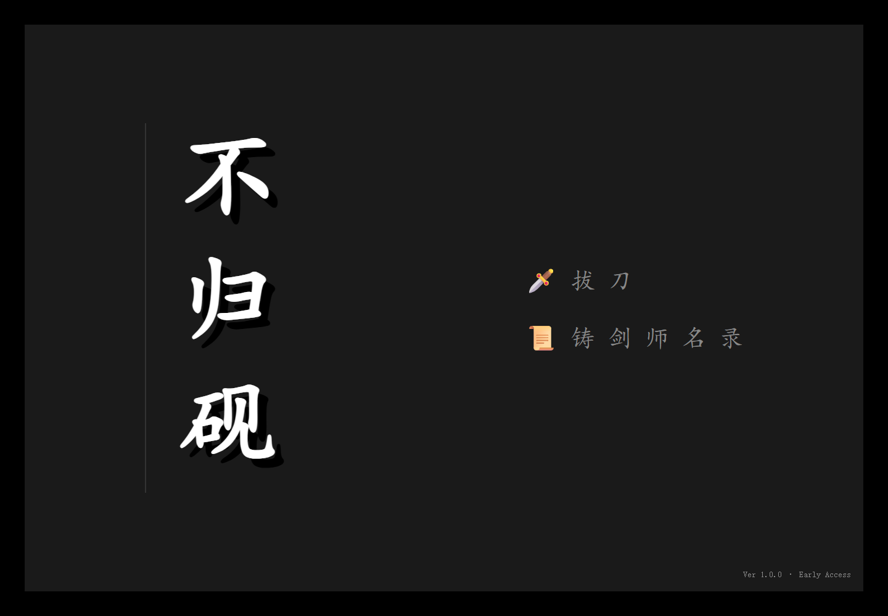
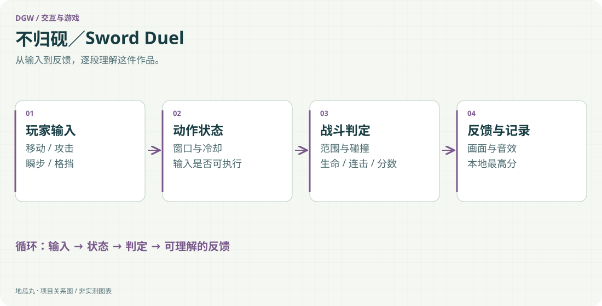

地瓜丸的工作室 · 其他项目
用清晰的动作状态、命中反馈与节奏，试做一场有手感的对决。

Canvas 2DJavaScript动作状态机音效与粒子Electron本地记录

<aside class="project-stage"><strong>这件作品进行到哪里</strong>有网页动作原型与 Electron 配置；本轮未运行或复验最新平衡</aside>

<figure class="case-figure"><figcaption>现有网页原型的标题界面存档。点击查看大图 ↗</figcaption></figure>

<figure class="case-figure"><a class="case-image-link" href="assets/projects/sword-duel.svg"><picture><source media="(max-width:600px)" srcset="assets/projects/sword-duel-mobile.svg" width="460" height="1000"></picture></a><figcaption>依据项目资料整理的功能关系示意；实际阶段见正文。点击查看大图 ↗</figcaption></figure>

## 手感来自输入和反馈之间的关系

《不归砚》是一个网页动作游戏原型，工程名为 Sword Duel。玩家通过移动、攻击、瞬步和格挡参与战斗，界面同时反馈体力、连击、分数与失败结果。作品尝试解决的，是一次操作如何被玩家立即理解，以及下一次动作何时可以衔接。

## 动作需要明确的状态边界

实现围绕蓄力、挥击、格挡窗口、冲刺与冷却等状态展开。输入先决定动作是否允许发生，碰撞与攻击范围再决定结果，随后更新生命、分数和连击。不同状态的持续时间与取消关系影响节奏，如果所有输入都直接改变位置或伤害，画面即使热闹，也很难形成可学习的规则。

## 反馈要指向刚才发生的事

Canvas 绘制、粒子、镜头震动、短暂停顿与音效共同强调命中、招架和失败。表现层需要服从动作逻辑：玩家应能分清击中了、被防住了，还是因为状态限制没有出手，而非每次都播放同一种夸张效果。连续反馈的强弱也要有区别，给重要事件留出辨识度。

## 从浏览器原型到桌面封装

工程保留 HTML 页面与 Electron 入口，包含本地最高分记录和桌面打包配置。网页与桌面运行环境不同，存储、音频、窗口焦点和键盘输入需要分别检查。封装能力让原型更容易打开，但安装包存在并不能证明每种设备上都已完成测试。

## 当前展示范围

页面与工程配置能说明玩法结构、动作状态和反馈设计，本轮没有运行最新版本，因此不声称完成长期平衡、兼容性测试或正式发行。这里把它作为持续创作的动作交互实验，与教学平台中“操作之后必须给出可解释反馈”的设计原则相互连接。

## 继续阅读

[[projects|更多作品]] · [[platform|地瓜丸的 FPGA 教学平台]] · [[contact|去找地瓜丸→]]

