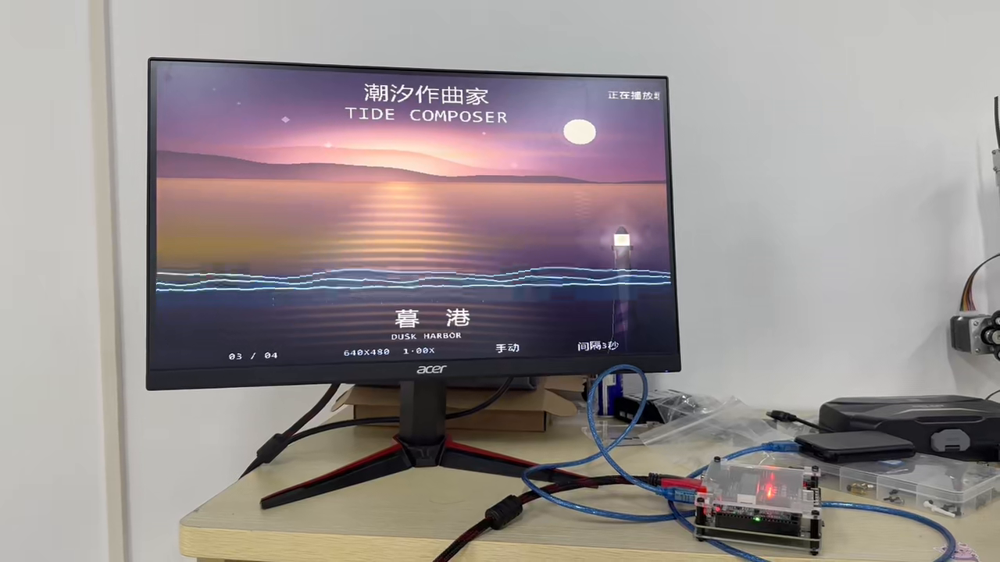
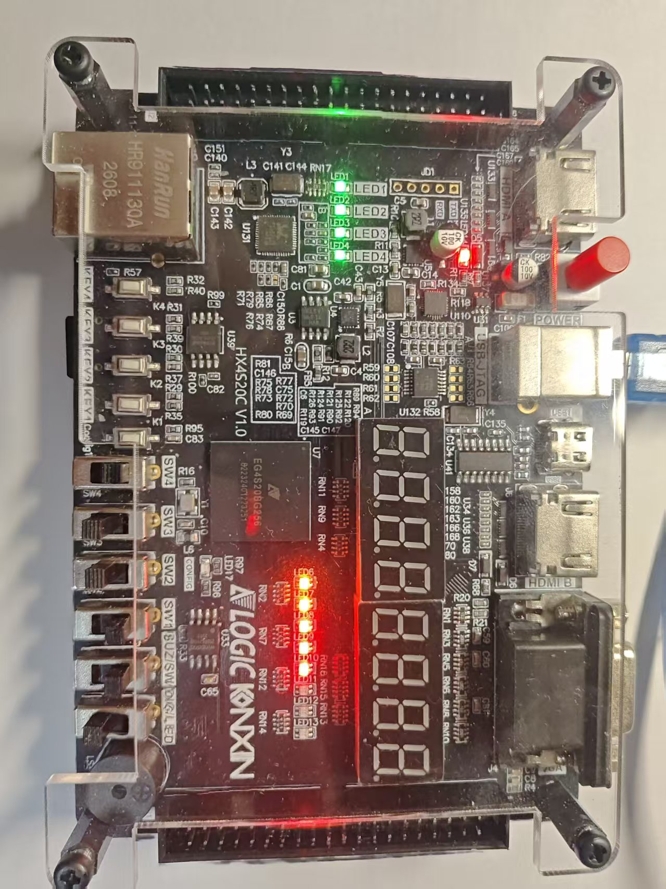

CASE 02 · FPGA 实物作品
四幅海岸，五首音乐， 在 FPGA 上实时组织音画。

面向海洋展馆的音画展示作品。TF 卡提供图像与音乐，FPGA 完成图像缓存、转场、菜单和实时缩放，经 HDMI 输出画面与声音。

<strong>640 × 480 / 60 Hz</strong>HDMI 输出模式

<strong>1× / 2×</strong>板端实时中心缩放

<strong>4 图 / 5 曲</strong>可替换的 TF 卡素材

<figure class="case-figure "><figcaption>真实拍摄的“暮港”场景：显示器、开发板与连接线同框，可看到板端输出的画面。点击查看大图 ↗</figcaption></figure>

## 从素材到屏幕

<ol class="case-flow"><li>01<strong>TF 卡素材</strong>
读取四幅场景与五首音乐。
</li><li>02<strong>图像缓存</strong>
图像预载至 SDRAM，显示侧读取。
</li><li>03<strong>板端处理</strong>
缩放读地址、转场遮罩、OSD 与画面调节。
</li><li>04<strong>HDMI 输出</strong>
画面、音乐、潮汐动效与 LED 反馈。
</li></ol>

## 我参与和推进的部分

<section>我推进的工作
推进功能目标与效果取舍；查看画面和板端反馈，围绕缩放、转场、颜色和可操作性迭代。
</section><section>AI 辅助的工作
协助 RTL 与构建脚本修改、仿真回归、固化流程和作品材料整理。
</section><section>工程基础与协作
作品以“奶蛙大队”参赛；基于官方 TF、HDMI、I2S 等示例继续开发。这里按个人参与过程介绍。
</section>

## 一个关键改动：从预制放大图到实时缩放

<section>早期做法<h3>素材卡多准备一张放大图</h3>
放大效果跟着图片文件走，换场景还要准备对应素材。
</section><section>最后采用<h3>显示时改变 SDRAM 读地址</h3>
截取原图中央 320 × 240 区域，把每个源像素横向、纵向各读两次，输出 640 × 480。四幅原图共用这一套处理。
</section>

缩放状态在转场全遮挡阶段提交，避免切换中间画面暴露。开启 2 倍缩放后，仍可继续手动切图和自动轮播。

<aside class="mascot-note">
<strong>这项改动解决了什么</strong>
素材卡只保存原图，放大由硬件实时完成。功能变化同时涉及图像地址、场景状态和转场时机，需要一起验证。

</aside>

## 实物与交互

<h3>把工程做成可以操作的展陈</h3>
在按键菜单里切换图片、音乐和转场，调整亮度与对比度；画面参数平滑变化。无操作一段时间后降低亮度。

音频样本同时参与声音输出、潮汐动效与 LED 联动，使观察者能把画面和声音联系起来。

OSD 菜单六种转场音画联动上电启动

<figure class="case-figure portrait"><figcaption>作品使用的开发板实拍，图中可见按键、指示灯和 HDMI 接口。点击查看大图 ↗</figcaption></figure>

## 我如何检查结果

<section>行为层<h3>RTL 回归</h3>
检查四图缩放控制、轮播、转场、亮度／对比度及待机行为；地址级仿真逐点检查源坐标映射。
</section><section>实现层<h3>构建与时序报告</h3>
最终构建记录的 Setup WNS 为 +0.830 ns，Hold WNS 为 +0.003 ns。它们说明该次工具时序分析结果。
</section><section>部署层<h3>写入后再读回来</h3>
位流已写入 SPI Flash 并回读校验；TF 卡镜像写入后回读哈希与源镜像一致，保留对应日志。
</section>

## 当前阶段

已整理实物演示、代码包、技术报告和海报；本页公开实物图片与经过核对的结果。运行照片证明对应画面能够输出，构建报告和回读记录分别说明实现与写入结果；长期稳定性等指标需要专门测量。

## 继续阅读

[[skills|能力与作品证据]] · [[platform|把 FPGA 知识做成在线练习]] · [[workflow|从想法到上线的工作流]]
