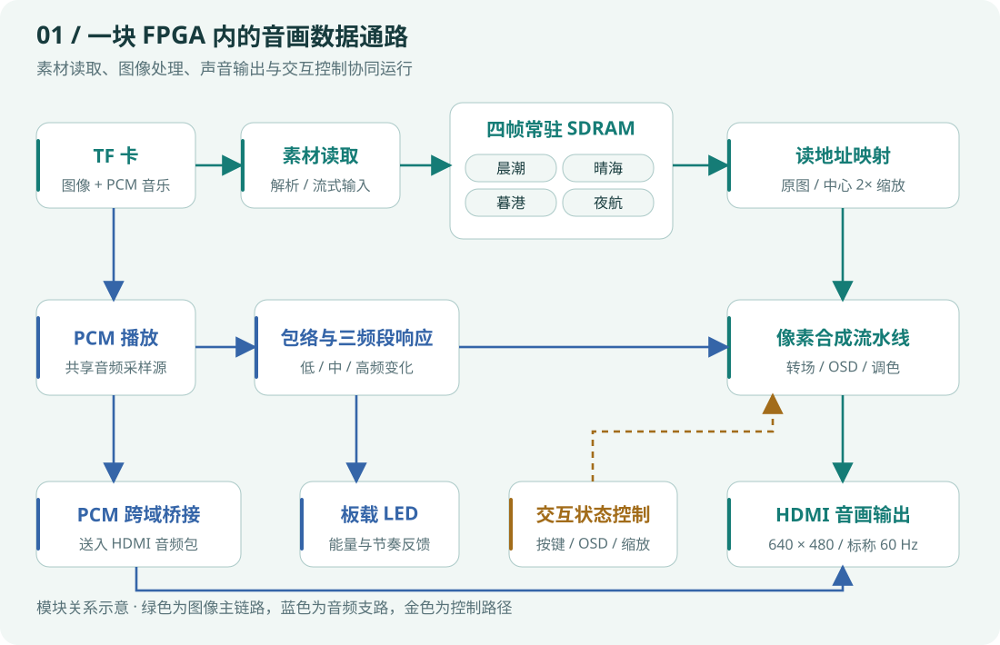
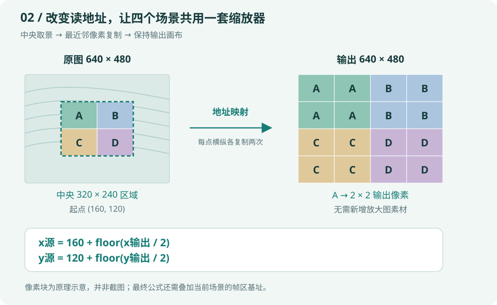
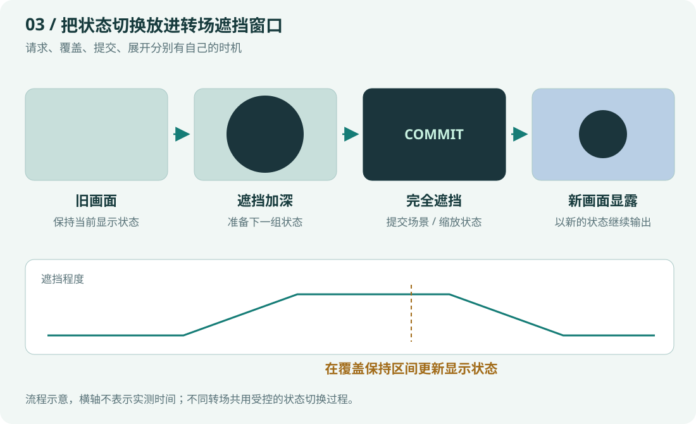
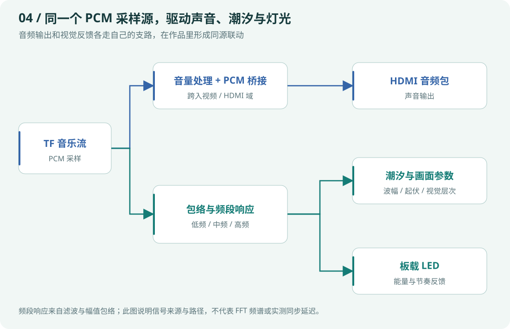

TIDE COMPOSER / TECHNICAL OVERVIEW
把一块 FPGA， 做成可交互的海洋音画引擎。

从 TF 卡素材到 HDMI 音画，实时缩放、转场、OSD 与音频反馈在硬件数据通路中协同运行。潮汐作曲家的技术含量，体现在怎样组织整条链路。

Verilog RTL四帧常驻缓存板端实时缩放PCM 音画联动
<a href="tide-composer.html">先看实物与项目案例 ↗</a>

## 技术创新点：让多个子系统成为一个作品

<section>01 / 存储与显示解耦<h3>四个场景共用一套缩放器</h3>
图像先进入 SDRAM 的四个逻辑帧区。显示侧通过读地址映射切换 1× / 2×，素材卡不必为每一幅图准备放大副本。
</section><section>02 / 转场参与控制<h3>把状态切换藏进遮挡窗口</h3>
覆盖旧画面后，再提交场景与缩放状态，并保留覆盖保持区间。转场同时承担视觉表达和状态交接的工作。
</section><section>03 / 同源数据驱动<h3>让音乐成为画面的一部分</h3>
PCM 音乐分出声音输出和包络反馈两条路径，低、中、高频响应参与潮汐动效，能量变化也驱动板载 LED。
</section><section>04 / 像素级硬件合成<h3>在出屏链路里完成视觉编排</h3>
像素坐标、字模、遮罩和定点运算共同生成 OSD、天体、潮汐与画面调节，减少对预制帧素材的依赖。
</section>

这些亮点集中在系统组织与具体实现：把存储、显示、音频和交互控制连成可操作、可固化、可复查的完整音画系统。

## 01　系统架构：从文件走到像素与声音

<figure class="case-figure tech-diagram"><a class="case-image-link" href="assets/tide-tech/architecture.svg"><picture><source media="(max-width: 600px)" srcset="assets/tide-tech/architecture-mobile.svg" width="420" height="1080"></picture></a><figcaption>依据当前固化版的数据通路绘制。四个逻辑帧区用于缓存场景，不表示四块独立 SDRAM 芯片。点击查看大图 ↗</figcaption></figure>

图像链路在预载后从 SDRAM 持续读取；音乐链路保持流式取样。按键与 OSD 菜单改变的是场景、转场、音量和显示参数，运行时由 FPGA 组织输出，不依赖电脑实时渲染。

<strong>100 MHz</strong>TF / 控制链路时钟

<strong>125 MHz</strong>外存时钟与移相输出

<strong>25 MHz</strong>视频像素时钟

<strong>125 MHz</strong>HDMI 5× 串行时钟

上面数值来自 PLL 配置。各域通过 FIFO、状态同步和 PCM 采样桥接配合，音频复位采用异步置位、目的域同步释放。多时钟设计的目标是让数据按各自节奏流动，同时把交接条件写清楚。

## 02　实时缩放：动的是地址，素材不重做

原图为 640 × 480。开启 2 倍缩放时，显示侧读取原图中央的 320 × 240 区域，每个源像素映射为 2 × 2 个输出像素，仍然输出 640 × 480。

<figure class="case-figure tech-diagram"><a class="case-image-link" href="assets/tide-tech/zoom-map.svg"><picture><source media="(max-width: 600px)" srcset="assets/tide-tech/zoom-map-mobile.svg" width="420" height="1035"></picture></a><figcaption>像素块用于解释映射原理，不是产品截图。四幅原图通过同一套映射处理。点击查看大图 ↗</figcaption></figure>

展开：坐标与帧地址怎样对应

<code>x源 = 160 + floor(x输出 / 2)</code> <code>y源 = 120 + floor(y输出 / 2)</code>

再以源坐标生成帧内地址，并叠加当前场景基址。160 和 120 是中央裁剪的起点；地址级回归对读请求逐点检查。

它带来的直接收益是<strong>同一份素材支持两种取景</strong>：切换场景时继续复用同一套缩放逻辑，也不需要额外存一张放大图。当前采用最近邻 2 倍中心缩放；它的优势是地址映射直接、实现清晰。

## 03　画面切换：让新状态在合适的时刻生效

场景编号、帧区和缩放状态如果各自立即改变，显示端可能在过渡中读到不一致的组合。本作品先进入转场，在完全覆盖的保持区间更新显示状态，再展开新画面。

<figure class="case-figure tech-diagram"><a class="case-image-link" href="assets/tide-tech/scene-switch.svg"><picture><source media="(max-width: 600px)" srcset="assets/tide-tech/scene-switch-mobile.svg" width="420" height="1050"></picture></a><figcaption>表达状态交接策略；横轴不是示波器或仿真的实测时序。点击查看大图 ↗</figcaption></figure>

转场模式在一次切换过程中保持，视频侧对转场参数按帧更新。六类遮罩／转场效果共享这一套控制思路，让视觉效果与状态管理共同服务于完整的切图过程。

## 04　音画联动：一个采样源，多种实时反馈

TF 卡中的 PCM 既送往 HDMI 音频输出，也用于幅值包络和低、中、高频响应。潮汐线与板载 LED 读取这些变化，形成随音乐起伏的视觉反馈。

<figure class="case-figure tech-diagram"><a class="case-image-link" href="assets/tide-tech/audio-visual.svg"><picture><source media="(max-width: 600px)" srcset="assets/tide-tech/audio-visual-mobile.svg" width="420" height="975"></picture></a><figcaption>频段响应来自定点滤波与包络提取；图中展示功能路径，不将其描述为 FFT 频谱分析。点击查看大图 ↗</figcaption></figure>

这使<strong>声音输出与画面反馈拥有共同的数据来源</strong>。PCM 桥接把样本送入 HDMI 域，视觉支路按自己的显示节奏更新；是否达到某个声画延迟指标，需要另外测量。

## 技术栈：从 RTL 到可复现的部署

| 技术层 | 工程中使用的技术及职责 |
| --- | --- |
| 硬件平台 | HX4S20C 开发板，安路 EG4S20BG256 FPGA，板载按键、LED、HDMI 与外存 |
| RTL 实现 | Verilog HDL；状态机、帧区选择、地址映射、像素合成、字模与定点运算 |
| 存储链路 | SPI 模式 TF 卡读取；SDRAM 场景缓存；W25Q64FV SPI Flash 保存启动位流 |
| 显示链路 | 640 × 480 显示模式；像素时序、OSD、遮罩转场、亮度与对比度调节、HDMI 输出 |
| 音频链路 | PCM 播放与音量处理；I2S 节拍链路、直接 PCM 跨域桥接及 HDMI 音频打包 |
| 时钟与跨域 | PLL、FIFO、状态同步、采样保持／toggle 桥接、分域复位释放 |
| 仿真验证 | ModelSim ASE + SystemVerilog testbench；功能、地址映射、遮罩与画面参数回归 |
| 综合与实现 | Anlogic TD 6.2.1；综合、布局布线、时序分析、位流生成 |
| 自动化交付 | PowerShell / Tcl 构建烧录；Python 素材镜像与校验辅助工具 |

## 验证与实现结果

<strong>7,596</strong>slices · 77.51%

<strong>28 / 15</strong>RAM / DSP 资源数

<strong>+0.830 ns</strong>Setup WNS

<strong>+0.003 ns</strong>Hold WNS

<ol class="case-flow"><li>01 / 行为<strong>RTL 回归</strong>
场景、缩放、转场与画面参数测试保留通过记录。
</li><li>02 / 地址<strong>逐点检查映射</strong>
源像素坐标与当前显示读地址对应。
</li><li>03 / 实现<strong>综合与时序</strong>
用最终固化版的工具报告核对资源与裕量。
</li><li>04 / 部署<strong>写入后回读</strong>
SPI Flash 和 TF 镜像均保留校验记录。
</li></ol>

这些数值来自当前固化版本的构建摘要；运行照片、仿真、时序报告和写入校验各自说明不同层面的结果。特别是 Hold 裕量较小，后续时钟或布局变化仍需重新收敛与验证。

<strong>作品的技术价值</strong>
从素材管理到像素生成，从跨时钟交接到固化校验，把多个硬件子系统整合成一个能操作、能展示、能继续迭代的音画作品。

## 项目与能力入口

[[tide-composer|看实物照片与项目过程]] · [[skills|查看个人能力与作品证据]] · [[fpga|FPGA 与数字逻辑实践]]

资料依据：当前实时缩放固化版 RTL、PLL 配置、ModelSim 回归日志、TD 构建摘要与 Flash / TF 回读记录。页面示意图依据工程关系重新绘制。作品基于官方示例继续开发，以奶蛙大队参赛。

