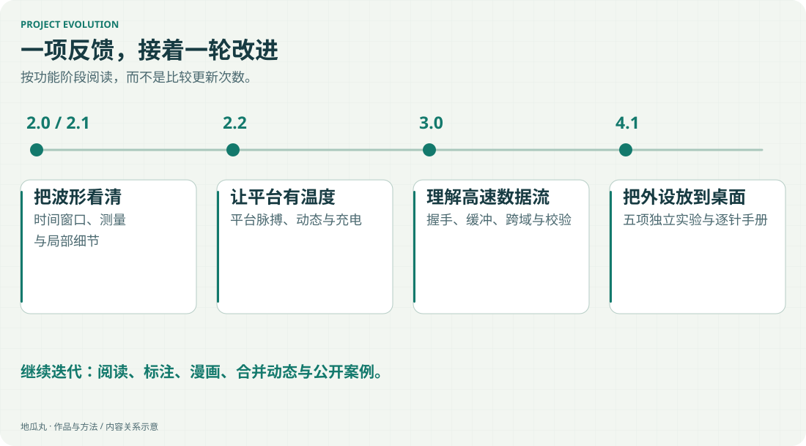

这条时间线按功能阶段组织，展示作品是怎样逐步变化的。具体能力以当前在线版本为准。

| 阶段 | 主要变化 |
| --- | --- |
| 波形台 2.0 / 2.1 | 时间窗口、测量、密集活动与局部精细波形 |
| 2.2 社区互动 | 平台脉搏、匿名动态与给地瓜丸充电 |
| 3.0 高速数据流 | Ready/Valid、Skid Buffer、异步 FIFO、流式 CRC32 |
| 2026-11-06 · 4.1 | ADC、DAC、SPI、GPIO、PCIe 五关，完整硬件与逐针手册 |
| 2026-11-06 · 界面迭代 | 手册阅读、硬件横幅、设备标注与章节漫画 |
| 2026-11-07 | 合并连续重复运行动态；建立公开 AI 共创档案 |
| 2026-11-08 | 补充三篇图文案例、能力证据入口、分类导航和图片大图查看 |
| 2026-11-08 · 技术档案 | 新增潮汐作曲家技术介绍，四组响应式架构图与实现验证数据 |
| 2026-11-08 · 图文档案 | 22 个内容页全部配图，补入真实操作动图、作品照片和独立手机图解 |

| 2026-11-09 · 平台主线 | 重构介绍站、交互 3D 板卡、国内视频与海报、吉祥物专区及 14 篇其他项目介绍 |

<!-- note-visuals-20261108 -->

<figure class="case-figure note-visual note-diagram"><a class="case-image-link" href="assets/notes/evolution.svg"><picture><source media="(max-width:600px)" srcset="assets/notes/evolution-mobile.svg" width="460" height="840"></picture></a><figcaption>按已完成的功能阶段整理；确切版本与日期见上方记录。点击查看大图 ↗</figcaption></figure>

## 怎样阅读这些记录

版本号说明大的功能阶段，小改动继续记录日期。重点不是更新次数，而是使用中遇到的问题是否被解决、能力有没有更容易被理解。

## 继续探索

- [[platform|我的 FPGA 教学平台]]
- [[waveform|把波形真正看清]]
- [[hardware|把硬件与手册放在一起]]
- [[interaction|让信息看得清、找得到]]
- [[now|我最近在做什么]]

[[index|回到档案首页]]
