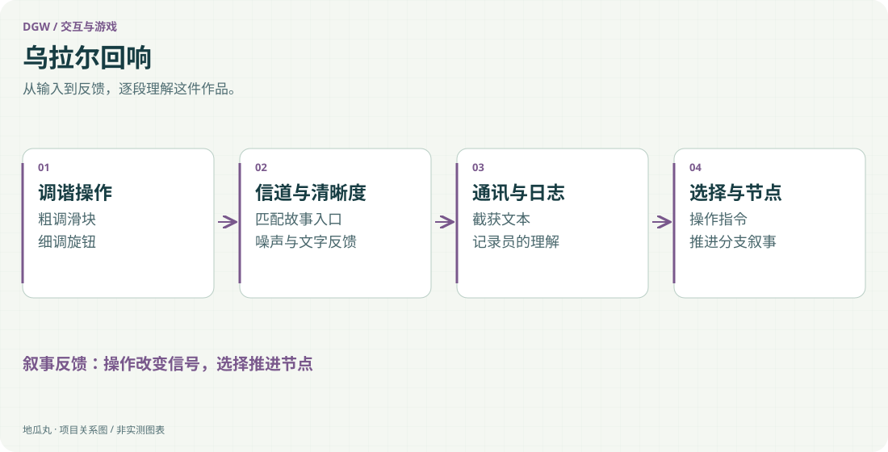

地瓜丸的工作室 · 其他项目
用调频、噪声和通讯文本，让玩家通过操作进入故事。

HTML / CSSJavaScriptWeb Audio分支叙事CapacitorAndroid

<aside class="project-stage"><strong>这件作品进行到哪里</strong>有网页交互、故事节点与 Android 工程；未核验最终发行版本</aside>

<figure class="case-figure"><a class="case-image-link" href="assets/projects/ural-echo.svg"><picture><source media="(max-width:600px)" srcset="assets/projects/ural-echo-mobile.svg" width="460" height="1000"></picture></a><figcaption>依据项目资料整理的功能关系示意；实际阶段见正文。点击查看大图 ↗</figcaption></figure>

## 让“听见故事”成为一种操作

《乌拉尔回响》把玩家放在一台高频解调仪之前。故事通过频段、噪声、通讯文本和操作指令展开：玩家拖动粗调滑块、转动细调旋钮，寻找信号，等待清晰度达到条件，再阅读截获内容并选择下一步。界面中的仪器是叙事载体，不是真实的无线电接收设备。

## 交互与叙事共用状态

频率位置影响当前可匹配的信道，清晰度影响文本何时出现，选择则推进该信道里的故事节点。通讯内容、记录员日志与可选指令分别呈现，帮助玩家区分“对方说了什么”和“自己怎样理解”。这要求仪器状态与剧情状态保持一致，避免按钮已经推进，画面却仍停在旧内容。

## 网页技术承担仪器感

项目使用 HTML、CSS 与 JavaScript 组织滑块、旋钮、文字与面板，Web Audio 合成噪声及操作声音，故事内容以独立节点结构维护。调谐反馈、文本逐步显示和声音变化共同解释当前操作，让用户无需先读完长篇说明，也能理解自己正在靠近还是离开信号。

## 多端不是简单换一个外壳

现有文件包括网页版本、Capacitor Android 工程，另有原生 Android 项目与调试包。触摸拖动、旋钮手感、音频启动权限和屏幕比例都会影响体验；桌面能运行，不等于手机上已经完成适配。不同实现的最终版本关系与正式发布状态还需分别确认。

## 这件作品留下的经验

它尝试把仪器界面、科幻文本和选择机制放进同一套可操作叙事。公开展示聚焦交互结构与创作方法，不把虚构的故事设定当作历史或科学陈述，也不把现有调试包描述为已上架的成熟产品。

## 继续阅读

[[projects|更多作品]] · [[platform|地瓜丸的 FPGA 教学平台]] · [[contact|去找地瓜丸→]]

