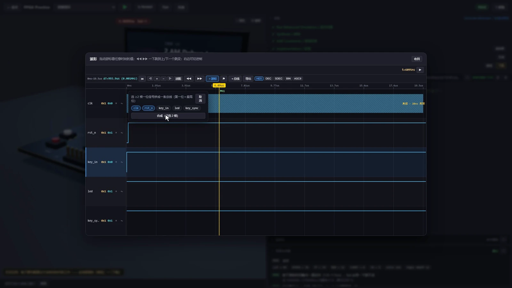
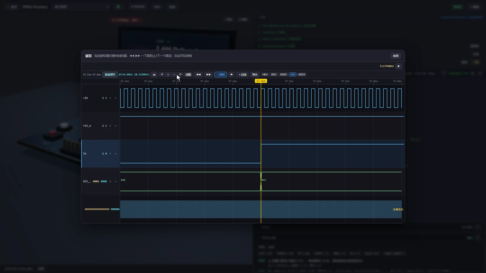

地瓜丸 · 波形台 2.0 / 2.1
放大到最大， 还是挤成一团？

这条学习者反馈推动了局部精细波形。先用长时间窗口定位活动，再打开短时间细节，才能继续看清边沿。

<figure class="case-figure field-frame"><figcaption>实际波形界面：时间差测量、M1 标记与信号选择。点击看原图 ↗</figcaption></figure>

## 打开波形后，我通常这样看

<ol class="field-path"><li><b>适配全局</b>先判断复位、输入和输出变化发生在哪一段。</li><li><b>定位活动区</b>平移或跳到信号变化的位置，缩小时间窗口。</li><li><b>进入局部细节</b>密集区需要精细波形时，继续查看局部边沿。</li><li><b>测量与对照</b>用双游标量时间差，再核对同一时刻的输出。</li></ol>
<table class="field-table"><thead><tr><th>想弄清什么</th><th>用哪个工具</th><th>看什么结果</th></tr></thead><tbody><tr><td>这两个沿相差多久</td><td>双游标 / 时间差</td><td>选定位置的 ΔT。</td></tr><tr><td>哪一拍发生变化</td><td>跳变定位 / 平移</td><td>信号从一个值变为另一个值的位置。</td></tr><tr><td>总线数值是多少</td><td>HEX / DEC / SDEC / BIN / ASCII</td><td>相同位序在不同进制下的解释。</td></tr><tr><td>灯和波形是否一致</td><td>时间游标 / 虚拟 LED</td><td>同一时刻的值与板卡反馈。</td></tr><tr><td>想保留一段结果</td><td>CSV 导出</td><td>后续能继续检查的数值记录。</td></tr></tbody></table>

## 换一种信号，再试一次

<figure class="case-figure field-frame"><figcaption>UART 发送波形。逐位观察数据，比只看一次通过结果更容易定位串口问题。点击看原图 ↗</figcaption></figure><nav class="field-read-next" aria-label="继续阅读"><a href="https://dgwfpga.cn/practice/#/level/L7_uart_tx">进入串口发送关 →</a><a href="feature-tour.html">查看更多波形实景 →</a><a href="fpga.html">灯不亮时怎么查 →</a></nav>
