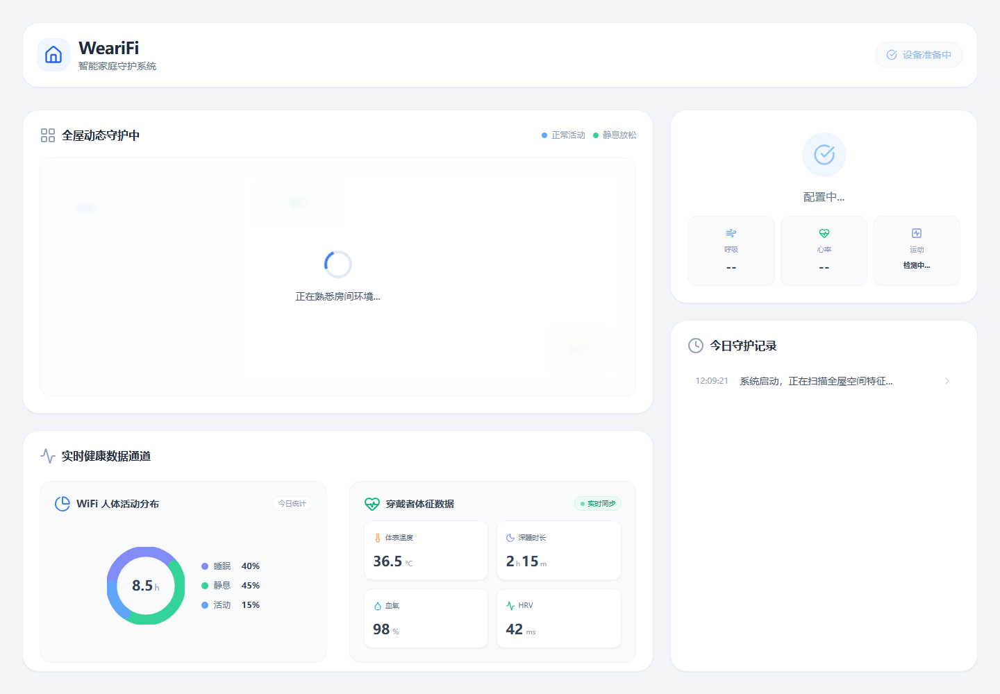
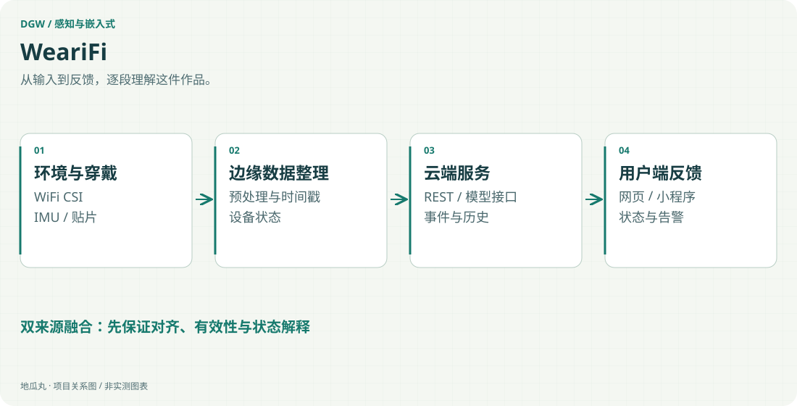

地瓜丸的工作室 · 其他项目
把空间感知与可穿戴感知放在同一个监护流程里。

ESP32-S3 / WiFi CSInRF / BLEDjango RESTPyTorchPostgreSQL网页与小程序

<aside class="project-stage"><strong>这件作品进行到哪里</strong>参赛方案、前后端工程与演示材料齐备；识别率和长期监护指标未独立复测</aside>

<figure class="case-figure"><figcaption>参赛材料中的前端原型界面；设备状态与数值用于展示界面结构，项目阶段见正文。点击查看大图 ↗</figcaption></figure>

<figure class="case-figure"><a class="case-image-link" href="assets/projects/wearifi.svg"><picture><source media="(max-width:600px)" srcset="assets/projects/wearifi-mobile.svg" width="460" height="1000"></picture></a><figcaption>依据项目资料整理的功能关系示意；实际阶段见正文。点击查看大图 ↗</figcaption></figure>

## 两种感知，观察不同信息

WeariFi 面向居家活动与健康监护，尝试将 WiFi CSI 的环境变化信息与柔性贴片的运动数据联系起来。非接触式感知关心空间中的活动，可穿戴侧关注佩戴者本人的动作；两种来源需要明确时间关系和设备状态，才能进一步讨论如何互补，而非简单叠加两个传感器名称。

## 感知、边缘与应用三层协同

项目材料与工程按三层组织：ESP32-S3 负责 CSI 采集与边缘预处理，nRF 贴片侧负责运动采集和 BLE 通信；数据再进入服务端，组织查询、事件和可视化。现有后端工程使用 Django REST 与 PyTorch，包含 PostgreSQL、异步任务和部署依赖；网页用户端与手机小程序承担状态查看、历史信息及事件入口。

## 技术难点在融合之前

不同设备的数据频率、时间戳和丢失状态并不天然一致。方案因此需要先处理对齐、预处理、缺失与设备连接，再建立模型输入。告警界面也必须区分“没有检测到事件”和“设备没有有效数据”，避免让一个看起来平静的页面掩盖断连。模型训练、阈值与应用提示需要在同一验证条件下解释。

## 从参赛材料走向可检验系统

已有设计说明、技术文档、软硬件模块工程、网页、小程序及演示视频，能够展示整体系统如何分工。公开页保留这种系统集成思路，不沿用文档中未经独立核验的“首创”、误报率、续航或社会效益数字。不同应用产品线是方案延展，不能由一份演示推断全部已经成熟落地。

## 当前作品定位

这是围绕感知融合、数据服务与交互呈现推进的团队项目实践。这里展示技术路径与工程材料，不将其当作临床诊断设备，也不以方案目标替代真实人群测试。

## 继续阅读

[[projects|更多作品]] · [[platform|地瓜丸的 FPGA 教学平台]] · [[contact|去找地瓜丸→]]

