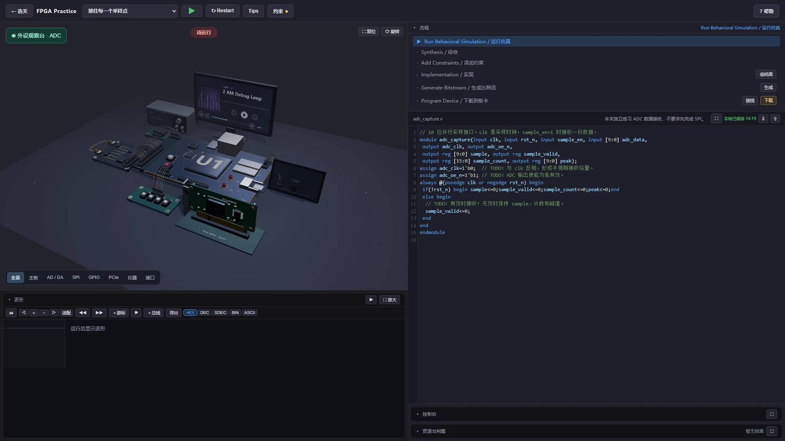

地瓜丸 · 网页实现
按钮点下去， 要真的到得了下一步。

这个介绍站自己就遇到过问题：首图纵向拉伸，本机能点开的文章到线上却变成 404。这一页用它和练习工作台，说明我怎样做界面联调。

<figure class="case-figure field-frame"><figcaption>正式练习站的初始工作台截图，代码为待完成模板。点击看原图 ↗</figcaption></figure>

## 一张工作台，几处状态要对上

<table class="field-table"><thead><tr><th>操作</th><th>后面要发生什么</th></tr></thead><tbody><tr><td>编辑 Verilog</td><td>当前代码进入运行任务，报错能回到具体行。</td></tr><tr><td>图形连线</td><td>约束区出现对应的端口与针脚语句。</td></tr><tr><td>移动时间游标</td><td>所选时刻的信号值与板卡反馈相互对应。</td></tr><tr><td>点选器件</td><td>手册打开相应资料，接线关系能够继续跳转。</td></tr><tr><td>打开大卡片</td><td>代码、控制台或判题内容有更大的阅读空间。</td></tr></tbody></table>

## 两个真实的页面问题

<table class="field-table"><thead><tr><th>现象</th><th>定位到哪里</th><th>这次怎样处理</th></tr></thead><tbody><tr><td>图片宽度缩小，高度还很大</td><td>样式只改宽度，HTML 的固定高度仍生效。</td><td>按原比例显示；手机检查图片进入视野前后的高度。</td></tr><tr><td>文章在本机正常，线上 404</td><td>生成的无后缀链接与国内静态服务路由不一致。</td><td>生成明确的 HTML 链接，兼容旧地址，并检查真实公网 URL。</td></tr></tbody></table>

页面检查需要走到部署后的链接。只看本机构建成功，很容易漏掉资源路径、缓存和网关行为的差异。

<nav class="field-read-next" aria-label="继续阅读"><a href="feature-tour.html">查看图片交互 →</a><a href="interaction.html">查看阅读与布局改动 →</a><a href="workflow.html">查看更新流程 →</a></nav>
