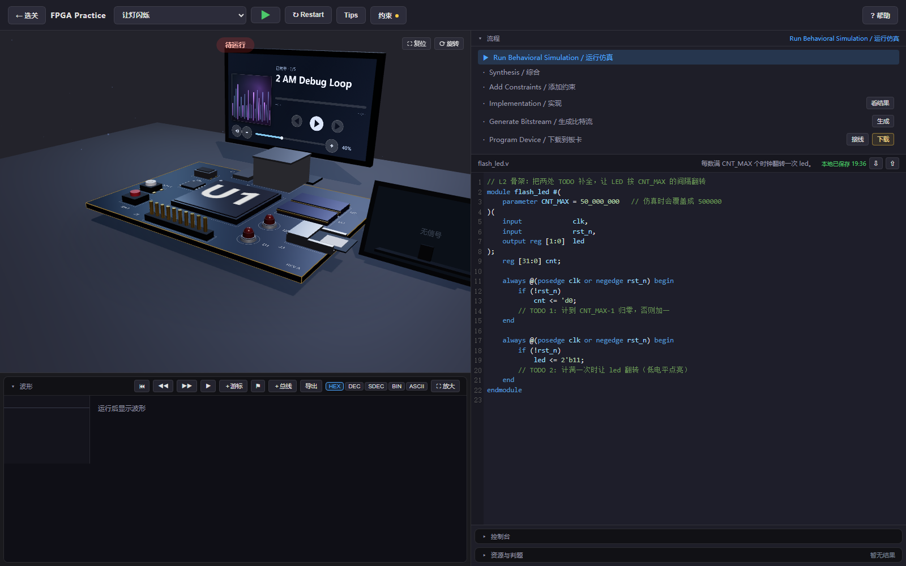
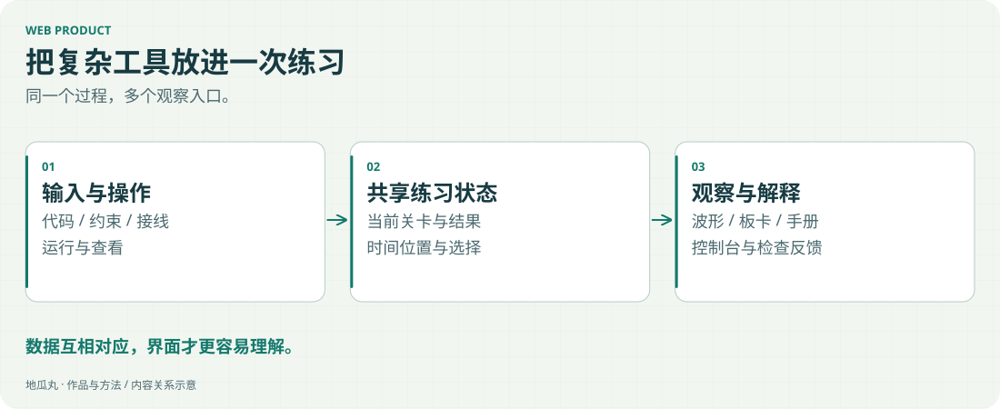

网页开发在这个项目里的任务，是把复杂的练习过程组织成一个可以操作的界面。

<!-- note-visuals-20261108 -->

<figure class="case-figure note-visual "><figcaption>真实练习布局存档；代码为学员待填写模板。点击查看大图 ↗</figcaption></figure>

<figure class="case-figure note-visual note-diagram"><a class="case-image-link" href="assets/notes/web.svg"><picture><source media="(max-width:600px)" srcset="assets/notes/web-mobile.svg" width="460" height="776"></picture></a><figcaption>练习界面关系示意：代码、约束与结果需要互相对应。点击查看大图 ↗</figcaption></figure>

## 具体实践

编辑器、约束连线、运行反馈、三维教具、元件手册、波形测量和可放大的工作区域，需要共享一致的状态。手机与电脑的空间不同，也需要不同的布局处理。

## 从使用中发现问题

文字与深色背景融在一起、手册被挤成横条、学习动态被重复记录占满，都是实际反馈。修复的目标是恢复信息的可读性与操作的确定性。

## 验证到页面里

构建成功只是一步。还要检查真实页面中的点击、滚动、窄屏布局和资源加载，才能说明改动已经产生了预期效果。

## 继续探索

- [[interaction|让信息看得清、找得到]]
- [[debugging|从反馈里找到真正的问题]]
- [[platform|我的 FPGA 教学平台]]
- [[workflow|从想法到上线的工作流]]

[[index|回到档案首页]]
