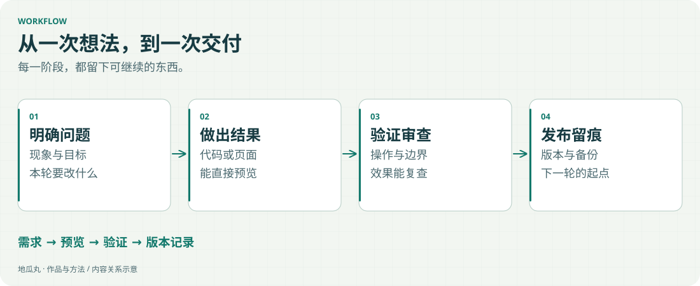

地瓜丸 · AI 协作工程工作流
把一次次修改， 整理成能复用的工程流程。

这套工作流是在教学平台、功能宣传片和硬件项目的反复迭代中逐步搭起来的。它依托工程目录、Markdown、Git、本地预览和检查脚本，由我负责目标与取舍，AI 辅助实现、分析和验证。

<figure class="case-figure"><a class="case-image-link" href="assets/notes/workflow.svg"><picture><source media="(max-width:600px)" srcset="assets/notes/workflow-mobile.svg" width="460" height="946"></picture></a><figcaption>从需求到交付，每一段都有可以继续使用的产物。点击看大图。</figcaption></figure>

## 先搭清楚这六个部分

<table class="field-table"><thead><tr><th>部分</th><th>放什么</th><th>解决什么问题</th></tr></thead><tbody><tr><td>需求与决策</td><td>当前目标、限制、验收标准与已确认选择。</td><td>实现时知道做到哪一步才算完成。</td></tr><tr><td>项目工作包</td><td>按页面、关卡、镜头或服务拆分具体任务。</td><td>范围清楚，能独立预览和检查。</td></tr><tr><td>素材与上下文</td><td>原始资料、审查后的网页素材、工程现状与历史。</td><td>复用已有成果，避免从零重新解释。</td></tr><tr><td>实现与预览</td><td>可运行代码、可点击页面、可观看的演示。</td><td>让讨论落到实际结果。</td></tr><tr><td>验证工具</td><td>构建、类型检查、浏览器操作、运行链路及公网检查脚本。</td><td>重复动作按相同标准检查。</td></tr><tr><td>版本与交接</td><td>Git 提交、备份、交付说明、文件地图和待办。</td><td>遇到问题可回退，下次协作有起点。</td></tr></tbody></table>

## 我按这个顺序搭起来

<ol class="field-review-list"><li><b>先固定一类真实任务。</b>从一个页面更新、一关实验或一段演示开始，写明输入、输出和验收标准。</li><li><b>建立项目入口和职责地图。</b>说明正文、代码、素材、预览与发布文件分别在哪里，保留原始资料。</li><li><b>把任务拆成具体工作包。</b>让 AI 使用现有工程和记录完成实现，每个工作包都能展示结果。</li><li><b>把重复检查整理成工具。</b>按任务接入构建、类型、页面和运行检查，保留测试条件与报告。</li><li><b>接上预览和发布步骤。</b>需要审查时先展示具体版本；发布后继续检查真实入口和资源。</li><li><b>让交付成为下一轮输入。</b>记录版本、证据、回退范围和待办，后续沿这份上下文继续推进。</li></ol>

## 在项目里，它具体怎么跑

<table class="field-table"><thead><tr><th>任务</th><th>实现前准备</th><th>交付时检查</th></tr></thead><tbody><tr><td>教学平台更新</td><td>使用反馈、现有界面、课程目标和当前版本。</td><td>点击、波形、约束、运行反馈及桌面／手机布局。</td></tr><tr><td>功能演示视频</td><td>分镜、实录素材、吉祥物、横竖版构图。</td><td>聚焦、文字、声音、二维码与编码后的成片。</td></tr><tr><td>视觉与控制项目</td><td>目标数据、接口协议、执行机构和联调条件。</td><td>识别、坐标、命令、控制界面与实机动作逐段对应。</td></tr><tr><td>网站发布</td><td>审查后的内容、静态构建和上一版备份。</td><td>国内入口、资源加载、媒体播放和公开版本一致性。</td></tr></tbody></table>

## 工作流里，我把控什么

目标和验收标准由我确定；技术方案、优先级和体验问题由我审查。AI 协助拆解、实现、排查和整理，脚本承担重复检查。重要决定和验证结果进入记录，形成下一次修改可复用的工程上下文。

<nav class="field-read-next" aria-label="继续阅读"><a href="skills.html">技术能力与作品证据 →</a><a href="ai-collaboration.html">看具体协作分工 →</a><a href="projects.html">我做过的项目 →</a></nav>
